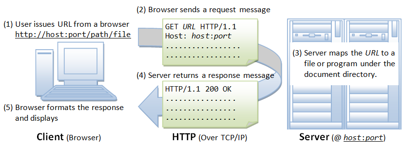
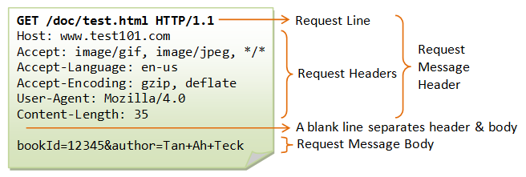
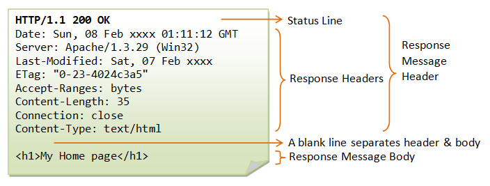

# **Introducción al Protocolo HTTP**

## **1. ¿Qué es HTTP?**

El **protocolo HTTP (Hypertext Transfer Protocol)** es el protocolo de comunicación fundamental en la web. Es el conjunto de reglas que gobierna cómo los navegadores web (clientes) y los servidores web intercambian datos. HTTP permite que los navegadores envíen peticiones y reciban respuestas, facilitando la visualización de las páginas web.

Por tanto es un **protocolo estandarizado** que define cómo se formatean y transmiten los mensajes, y qué acciones deben tomar los servidores y navegadores en respuesta a diversas órdenes. Por tanto nos permite poner todo nuestro esfuerzo en el desarrollo de la aplicación web sin preocuparnos de los sistemas operativos, navegadores o medios de comunicación que se utilicen.

En los puntos anteriores hemos hablado con reiteración de cómo el usuario hace una petición al servidor y este responde con una respuesta que contiene la página web solicitada. Este proceso de petición y respuesta se realiza utilizando el protocolo HTTP, ya que los navegadores (que serán nuestros clientes) y los servidores web (donde se ejecuta nuestro código PHP) se comunican a través de este protocolo.

!!! tip "Protocolo **sin** estado"

    Es importante destacar que:

    - **HTTP es un protocolo sin estado**, lo que significa que no mantiene información entre las peticiones. Cada solicitud es independiente.

Para comprenderlo hay que situarse en lo que vimos en la primera parte de este tema ([Programación Web](introduccion-laravel.md)), inicialmente **HTTP** fue diseñado para transferir documentos HTML, páginas web estáticas. Con lo cual su trabajo terminaba con cada respuesta. No había necesidad de mantener el estado entre peticiones.

Para todo lo demás: web dinámica, sesiones de usuario, carritos de compra, etc. se han tenido que desarrollar mecanismos adicionales (cookies, sesiones, tokens, etc.) para mantener el estado entre peticiones, ya que el servidor necesita "recordar" información sobre el usuario entre diferentes solicitudes.



## **2. Estructura de una Petición HTTP**

Una **petición HTTP** es un mensaje (paquete) enviado por el cliente (navegador) al servidor para solicitar un recurso o realizar una acción.

La estructura de una petición HTTP se compone de tres partes principales:

1. **Línea de solicitud (Request Line)**:

    - **Método HTTP**: Define la acción que se desea realizar (por ejemplo, `GET`, `POST`, `PUT`, `DELETE`).
    - **URL**: La dirección del recurso solicitado.
    - **Versión HTTP**: La versión del protocolo HTTP utilizado, como HTTP/1.1 o HTTP/2.

    Ejemplo:

    ```text
    GET /productos HTTP/1.1
    ```

2. **Encabezados (Headers)**:

    - Los encabezados contienen información adicional sobre la petición, como el tipo de contenido, el tipo de navegador, cookies, entre otros.

    - Algunos encabezados comunes:

        - `Host`: Especifica el dominio del servidor.
        - `User-Agent`: Información sobre el navegador o cliente que realiza la petición.
        - `Content-Type`: Tipo de datos que se están enviando (por ejemplo, `application/json`).

    Ejemplo:

    ```text
    Host: midominio.com
    User-Agent: Mozilla/5.0
    Content-Type: application/x-www-form-urlencoded
    ```

3. **Cuerpo (Body)** (solo en algunos métodos como `POST` o `PUT`):

    - Contiene los datos que el cliente quiere enviar al servidor, como datos de formularios o archivos.

    Ejemplo:

    ```text
    nombre=Juan&email=juan@dominio.com
    ```



## **3. Estructura de una Respuesta HTTP**

La respuesta HTTP es lo que el servidor envía de vuelta al cliente después de procesar la petición. La estructura es similar a la petición, la principal diferencia es el **código de estado**. Este código permite al cliente entender el resultado de la petición. Su estructura también se divide en tres partes:

1. **Línea de estado (Status Line)**:

    - **Versión HTTP**: La versión del protocolo HTTP que se está utilizando.
    - **Código de estado**: Un número que indica el resultado de la petición (por ejemplo, `200 OK`, `404 Not Found`).
    - **Mensaje de estado**: Una breve descripción del código de estado.

    Ejemplo:

    ```text
    HTTP/1.1 200 OK
    ```

2. **Encabezados (Headers)**:

    - Los encabezados de la respuesta contienen información sobre el servidor, el tipo de contenido, las cookies, y otras directivas.

    - Algunos encabezados comunes:

        - `Content-Type`: Tipo de contenido de la respuesta (por ejemplo, `text/html`).
        - `Set-Cookie`: Para enviar cookies al cliente.
        - `Cache-Control`: Directiva para controlar el almacenamiento en caché de la respuesta.

    Ejemplo:

    ```text
    Content-Type: text/html; charset=UTF-8
    Cache-Control: no-cache
    ```

3. **Cuerpo (Body)**:

    - Contiene el contenido solicitado por el cliente, como HTML, JSON, imágenes, etc.
    - En el caso de una página web, el cuerpo contendrá el código HTML que el navegador debe renderizar.

    Ejemplo:

    ```text
    <html><body><h1>Bienvenido a mi sitio web</h1></body></html>
    ```



## **4. Métodos HTTP**

Los métodos HTTP definen el tipo de acción que se desea realizar sobre un recurso en el servidor. Los más comunes son (hay más, pero estos son los principales):

- **GET**: Solicita un recurso. No modifica datos.
- **POST**: Envía datos al servidor para crear un nuevo recurso.
- **PUT**: Actualiza un recurso existente.
- **DELETE**: Elimina un recurso.

## **5. Código de Estado HTTP**

Los códigos de estado indican el resultado de una petición. Los códigos se dividen en varias categorías:

- **1xx (Informativo)**: Indica que la petición está en proceso.

- **2xx (Éxito)**: La petición fue exitosa.

    - **200 OK**: Petición exitosa.
    - **201 Created**: Recurso creado correctamente.

- **3xx (Redirección)**: Requiere una acción adicional para completar la petición.

    - **301 Moved Permanently**: El recurso ha sido movido permanentemente.

- **4xx (Error del cliente)**: La petición contiene errores.

    - **404 Not Found**: El recurso solicitado no se encuentra.

- **5xx (Error del servidor)**: El servidor encontró un error al procesar la petición.

    - **500 Internal Server Error**: Error general en el servidor.

## **6. Lo que el programador debe tener en cuenta**

1. **Validación de entradas**: En Laravel, la validación de datos de las peticiones HTTP es crucial para garantizar que los datos que recibimos sean los correctos. Laravel ofrece herramientas integradas para validar fácilmente los datos de entrada, asegurando que las solicitudes sean correctas antes de procesarlas. Por ejemplo, podemos usar la clase `Request` para validar datos en los controladores con reglas simples, lo que ayuda a prevenir problemas como la inyección de SQL o XSS.

    !!! tip "Ejemplo en Laravel:"

        ```php
        $request->validate([
            'email' => 'required|email',
            'password' => 'required|min:6',
        ]);
        ```

2. **Generar códigos de respuesta coherentes**: Al enviar respuestas HTTP desde tu aplicación, es importante usar códigos de estado apropiados para indicar el resultado de la operación. Laravel maneja esto de forma sencilla, permitiéndote devolver respuestas con códigos de estado adecuados, como `200 OK` para operaciones exitosas, `404 Not Found` cuando el recurso no existe, o `400 Bad Request` si los datos de entrada no son válidos.

    !!! tip "Ejemplo en Laravel:"

        ```php
        return response()->json(['message' => 'Recurso creado'], 201);
        ```

3. **Uso adecuado de los encabezados HTTP**: Los encabezados HTTP proporcionan información adicional sobre la petición y la respuesta. Laravel facilita la manipulación de encabezados, permitiéndote enviar encabezados personalizados fácilmente, como `Content-Type`, `Cache-Control`, o incluso encabezados para las cookies. Es importante configurarlos adecuadamente para controlar el comportamiento de la respuesta, como indicar que los datos enviados son en formato JSON o gestionar el almacenamiento en caché.

    !!! tip "Ejemplo en Laravel:"

        ```php
        return response($data, 200)
        ->header('Content-Type', 'application/json')
        ->header('Cache-Control', 'no-cache');
        ```

4. **Simplificación de tareas repetitivas con Laravel**: Un Framework como Laravel está diseñado para simplificar muchas de estas tareas comunes. Laravel maneja automáticamente muchas de las configuraciones necesarias para trabajar con HTTP, como la validación, generación de respuestas con códigos de estado apropiados, y la manipulación de encabezados. Esto permite que los desarrolladores se centren en la lógica de negocio sin preocuparse por detalles repetitivos y errores comunes.

Laravel, por ejemplo, gestiona la validación de datos, la gestión de errores HTTP, y la creación de respuestas JSON de manera eficiente. Esto reduce considerablemente la cantidad de trabajo manual que el programador debe hacer, facilitando el desarrollo y asegurando que las prácticas recomendadas se sigan automáticamente.

## **Resumen**

- El protocolo **HTTP** es fundamental para la comunicación en la web, permitiendo la interacción entre clientes (navegadores) y servidores.
- Una **petición HTTP** consta de una línea de solicitud, encabezados y un cuerpo (opcional).
- Una **respuesta HTTP** incluye una línea de estado, encabezados y un cuerpo con el contenido solicitado.
- Los **métodos HTTP** definen las acciones que se desean realizar sobre los recursos.
- Los **códigos de estado HTTP** informan sobre el resultado de las peticiones.
- Como programadores, debemos prestar atención a la validación de entradas, manejo de errores, seguridad, caché y redirecciones para garantizar una aplicación web robusta y segura.
