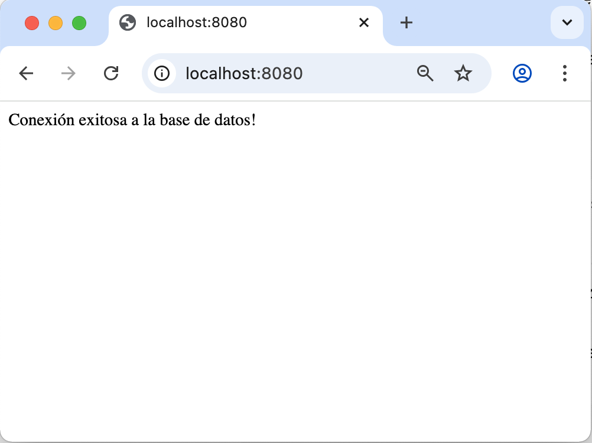
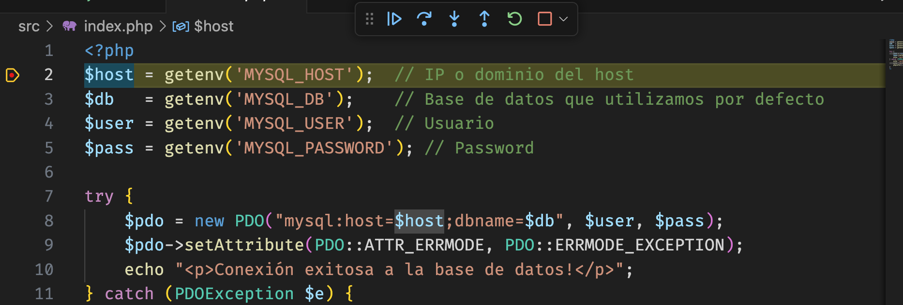

# **Guía paso a paso: Configuración del entorno de trabajo con Docker**

## Introducción

Para todo desarrollo `web`, es fundamental contar con un entorno de trabajo adecuado que facilite la creación, prueba y despliegue de aplicaciones. Al final lo que necesitamos básicamente es:

- Un servidor web (Nginx o Apache).
- Un intérprete de PHP (PHP-FPM).
- Un sistema de gestión de bases de datos (MySQL, PostgreSQL, etc.).

Existen en el mercado múltiples soluciones para crear este entorno de trabajo.

1. Instalar cada uno de los componentes por separado en nuestro sistema operativo. Esta opción puede ser complicada y propensa a errores, además de que puede generar conflictos entre versiones de librerías y dependencias.
2. Utilizar soluciones empaquetadas como XAMPP, WAMP, MAMP, etc. Estas soluciones son más fáciles de instalar, pero pueden ser limitadas en cuanto a personalización. Además no podemos controlar las versiones de los componentes.
3. Utilizar máquinas virtuales (como Vagrant) o contenedores (como Docker). Estas soluciones permiten crear entornos aislados y reproducibles, facilitando la gestión de dependencias y versiones.
4. Incluso `Laravel` tiene una solución personalizada que funciona con contenedores: `Laravel Sail`.

Seguramente cada desarrollador habrá encontrado su propia solución, pero en este curso vamos a utilizar **Docker** para crear nuestro entorno de trabajo. Docker es una plataforma que permite crear, desplegar y ejecutar aplicaciones en contenedores. Los contenedores son entornos ligeros y portátiles que contienen todo lo necesario para ejecutar una aplicación, incluyendo el código, las librerías y las dependencias.

## Requisitos previos:

1. **Instalar Docker Desktop**:

    - **Windows/Mac**: [Descargar Docker Desktop](https://www.docker.com/products/docker-desktop)
    - **Linux**: Sigue las instrucciones de instalación para tu distribución desde [Docker Docs](https://docs.docker.com/engine/install/).

2. **Instalar VSCode**:

    - [Descargar VSCode](https://code.visualstudio.com/)
    - Recomendamos instalar la extensión de Microsoft para Docker, que nos facilitará la gestión de los contenedores desde el editor. En el punto 10 de esta guía veremos cómo usar esta extensión.

3. **Preparar servicio MySQL en Docker**:

    En este punto tenemos tres opciones:

    - **Opción 1**: Instalar el contenedor de MySQL desde cero. Puedes seguir las instrucciones de la [documentación oficial de Docker](https://hub.docker.com/_/mysql) para crear un contenedor MySQL, y llamarle docker_mysql.
    - **Opción 2**: Utilizar un contenedor MySQL ya existente. En este caso, asumimos que ya tienes un contenedor MySQL en funcionamiento con las siguientes características:
    - **Opción 3**: Añadir a nuestro `docker-compose.yml` el contenedor de MySQL. En este caso, añadiremos un contenedor MySQL al archivo `docker-compose.yml` que vamos a crear a continuación.

    A partir de ahora en los apuntes vamos a seguir la opción 3. Vamos a crear un `docker-compose.yml` que incluye un contenedor MySQL.

    En función de la opción elegida, tendrás que adaptar la conexión a la base de datos en el código PHP que vamos a crear. En el caso de contar ya con un contenedor MySQL en funcionamiento, o acceso a un servicio MySQL ya existente, el temario presupone que estas son las credenciales de acceso:

    - **Nombre del contenedor**: `docker_mysql` (Si utilizas un contenedor MySQL)
    - **IP**: `localhost` (o `host.docker.internal` si estás con docker en Windows o Mac)
    - **Usuario**: `alumno`
    - **Contraseña**: `alumno`
    - **Base de datos**: `test`

---

## Paso 1: Preparación del proyecto

1. **Crea una carpeta para tu proyecto**:

    - Abre una terminal (CMD, PowerShell, Terminal de VSCode, etc.).
    - Crea una nueva carpeta para tu proyecto y navega dentro de ella.

    !!! note "Crear carpeta del proyecto"

        ```bash
        mkdir mi-proyecto-php
        cd mi-proyecto-php
        ```

2. **Crea la estructura de carpetas**:

    Dentro de la carpeta `mi-proyecto-php`, crea las siguientes carpetas y archivos:

    !!! note "Estructura de carpetas"

        ```bash
        mkdir -p docker/mysql/init docker/nginx docker/php docker/scripts src
        touch docker-compose.yml
        touch docker/mysql/init/01-grants.sql
        touch docker/nginx/default.conf
        touch docker/php/Dockerfile
        touch docker/php/xdebug.ini
        touch docker/scripts/.gitkeep
        touch src/index.php
        ```

    Una vez creada la estructura, debería verse así:

    ```text
    .
    ├── docker-compose.yml            # Archivo principal de configuración de Docker
    ├── docker/
    │   ├── nginx/
    │   │   └── default.conf          # Configuración de Nginx
    │   ├── php/
    │   │   ├── Dockerfile            # Dockerfile para el contenedor PHP
    │   │   ├── xdebug.ini            # Configuración de Xdebug para PHP
    │   ├── scripts/
    │   │   └── .gitkeep              # Git keep para mantener la carpeta vacía
    │   └── mysql/
    │       └── init/
    │           └── 01-grants.sql     # Script de inicialización para MySQL
    └── src/
        └── index.php                 # Archivo de entrada de tu proyecto PHP (por ejemplo, Laravel)
    ```

    Esta es la estructura básica que vamos a utilizar para nuestro proyecto PHP con Docker.

---

## Paso 2: Configuración de `docker-compose.yml`

1. **Abre el archivo `docker-compose.yml`** en tu editor de texto favorito (puede ser VSCode).

2. **Pega el siguiente contenido** en el archivo `docker-compose.yml`:

!!! tip "Requisitos"

    En nuestro caso vamos a añadir un contenedor MySQL al archivo `docker-compose.yml`. Si ya tienes un servidor MySQL en funcionamiento, debes eliminar la sección del contenedor `mysql` del archivo `docker-compose.yml` y utilizar las credenciales de tu servidor MySQL.

    - **Nombre del contenedor**: `dk_mysql`
    - **IP**: `localhost` # IP o `host.docker.internal` si es un contenedor y estás en Windows o Mac
    - **Usuario**: `alumno`
    - **Contraseña**: `alumno`
    - **Base de datos**: `test`

    El usuario `alumno` tiene permisos para acceder por la red a la base de datos `test`.

!!! note "docker-compose.yml"

    ```yaml
    services:
        php:
            build:
                context: .
                dockerfile: docker/php/Dockerfile
            working_dir: /var/www/html
            volumes:
                - ./src:/var/www/html
                - ./docker/scripts:/scripts
            environment:
                # Xdebug apagado por defecto; se activa con XDEBUG_MODE=debug
                XDEBUG_CONFIG: "client_host=host.docker.internal client_port=9003"

                # Variables de entorno utilizadas en los ejemplos del curso 
                MYSQL_HOST: mysql
                MYSQL_USER: alumno
                MYSQL_PASSWORD: alumno
                MYSQL_DB: test

            extra_hosts:
                - "host.docker.internal:host-gateway"
            depends_on:
                - mysql

        nginx:
            image: nginx:alpine
            ports:
                - "8080:80"
            depends_on:
                - php
            volumes:
                - ./src:/var/www/html:ro
                - ./docker/nginx/default.conf:/etc/nginx/conf.d/default.conf:ro

        mysql:
            image: mysql:8.0
            environment:
                MYSQL_ROOT_PASSWORD: administrador
                MYSQL_DATABASE: test
                MYSQL_USER: alumno
                MYSQL_PASSWORD: alumno
            ports:
                # Para evitar colisiones con MySQL local del host puedes cambiar el puerto 3306 por otro, por ejemplo 3307:3306
                - "3306:3306"
            volumes:
                - dbdata:/var/lib/mysql
                - ./docker/scripts:/scripts
                - ./docker/mysql/init:/docker-entrypoint-initdb.d:ro
            tmpfs:
                - /tmp
    volumes:
        dbdata:
    ```

!!! tip "Ficheros `.yaml`"

    Los ficheros `.yaml` son muy sensibles a los espacios y tabulaciones. Asegúrate de que la indentación es correcta para evitar errores al ejecutar Docker Compose. Si te da problemas puedes descargar el archivo de ejemplo desde [aquí](https://jbeteta-ies.github.io/2025_Laravel_32/content/T02/resources/docker-compose.yml).

En el archivo `docker-compose.yml`:

Definimos los tres servicios principales de nuestro entorno de desarrollo: php, nginx y mysql. Además, configuramos los volúmenes, variables de entorno y otros parámetros necesarios para que los contenedores puedan trabajar juntos correctamente.

### Servicio `php`

- **`build`**:

    - En lugar de usar directamente una imagen ya preparada, el contenedor PHP se construye a partir del archivo `docker/php/Dockerfile`.
    - Esto nos permite personalizar el entorno PHP e instalar exactamente las extensiones y herramientas que necesitamos.
- **`working_dir: /var/www/html`**:

    - Define el directorio de trabajo dentro del contenedor PHP.
    - Será la carpeta en la que ejecutaremos los comandos y donde estará montado el código de nuestra aplicación.
- **`volumes`**:

    - `./src:/var/www/html`

        - Monta la carpeta `src` de nuestro proyecto dentro del contenedor.
        - Todo lo que editemos en `src` desde nuestra máquina estará disponible inmediatamente dentro del contenedor.
    - `./docker/scripts:/scripts`

        - Monta una carpeta adicional para scripts auxiliares que podamos utilizar durante el desarrollo.
- **`environment`**:

    - `XDEBUG_CONFIG`

        - Define la configuración básica de Xdebug para que pueda conectarse con Visual Studio Code.
    - `MYSQL_HOST`, `MYSQL_USER`, `MYSQL_PASSWORD`, `MYSQL_DB`

        - Son variables de entorno que utilizaremos desde PHP para conectarnos a MySQL sin tener que escribir los datos directamente en el código.
- **`extra_hosts`**:

    - Añade una entrada especial para que el contenedor pueda localizar al host con el nombre `host.docker.internal`.
    - Esto es útil, por ejemplo, para la depuración con Xdebug.
- **`depends_on`**:

    - Indica que el servicio `php` depende del servicio `mysql`.
    - Docker Compose arrancará primero MySQL antes de iniciar PHP.

### Servicio `nginx`

- **`image: nginx:alpine`**:

    - Utiliza la imagen oficial ligera de Nginx basada en Alpine Linux.
    - Es una opción muy habitual por su bajo consumo de recursos.
- **`ports`**:

    - `8080:80`

        - Expone el puerto 80 del contenedor Nginx en el puerto 8080 de nuestra máquina.
        - Gracias a esto podremos acceder a la aplicación desde el navegador en `http://localhost:8080`.
- **`depends_on`**:

    - Indica que Nginx depende del servicio `php`.
- **`volumes`**:

    - `./src:/var/www/html:ro`

        - Monta la carpeta `src` dentro del contenedor Nginx en modo solo lectura.
        - Esto es suficiente para servir la aplicación y añade una pequeña mejora de seguridad.
    - `./docker/nginx/default.conf:/etc/nginx/conf.d/default.conf:ro`

        - Monta el fichero de configuración personalizado de Nginx.

### Servicio `mysql`

- **`image: mysql:8.0`**:

    - Utiliza la imagen oficial de MySQL 8.0.
- **`environment`**:

    - `MYSQL_ROOT_PASSWORD`

        - Contraseña del usuario `root`.
    - `MYSQL_DATABASE`

        - Base de datos inicial que se creará automáticamente.
    - `MYSQL_USER` y `MYSQL_PASSWORD`

        - Usuario y contraseña que utilizaremos normalmente en el curso para conectarnos a la base de datos.
- **`ports`**:

    - `3306:3306`

        - Expone MySQL en el mismo puerto estándar del host.
        - Si ya tienes un MySQL local instalado, puedes cambiarlo por ejemplo a `3307:3306`.
- **`volumes`**:

    - `dbdata:/var/lib/mysql`

        - Utiliza un volumen Docker para almacenar los datos de MySQL de forma persistente.
        - Así, aunque eliminemos el contenedor, los datos podrán mantenerse.
    - `./docker/scripts:/scripts`

        - Monta la carpeta de scripts auxiliares.
    - `./docker/mysql/init:/docker-entrypoint-initdb.d:ro`

        - Monta la carpeta con scripts SQL de inicialización.
        - MySQL ejecutará automáticamente estos scripts la primera vez que se cree el contenedor.
- **`tmpfs`**:

    - `- /tmp`

        - Crea un sistema de archivos temporal en memoria para la carpeta `/tmp` dentro del contenedor.

### Volumen `dbdata`

```yaml
volumes:
    dbdata:
```

Este volumen se utiliza para guardar los datos de MySQL fuera del contenedor. De esta manera, la información de la base de datos no se pierde al detener o recrear los servicios.

El fichero `docker/php/xdebug.ini` configura Xdebug, el depurador de PHP que usaremos en el paso 10. Su contenido es:

!!! note "Configuración Xdebug"

    ```ini
    xdebug.mode=debug
    xdebug.start_with_request=yes
    xdebug.client_host=host.docker.internal
    xdebug.client_port=9003
    xdebug.log_level=0
    ```

Esto habilitará Xdebug en el contenedor PHP y permitirá la depuración remota.

!!! warning "Si lo dejas vacío, la depuración del paso 10 no funcionará"

    Sin este contenido, Xdebug queda en su modo por defecto (`develop`) y nunca se conecta con VS Code: pulsas F5, recargas la página y no se detiene en ningún punto de interrupción. Como el `Dockerfile` **copia** este archivo dentro de la imagen, si lo rellenas o lo cambias después tienes que reconstruir el contenedor PHP:

    ```bash
    docker compose up -d --build php
    ```

    Para comprobar que está activo: `docker compose exec php php -i | grep xdebug.mode` debe mostrar `debug`.

---

## Paso 3: Configuración de Nginx

1. **Abre el archivo `docker/nginx/default.conf`**.

2. **Pega el siguiente contenido** en el archivo `default.conf`:

!!! note "Configuración nginx"

    ```nginx
    server {
       listen 80;
       server_name localhost;

       root /var/www/html;
       index index.php index.html;

       location / {
           try_files $uri $uri/ =404;
       }

       location ~ \.php$ {
           include fastcgi_params;
           fastcgi_pass php:9000;
           fastcgi_index index.php;
           fastcgi_param SCRIPT_FILENAME /var/www/html$fastcgi_script_name;
       }
    }
    ```

---

## Paso 4: Crear el `Dockerfile` para PHP

Este archivo define cómo se construye la imagen de PHP con las extensiones necesarias. Es necesario para que PHP pueda interactuar con MySQL, Nginx y otras librerías. Se ejecutará cuando construyamos el contenedor PHP.

1. **Abre el archivo `docker/php/Dockerfile`**.

2. **Pega el siguiente contenido** para crear el contenedor de PHP con las extensiones necesarias, de momento las librerías PDO y MySQL:

En este ejemplo también copiamos un fichero de configuración adicional (`xdebug.ini`) dentro de `/usr/local/etc/php/conf.d`, que es el directorio donde PHP carga configuraciones extra.

!!! note "Dockerfile PHP"

    ```Dockerfile
    FROM php:8.3-fpm

    RUN apt-get update && apt-get install -y \
        git curl unzip zip libzip-dev libpng-dev \
        && docker-php-ext-install pdo_mysql zip gd \
        && pecl install xdebug \
        && docker-php-ext-enable xdebug \
        && apt-get clean && rm -rf /var/lib/apt/lists/*

    COPY --from=composer:2 /usr/bin/composer /usr/bin/composer

    COPY docker/php/xdebug.ini /usr/local/etc/php/conf.d/xdebug.ini

    WORKDIR /var/www/html
    CMD ["php-fpm"]
    ```

Podemos resumir el contenido del `Dockerfile` en los siguientes puntos:

- **`FROM php:8.3-fpm`**: utiliza la imagen base oficial de PHP 8.3 con PHP-FPM.

- **`apt-get install ...`**: instala utilidades y librerías necesarias, como `git`, `curl`, `unzip`, `zip`, `libzip-dev` y `libpng-dev`.

- **`docker-php-ext-install ...`**: instala extensiones de PHP necesarias para este entorno, como `pdo_mysql`, `zip` y `gd`.

- **`pecl install xdebug`**: instala la extensión Xdebug para permitir la depuración.

- **`docker-php-ext-enable xdebug`**: habilita Xdebug dentro de PHP.

- **`apt-get clean && rm -rf /var/lib/apt/lists/*`**: limpia la caché de paquetes para reducir el tamaño final de la imagen.

- **`COPY --from=composer:2 ...`**: copia Composer desde la imagen oficial, de forma que queda disponible dentro del contenedor sin necesidad de instalarlo manualmente.

- **`COPY docker/php/xdebug.ini ...`**: copia el archivo de configuración de Xdebug dentro del directorio de configuración de PHP.

- **`WORKDIR /var/www/html`**: define la carpeta de trabajo dentro del contenedor.

- **`CMD ["php-fpm"]`**: indica que el contenedor arrancará ejecutando PHP-FPM.

## Paso 5: Crear un archivo PHP de prueba

Vamos a crear un archivo PHP simple para testear el entorno de trabajo. En un archivo vamos a conseguir:

```text
- a) Probar si nginx funciona correctamente.
- b) Probar si PHP funciona correctamente (Debe ejecutar código PHP).
- c) Probar si PHP se conecta correctamente a MySQL usando PDO.
```

1. **Abre el archivo `src/index.php`**.

2. **Pega el siguiente contenido** para crear un archivo PHP que se conecte a MySQL:

!!! note "prueba `php` y conexión a MySQL"

    ```php
    <?php
    $host = getenv('MYSQL_HOST');  // IP o dominio del host
    $db   = getenv('MYSQL_DB');    // Base de datos que utilizamos por defecto
    $user = getenv('MYSQL_USER');  // Usuario
    $pass = getenv('MYSQL_PASSWORD'); // Password

    try {
        $pdo = new PDO("mysql:host=$host;dbname=$db", $user, $pass);
        $pdo->setAttribute(PDO::ATTR_ERRMODE, PDO::ERRMODE_EXCEPTION);
        echo "<p>Conexión exitosa a la base de datos!</p>";
    } catch (PDOException $e) {
        echo "<p>Error al conectar a la base de datos: " . $e->getMessage() . "</p>";
        echo "<p>Host: $host, DB: $db, User: $user, Pass: $pass</p>";
        phpinfo(); // Muestra información de PHP para depuración
    }
    ?>
    ```

---

## Paso 6: Dar permisos al usuario *'alumno'* en MySQL

Para completar los permisos del usuario vamos a utilizar el fichero `docker/mysql/init/01-grants.sql` que se ejecutará automáticamente la primera vez que se cree el contenedor de MySQL.

Recuerda que el usuario se crea durante la inicialización del contenedor de MySQL. Ahora lo que hacemos es completar los permisos de este usuario para poder utilizarlo desde nuestras aplicaciones.

```sql
GRANT ALL PRIVILEGES ON *.* TO 'alumno'@'%' IDENTIFIED BY 'alumno' WITH GRANT OPTION;
FLUSH PRIVILEGES;
```

---

## Paso 7: Levantar el entorno con Docker

1. **Abre la terminal** en la carpeta del proyecto.

2. **Levanta los contenedores de Docker** usando `docker compose`:

    La primera vez que levantes el contenedor, debes usar el siguiente comando para construir las imágenes y levantar los contenedores:

    ```bash
    docker compose up --build
    ```

    Podemos añadir `-d` al final del comando para que se ejecute en segundo plano:

    ```bash
    docker compose up --build -d
    ```

    Esto descargará las imágenes necesarias y construirá los contenedores.

    Las próximas veces que levantes el contenedor no será necesario usar `--build`, ya que no has hecho cambios en el `Dockerfile` ni en el `docker-compose.yml`. Si vuelves a utilizar `--build`, Docker volverá a construir la imagen, lo que puede tardar un poco más. Y puedes perder los cambios que hayas hecho en el contenedor. Para volver a levantar el contenedor, puedes usar:

    ```bash
    docker compose up 
    ```

    Si quieres que se ejecute en segundo plano, puedes añadir `-d` al final del comando:

    ```bash
    docker compose up -d
    ```

    Si quieres parar el contenedor, puedes usar:

    ```bash
    docker compose down
    ```

    Para eliminar los contenedores y las imágenes asociadas a ellos, puedes usar:

    ```bash
    docker compose down --rmi all
    ```

    !!! tip "Modificación de los contenedores"

        Si modificas el `Dockerfile` o el `docker-compose.yml`, tendrás que volver a ejecutar `docker compose up --build` para que los cambios surtan efecto. Pero antes es conveniente eliminar los contenedores y las imágenes para evitar conflictos. Puedes hacerlo con:

        ```bash
        docker compose down --rmi all
        ```

        Luego volvemos a construir los contenedores con:

        ```bash
        docker compose up --build
        ```

---

## Paso 8: Verificar el entorno

1. Una vez que los contenedores estén levantados, abre tu navegador y accede a [http://localhost:8080](http://localhost:8080).

2. **Deberías ver el mensaje** "Conexión exitosa a la base de datos!" si todo está configurado correctamente.

!!! success "Mensaje"

    

Si ves un mensaje de error, revisa la configuración de tu `docker-compose.yml`, el `Dockerfile` y el archivo `index.php`. También puedes revisar los logs de los contenedores para obtener más información sobre cualquier error que pueda estar ocurriendo.

---

## Paso 9: Conectarse al contenedor MySQL

En ocasiones puede ser necesario conectarse al contenedor MySQL para crear tablas, insertar datos, etc. Para ello:

1. **Conectarse al contenedor MySQL** con el siguiente comando:

Para conectarnos al contenedor MySQL ejecutando el cliente `mysql` tenemos dos opciones:

!!! note "Conectarse a MySQL"

    **Opción recomendada**, con el nombre del servicio:

    ```bash
    docker compose exec mysql mysql -uroot -p
    ```

    El primer `mysql` es el nombre del servicio definido en el `docker-compose.yml`. El segundo `mysql` es el comando que queremos ejecutar dentro del contenedor.

    **Otra opción**, con el nombre real del contenedor:

    ```bash
    docker exec -it actividades-laravel-mysql-1 mysql -uroot -p
    ```

    Cambia `actividades-laravel-mysql-1` por el nombre de tu contenedor MySQL. Lo ves con `docker ps`.

    !!! tip "¿Cómo se llaman los contenedores?"

        Docker Compose los llama `<carpeta-del-proyecto>-<servicio>-1`. Si tu carpeta es `actividades-laravel`, serán `actividades-laravel-php-1`, `actividades-laravel-nginx-1` y `actividades-laravel-mysql-1` (compruébalo con `docker ps`). Por eso es más cómodo `docker compose exec <servicio>`: usa el nombre del servicio del `docker-compose.yml` (`php`, `nginx` o `mysql`), que es siempre el mismo. Ojo: no mezcles las dos formas; `docker exec -it mysql ...` falla porque no hay ningún contenedor que se llame solo `mysql`.


!!! tip "Atención"

    Si utilizas el comando `docker exec`, recuerda sustituir `nombre_del_contenedor` por el nombre real del contenedor MySQL. Si utilizas `docker compose exec mysql ...`, no necesitas conocer el nombre exacto del contenedor. Si has utilizado los datos de los apuntes la contraseña del usuario `root` es `administrador`.

1. Una vez dentro del contenedor MySQL, puedes ejecutar comandos SQL como:

```sql
SHOW DATABASES;
```

El servidor mostrará las bases de datos disponibles.

!!! tip "Usuario `alumno`"

    Si por algún motivo durante la creación del contenedor de `MySQL` no se ha creado el usuario `alumno`, puedes crearlo con los siguientes comandos SQL. Es el usuario que vamos a utilizar en los ejemplos de PHP para conectarnos a la base de datos.

    ```sql
    CREATE USER 'alumno'@'%' IDENTIFIED BY 'alumno';
    ```

    Si el usuario se ha creado necesitamos que tenga permisos para acceder a todas las bases de datos ya que es el usuario que utilizaremos en los ejemplos de PHP para conectarnos a la base de datos. Para ello ejecutamos:

    ```sql
    GRANT ALL PRIVILEGES ON *.* TO 'alumno'@'%' with GRANT OPTION;
    FLUSH PRIVILEGES;
    ```

    Desde el punto de vista de seguridad, este usuario `alumno` no es recomendable en un entorno de producción, pero para fines educativos y de desarrollo es suficiente.

    Para ver si esta creado el usuario `alumno`, puedes ejecutar:

    ```sql
    USE mysql;
    SELECT user, host FROM mysql.user;
    ```

    Esto mostrará los usuarios creados en el servidor MySQL. El usuario `alumno` debe aparecer en la lista como: `user: alumno`, `host: %`. Esto significa que el usuario `alumno` puede conectarse desde cualquier host.

---

## Paso 10: Configurar Visual Studio Code para depuración con Xdebug

1. Instala la extensión **PHP Debug** (autor: *Xdebug*, identificador `xdebug.php-debug`) desde la vista de extensiones (`Ctrl+Shift+X`). Sin ella, la opción `PHP` no aparece en el paso 4.
2. Abre la carpeta del proyecto en Visual Studio Code.
3. Ve a la pestaña de `Run and Debug` (o presiona `Ctrl+Shift+D`).
4. Haz clic en `create a launch.json file` y selecciona `PHP`. Si VS Code te propone otro depurador (por ejemplo, uno de SQL porque tienes abierto un `.sql`), cierra ese aviso: no hace falta.
5. Reemplaza el contenido del archivo `launch.json` con el siguiente:

```json
{
    "version": "0.2.0",
    "configurations": [
        {
            "name": "Listen for XDebug",
            "type": "php",
            "request": "launch",
            "port": 9003,
            "pathMappings": {
                "/var/www/html": "${workspaceFolder}/src"
            },
            "log": true
        }
    ]
}
```

Esto te creará un archivo `.vscode/launch.json` en la raíz del proyecto. De esta manera cuando lancemos el entorno de depuración en VSCode, este se conectará al contenedor PHP y podrás depurar tu código PHP.

Para iniciar la depuración:

1. Coloca un punto de interrupción (breakpoint) en tu código PHP. (index.php por ejemplo).
2. Inicia la depuración en VSCode haciendo clic en el botón verde de `Start Debugging` o presionando `F5`.
3. Accede a tu aplicación en el navegador (http://localhost:8080). Cuando el código alcance el punto de interrupción, VS se detendrá y podrás inspeccionar variables, pilas de llamadas, etc.

!!! success "Depuración con Xdebug"

    

## Paso 13: Usar VSCode con Docker

### Trabajar con contenedores desde VSCode

Para facilitar el trabajo con Docker sin necesidad de usar la terminal continuamente, utilizaremos Visual Studio Code junto con su extensión oficial.

1. **Instala la extensión Docker (Microsoft) en VSCode.**

2. Una vez instalada, aparecerá un nuevo panel de **Docker** en la barra lateral izquierda. Desde este panel podrás gestionar fácilmente tu entorno de contenedores.

3. En la sección **Containers**, podrás ver los contenedores en ejecución. Haz clic derecho sobre el contenedor `php` y selecciona **“Attach Visual Studio Code”**.

4. Se abrirá una nueva ventana de VSCode conectada directamente al contenedor PHP. Desde esta ventana podrás editar los archivos y trabajar dentro del contenedor como si fuera tu entorno local.

---

### Funcionalidades principales de la extensión Docker

La extensión de Docker permite gestionar el entorno de desarrollo de forma visual y sencilla:

- **Ver contenedores en ejecución** y su estado.
- **Iniciar, detener o reiniciar contenedores** con un clic.
- **Acceder a los logs** de cada contenedor.
- **Abrir una terminal dentro del contenedor** (exec).
- **Explorar imágenes, volúmenes y redes**.
- **Adjuntarse a un contenedor** para trabajar directamente desde VSCode.

Con esta herramienta evitamos depender constantemente de comandos en terminal y facilitamos el trabajo, especialmente para usuarios que se están iniciando en Docker.

## Conclusión

Has configurado un entorno de desarrollo web completo con Docker, basado en Nginx, PHP-FPM y MySQL, organizado de forma modular y preparada para proyectos reales. Este enfoque permite separar claramente la configuración del entorno (contenedores) del código de la aplicación, facilitando el mantenimiento y la escalabilidad.

---

### Estructura del proyecto

| Carpeta/Fichero | Descripción |
|---|---|
| `docker-compose.yml` | Define los servicios Docker: PHP, Nginx y MySQL. |
| `docker/` | Carpeta que contiene toda la configuración del entorno Docker. |
| `docker/nginx/default.conf` | Configuración de Nginx para servir la aplicación. |
| `docker/php/Dockerfile` | Imagen personalizada de PHP con extensiones necesarias, Composer y Xdebug. |
| `docker/php/xdebug.ini` | Configuración de Xdebug para depuración. |
| `docker/mysql/init/01-grants.sql` | Script de inicialización de la base de datos. |
| `docker/scripts/` | Carpeta reservada para scripts auxiliares del proyecto. |
| `src/` | Carpeta donde se desarrollará la aplicación (Laravel). |
| `src/index.php` | Archivo de prueba para verificar el entorno. |
| `.vscode/launch.json` | Configuración de depuración en Visual Studio Code. |

---

### Puesta en marcha del entorno

Para iniciar el entorno de desarrollo, abre una terminal en la carpeta del proyecto y ejecuta:

```bash
docker compose up -d
```

Si es la primera vez o has realizado cambios en la configuración:

```bash
docker compose up --build -d
```

Para detener el entorno:

```bash
docker compose down
```

---

### Carpeta de trabajo

La carpeta de trabajo principal es `src`, que está montada dentro del contenedor PHP en la ruta `/var/www/html`.

Aquí es donde se instalará Laravel y donde desarrollarás la aplicación. Esta separación permite mantener el código independiente de la infraestructura, facilitando la reutilización del entorno en otros proyectos.

---

### Idea clave

Este enfoque basado en Docker te permite trabajar con un entorno **aislado, reproducible y portable**, evitando problemas de configuración entre diferentes equipos y asegurando que todos los participantes del curso trabajen en las mismas condiciones.

!!! success "¡Enhorabuena!"

    Has configurado con éxito tu entorno de desarrollo web con Docker. Ahora estás listo para comenzar a desarrollar tu aplicación Laravel en un entorno profesional y moderno.

    Recuerda levantar el entorno con `docker compose up -d` cada vez que quieras trabajar en tu proyecto, y detenerlo con `docker compose down` cuando hayas terminado.

## Conclusión

Has configurado un entorno de desarrollo web completo con Docker, basado en Nginx, PHP-FPM y MySQL, organizado de forma modular y preparada para proyectos reales. Este enfoque permite separar claramente la configuración del entorno (contenedores) del código de la aplicación, facilitando el mantenimiento y la escalabilidad.

### Otras opciones de entorno de desarrollo

Aunque en este curso utilizamos Docker, existen otras alternativas para trabajar con Laravel. Algunas soluciones se basan en instalaciones locales de software (como XAMPP o Herd), otras utilizan máquinas virtuales (como Vagrant/Homestead) y otras también emplean contenedores pero de forma más automatizada (como Laravel Sail). La elección depende del nivel del desarrollador, la necesidad de control sobre el entorno y la facilidad de uso. En entornos profesionales, Docker es una de las opciones más utilizadas por su portabilidad y consistencia.

| Opción | Tipo | Gratuito | Uso recomendado |
|---|---|---|---|
| Instalación manual | Binarios | Sí | Control total / avanzado |
| [XAMPP](https://www.apachefriends.org/es/index.html) / [MAMP](https://www.mamp.info/en) | Binarios | Sí | Aprendizaje inicial |
| [Vagrant](https://www.vagrantup.com) / [Homestead](https://laravel.com/docs/8.x/homestead) | Máquina virtual | Sí | Entornos Laravel clásicos |
| [Docker](https://www.docker.com) | Contenedores | Sí | Profesional / reproducible |
| [Laravel Sail](https://laravel.com/docs/8.x/sail) | Contenedores (Docker) | Sí | Laravel simplificado |
| [Laravel Herd](https://herd.laravel.com) | Binarios | Básico | Desarrollo rápido local |
| Cloud (Codespaces, etc.) | Remoto | Básico | Sin instalación local |
