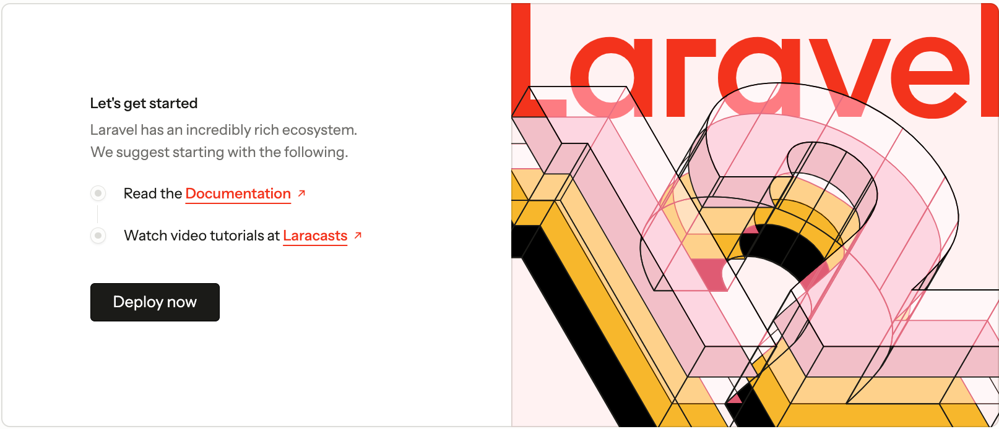

# Instalación y puesta en marcha de Laravel

## Introducción

En este apartado vamos a instalar Laravel dentro del entorno de desarrollo que hemos preparado previamente. Utilizaremos Composer para crear un nuevo proyecto Laravel y realizaremos las configuraciones necesarias en el servidor Nginx para que nuestra aplicación funcione correctamente.

El objetivo es tener un proyecto de Laravel completamente operativo y accesible desde el navegador.

### Recordatorio importante

!!! info "Importante"

    Si has seguido los temas 2.2 y 2.3, ya deberías tener el entorno Docker configurado. Y la estructura de carpetas y ficheros básicos creados.

## Preparar la carpeta de trabajo

Antes de instalar Laravel, es importante preparar correctamente la carpeta donde se va a ubicar el proyecto.

- Dirígete a la carpeta `src/` del proyecto clonado.

```bash
cd src
```

- Si existe un archivo `index.php` de prueba (utilizado previamente para verificar PHP), elimínalo:

```bash
rm index.php
```

Esto nos asegura que la carpeta `src/` esté vacía y lista para recibir el proyecto Laravel.

!!! tip "Importante"

    Laravel necesita que la carpeta de instalación esté vacía para crear correctamente su estructura de archivos.

## Crear el proyecto Laravel

### Acceder al contenedor PHP

Para instalar Laravel correctamente, es necesario ejecutar Composer **desde dentro del contenedor de PHP**.

1. Abre una terminal en Visual Studio Code. (O utilza Docker Desktop si lo prefieres).

2. Ejecuta el siguiente comando para acceder al contenedor `php`:

    !!! note "Acceder al contenedor PHP"

        ```bash
        docker compose exec php bash
        ```

        o, con el nombre real del contenedor (míralo con `docker ps`):

        ```bash
        docker exec -it actividades-laravel-php-1 bash
        ```

    Esto abrirá una consola dentro del contenedor.

### Comprobar que Composer está instalado

Antes de continuar, vamos a asegurarnos de que Composer está correctamente instalado dentro del contenedor.

!!! note "Comprobar Composer"

    Escribe:

    ```bash
    composer --version
    ```

    Deberías ver algo parecido a:

    ```bash
    Composer version 2.x.x 2025-XX-XX
    ```

!!! failure "Problema común"

    Si no ves la versión de Composer, o recibes un error, revisa que tu contenedor PHP haya sido construido correctamente a partir del `Dockerfile` que instala Composer.

---

### Ir a la carpeta de trabajo `src/`

Una vez dentro del contenedor, asegúrate de estar en la carpeta correcta (`/var/www/html`): Puedes utilizar el comando `pwd` para saber en qué carpeta te encuentras.:

!!! note "Comprobar carpeta actual"

    ```bash
    pwd
    ```

    Si no estás en la carpeta correcta:

    ```bash
    cd /var/www/html
    ```

Esta carpeta es donde se montó tu proyecto (`src/`) desde tu máquina local.

---

### Instalar Laravel

Ahora sí, desde dentro de `/var/www/html`, ejecuta el siguiente comando para instalar Laravel:

!!! note "Instalar Laravel"

    ```bash
    composer create-project laravel/laravel:^12.0 .
    ```

!!! tip "`. (el punto)`"

    El punto (`.`) al final del comando indica que Laravel debe instalarse en la carpeta actual (`/var/www/html`).

!!! tip "Versión de Laravel"

    El comando `laravel/laravel:^12.0` asegura que se instale la última versión estable de Laravel 12. En el momento de revisar la documentación del curso ha salido Laravel 13, pero para evitar problemas de compatibilidad con el curso, se recomienda instalar Laravel 12.

Composer descargará todo el framework, instalará las dependencias necesarias, y configurará el proyecto inicial. Puede tardar un poco, ten paciencia.

## Resumen operativo

| Acción | Comando |
|---|---|
| Entrar al contenedor PHP | `docker compose exec php bash` |
| Comprobar Composer | `composer --version` |
| Ir a la carpeta de trabajo | `cd /var/www/html` |
| Instalar Laravel | `composer create-project laravel/laravel:^12.0 .` |

Al finalizar el proceso, la carpeta `src/` tendrá la siguiente estructura principal:

```text
src/
├── app/
├── bootstrap/
├── config/
├── database/
├── public/
├── resources/
├── routes/
├── storage/
├── tests/
├── .env
├── artisan
└── composer.json
```

!!! info "Tiempo de instalación"

    Dependiendo de tu conexión a internet y de la velocidad de tu equipo, la instalación puede tardar varios minutos.

## Configurar Nginx para Laravel

Laravel está diseñado para servir su aplicación a través de la carpeta `public/`. Por lo tanto, es necesario ajustar la configuración de Nginx para apuntar correctamente a esta carpeta.

Edita el archivo `nginx/default.conf` y modifica la directiva `root`:

Antes:

```nginx
root /var/www/html;
```

Después:

!!! note "Configurar Nginx"

    ```nginx
    root /var/www/html/public;
    ```

Además, asegúrate de que la regla de `try_files` esté configurada de esta forma:

!!! note "Configurar try_files"

    ```nginx
    location / {
        try_files $uri $uri/ /index.php?$query_string;
    }

    location ~ \.php$ {
            include fastcgi_params;
            fastcgi_pass php:9000;
            fastcgi_index index.php;
            fastcgi_param SCRIPT_FILENAME $document_root$fastcgi_script_name;
        }
    ```

!!! tip "`fastcgi_param`"

    Fíjate porque la línea `fastcgi_param SCRIPT_FILENAME $document_root$fastcgi_script_name;` ha cambiado y es crucial para el funcionamiento de Laravel. Si no la modificas, nginx no podrá encontrar los archivos PHP correctamente y devolverá un error 404.

Esta configuración permite que Laravel maneje las rutas dinámicas correctamente.

!!! tip "Seguridad"

    No debes servir directamente el contenido fuera de la carpeta `public/` de Laravel. Es una mala práctica de seguridad.

## Levantar de nuevo los servicios Docker

Después de modificar la configuración de Nginx, es necesario reiniciar los contenedores Docker para aplicar los cambios.

Ejecuta los siguientes comandos desde la raíz del proyecto:

!!! note "Reiniciar Docker"

    ```bash
    docker-compose down
    docker-compose up -d
    ```

- `docker-compose down` detiene y elimina los contenedores actuales.
- `docker-compose up -d` vuelve a levantar los servicios en segundo plano.

## Verificar instalación de Laravel

Una vez que los servicios estén arriba, abre tu navegador y accede a la siguiente URL:

[http://localhost:8080](http://localhost:8080)

Deberías ver la pantalla de bienvenida de Laravel:

**"Laravel"** con el mensaje de "Let's get started" o similar.

!!! success "Pantalla de bienvenida"

    

Esto indica que Laravel está instalado correctamente y que la configuración del entorno es funcional.

!!! failure "Error 500: `tempnam(): file created...`, `Permission denied` o `attempt to write a readonly database`"

    Laravel necesita **escribir** en `storage/` (vistas compiladas, logs), en `bootstrap/cache/` y, mientras use SQLite (la base de datos que trae por defecto, donde guarda las sesiones), en `database/`. Composer creó esas carpetas como `root`, pero PHP-FPM atiende las peticiones con el usuario `www-data`, que no puede escribir en ellas. Dale permisos desde la carpeta del proyecto:

    ```bash
    docker compose exec php chown -R www-data:www-data storage bootstrap/cache database
    docker compose exec php chmod -R 775 storage bootstrap/cache database
    ```

    Recarga `localhost:8080`. Si sigue fallando (en Windows, las carpetas compartidas con Docker a veces ignoran el cambio de propietario), usa permisos completos, que en tu ordenador de desarrollo no son un problema:

    ```bash
    docker compose exec php chmod -R 777 storage bootstrap/cache database
    ```

    Nunca hagas esto último en un servidor de producción.

    En el tema 4 cambiaremos SQLite por MySQL en el archivo `.env`; desde entonces la carpeta `database/` ya no necesita permisos de escritura.

!!! info "¡Listo para empezar!"

    Ahora que Laravel está instalado, el siguiente paso será aprender a trabajar con rutas, controladores y modelos dentro del framework.

---
