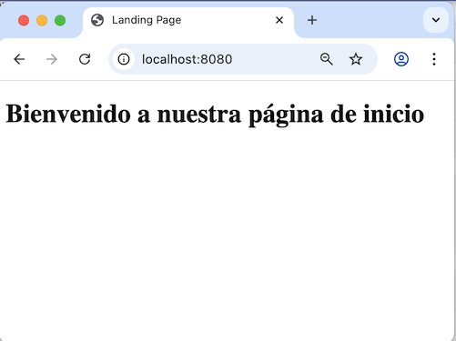
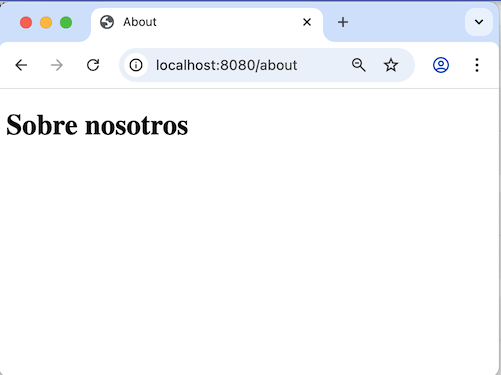

# Estructura y Elementos de un Proyecto Laravel

## Introducción al Patrón MVC en Laravel

Laravel sigue el patrón **MVC (Modelo - Vista - Controlador)**, una forma de organizar el código para separar responsabilidades:

- **Modelos (M):** Representan los datos y la lógica de negocio. Se encuentran en `app/Models`.
- **Vistas (V):** Son las pantallas o interfaces que verá el usuario. Están en `resources/views`.
- **Controladores (C):** Gestionan la lógica de la aplicación, recibiendo las peticiones y devolviendo respuestas. Están en `app/Http/Controllers`.
- **Rutas:** Definen por dónde accede el usuario a cada funcionalidad. Se configuran en `routes/web.php`.

!!! info "Esquema MVC en Laravel"

    ```mermaid
    graph TD
      Usuario -->|Solicita| Rutas
      Rutas -->|Delegan| Controladores
      Controladores -->|Consultan| Modelos
      Modelos -->|Datos| BaseDeDatos
      Controladores -->|Devuelven| Vistas
    ```

Esta separación facilita el mantenimiento, la escalabilidad y la organización del código.

## Estructura del Proyecto Laravel

Dividimos la estructura en dos bloques: **elementos MVC** y **otras carpetas importantes**.

### Elementos principales (MVC)

| Carpeta/Archivo | Descripción |
|---|---|
| `app/Models/` | Modelos de la base de datos. Ej: `User.php`. |
| `resources/views/` | Plantillas Blade que generan el HTML. |
| `app/Http/Controllers/` | Lógica que maneja las peticiones HTTP. |
| `routes/web.php` | Archivo donde se definen las rutas para clientes web. |

### Otras carpetas y archivos importantes

| Carpeta/Archivo | Descripción detallada |
|---|---|
| `app/` | Contiene la lógica de la aplicación: controladores, modelos, middleware. |
| `bootstrap/` | Carga inicial de la aplicación. Incluye `app.php`. |
| `config/` | Archivos de configuración de todo el sistema: base de datos, correo, sesiones, etc. |
| `database/` | Contiene migraciones, seeders y fábricas de datos para pruebas. |
| `public/` | Carpeta pública servida por Nginx. Contiene `index.php`, CSS, JS públicos. |
| `storage/` | Archivos generados automáticamente: logs, caché, ficheros temporales, subidas de usuarios. |
| `tests/` | Tests unitarios y funcionales para automatizar comprobaciones del proyecto. |
| `.env` | Archivo oculto que define las variables de entorno (configuraciones sensibles). |
| vendor/ | Carpeta generada por Composer que contiene todas las dependencias del proyecto. |
| `artisan` | Comando CLI propio de Laravel para realizar tareas de desarrollo dentro del proyecto. |
| `composer.json` | Archivo que define todas las dependencias PHP del proyecto (gestor Composer). |

Dentro de `app/` podemos encontrar:

| Carpeta/Archivo | Descripción |
|---|---|
| `Http/` | Contiene controladores y middleware. |
| `Models/` | Contiene los modelos de la base de datos. |
| `Console/` | Contiene comandos personalizados de Artisan. |

Dentro de `config/` podemos encontrar:

| Carpeta/Archivo | Descripción |
|---|---|
| `app.php` | Configuración de la aplicación. |
| `database.php` | Configuración de la base de datos. |
| `mail.php` | Configuración del correo electrónico. |
| `session.php` | Configuración de sesiones. |
| `auth.php` | Configuración de autenticación. |

Dentro de `database/` podemos encontrar:

| Carpeta/Archivo | Descripción |
|---|---|
| `migrations/` | Archivos que definen la estructura de las tablas de la base de datos. |
| `seeders/` | Archivos que permiten poblar la base de datos con datos iniciales. |
| `factories/` | Archivos que permiten crear datos de prueba para los modelos. |

Dentro de `storage/` podemos encontrar:

| Carpeta/Archivo | Descripción |
|---|---|
| `app/` | Archivos subidos por los usuarios. |
| `framework/` | Archivos generados automáticamente por Laravel. |
| `logs/` | Archivos de registro de errores y eventos. |

Dentro de `tests/` podemos encontrar:

| Carpeta/Archivo | Descripción |
|---|---|
| `Feature/` | Tests funcionales que comprueban el comportamiento de la aplicación. |
| `Unit/` | Tests unitarios que comprueban la lógica de los modelos y controladores. |

Dentro de `public/` podemos encontrar:

| Carpeta/Archivo | Descripción |
|---|---|
| `css/` | Archivos CSS públicos. |
| `js/` | Archivos JavaScript públicos. |
| `index.php` | Punto de entrada a la aplicación. |
| `favicon.ico` | Icono de la página web. |
| `robots.txt` | Archivo que indica a los motores de búsqueda qué páginas indexar. |
| `htaccess` | Archivo de configuración de Apache (no usado en nuestro caso). |

## Instalación del Comando `laravel`

Laravel dispone de una interfaz de línea de comandos (CLI) para facilitar tareas de creación de proyectos y componentes.

### Instalar el instalador de Laravel globalmente

Dentro del contenedor PHP, puedes instalar el instalador de Laravel si quieres crear proyectos más rápidamente:

!!! tip "Instalador de Laravel"

    Recuerda que en nuestro caso la instalación de laravel la tenemos que hacer **dentro del contenedor PHP**. `docker exec -it php bash` y luego ejecutar el siguiente comando.

!!! note "Instalar el instalador de Laravel"

    ```bash
    composer global require laravel/installer
    ```

Esto instalará el comando `laravel` de forma global.

### Diferencias entre `laravel` y `php artisan`

- `laravel`:

    - Se usa principalmente **fuera de los proyectos**.
    - Sirve para crear **nuevos proyectos**:

Ejemplos de uso del comando `laravel`:

Verificar la instalción:

!!! note "Comprobar la versión del instalador de Laravel"

    ```bash
    laravel --version
    ```

!!! failure "Si el comando anterior no funciona"

    Si el comando `laravel` no funciona, es posible que el directorio de Composer no esté en tu variable de entorno `PATH`. Normalmente es `~/.composer/vendor/bin` o `~/.config/composer/vendor/bin` dependiendo de tu sistema operativo. Asegúrate de añadirlo a tu `PATH` para poder usar el comando `laravel` globalmente.

    ```bash
    BIN_DIR=$(composer global config bin-dir --absolute)
    echo "export PATH=$BIN_DIR:\$PATH" > /etc/profile.d/composer.sh
    source /etc/profile
    source /etc/profile.d/composer.sh
    hash -r
    laravel --version
    ```

El problema con este comando es que estamos utilizando un contenedor Docker para el desarrollo, y el comando `laravel` se instala dentro del contenedor PHP. Cuando reiniciamos el contenedor la instalación se pierde.

Nosotros en el curso utilizaremos `composer create-project laravel/laravel:^12.0 .` para crear el proyecto Laravel dentro del contenedor PHP, y no usaremos el comando `laravel` para crear proyectos. Sin embargo, es importante conocer la existencia de este comando, ya que es muy utilizado en entornos de desarrollo sin Docker.

La salida de este comando debería ser similar a:

```text
laravel --version
Laravel Installer 5.19.0
```

Ahora cuando queramos crear un nuevo proyecto Laravel, podemos usar:

```bash
laravel new nombre-del-proyecto
```

**`php artisan`**: Se usa **dentro de un proyecto Laravel ya creado**.

!!! tip "Comando `php artisan`"

    Recuerda que en nuestro caso la instalación de laravel la tenemos que hacer **dentro del contenedor PHP**. `docker exec -it php bash` y luego ejecutar el siguiente los comandos necesarios. Pero tanto el comando `laravel` como `php artisan` se ejecutan dentro del contenedor PHP.

Algunos ejemplos de uso del comando `php artisan` (Los iremos viendo a lo largo del curso):

```bash title="Crear un nuevo controlador"
php artisan make:controller NombreControlador
```

```bash title="Crear un nuevo modelo"
php artisan make:model NombreModelo
```

```bash title="Crear un nuevo recurso (controlador + rutas)"
php artisan make:controller NombreControlador --resource
```

```bash title="Crear un nuevo middleware"
php artisan make:middleware NombreMiddleware
```

```bash title="Crear una nueva migración"
php artisan make:migration crear_tabla_usuarios
```

```bash title="Crear un nuevo seeder"
php artisan route:list
```

!!! tip "Importante"

    En este curso nos centraremos principalmente en `php artisan`, ya que es el que se utiliza dentro de los proyectos Laravel. El comando `laravel` solo se usa para crear nuevos proyectos y lo utilizaremos mínimamente.

### Sobre `php artisan serve`

!!! tip "¿Usar php artisan serve?"

    En nuestro entorno con Docker **NO usamos `php artisan serve`**.

    Ya tenemos configurado **Nginx** como servidor web. `php artisan serve` solo se utiliza en entornos locales simples (sin Docker, sin Nginx).

    Todo el acceso debe ser a través de [http://localhost:8080](http://localhost:8080) utilizando Nginx.

Podríamos haber prescindido de Nginx y usar `php artisan serve` para levantar un servidor web simple. Pero en entornos profesionales se utiliza siempre un servidor web dedicado (Nginx o Apache). Por tanto, para simular un entorno real de producción, hemos configurado Nginx.

## Clase `Route` en Laravel

Por su importancia, vamos a comenzar hablando de las rutas en Laravel, ya que son el punto de entrada a nuestra aplicación. La clase `Route` permite definir cómo responde nuestra aplicación a las diferentes URLs. Toda aplicación de php/laravel comienza por definir sus rutas.

Hay dos grandes tipos de rutas:

- **Rutas web**: Se definen en `routes/web.php` y manejan peticiones de navegadores tradicionales.
- **Rutas API**: Se definen en `routes/api.php` y están pensadas para ser usadas por clientes REST (apps móviles, servicios externos).

!!! tip "Rutas API"

    No busques en tus archivos el fichero `routes/api.php`. A partir de la versión 12 de laravel el fichero `routes/api.php` no se instala en el proyecto por defecto. En el tema correspondiente a APIs REST veremos como crear la estructura necesaria para trabajar con APIs REST.

Los métodos estáticos de la clase `Route` coinciden con los verbos HTTP más comunes. De esta manera podemos definir rutas que respondan a diferentes tipos de peticiones. Luego como parámetros reciben la URL y una función anónima (closure) o el nombre de un controlador y su método. De momento como no hemos visto los controladores vamos a usar closures.

Algunos métodos estáticos principales de `Route`:

### `Route::get()`

Responde a peticiones HTTP GET (páginas web).

```php
<?php
Route::get('/home', function () {
    return view('home');
});
```

Este ejemplo define una ruta que responde a la URL `/home` y devuelve la vista `home`. Tenemos que tener creada la vista `home.blade.php` en la carpeta `resources/views/`. la parte del fichero `.blade.php` no se pone en la ruta, laravel lo añade automáticamente.

### `Route::post()`

Responde a peticiones HTTP POST (envíos de formularios). En este caso vamos a responser con un simple texto. Esto lo utilizaremos al principio para ver que las rutas están funcionando correctamente. Luego ya cambiaremos el texto por una vista o por un controlador.

```php
<?php
Route::post('/submit', function () {
    return 'Formulario enviado';
});
```

### `Route::put()` y `Route::delete()`

Actualiza recursos existentes, o los elimina, utilizado en APIs REST. El esquema es similar a los anteriores.

```php
<?php
Route::put('/profile', function () {
    return 'Perfil actualizado';
});
```

```php
<?php
Route::delete('/post', function () {
    return 'Publicación eliminada';
});
```

### el método `Route::view()`

Este método es importante por simplicidad. Evita tener que pasar por un controlador si solo queremos devolver una vista simple sin lógica adicional. Por tanto se utiliza para rutas que solo muestran una página estática, por ejemplo la página `home`, la página de `about`, etc. Mientras no necesitemos lógica adicional, este método es perfecto.

```php
<?php
Route::view('/', 'welcome');
```

!!! tip "`/`"

    Esta ruta responde a la URL raíz del sitio web, es decir, `http://localhost:8080/` en nuestro entorno Docker. Por tanto es la página principal de nuestra web. Es importante que la ruta `/` siempre esté definida en nuestras aplicaciones web y apunte a una página de bienvenida, inicio, landing o similar.

## Poner en práctica las rutas con un ejemplo sencillo

Vamos a crear un par de rutas simples para ver cómo funcionan. Asociaremos a cada ruta una vista sencilla que crearemos en la carpeta `resources/views/`.

Vamos a crear dos vistas (páginas HTML) estáticas.

### 1. Crear las vistas

Dentro de `resources/views/`, crea una carpeta `landing`:

```text
resources/views/landing/
```

Dentro de `landing/`, crea dos archivos:

!!! tip "Páginas HTML5 en VSCode"

    Si usas Visual Studio Code, puedes crear un archivo nuevo y escribir `!` y luego pulsar `Tab` para que se genere una plantilla básica de HTML5 automáticamente.

**resources/views/landing/index.blade.php**

!!! note "resources/views/landing/index.blade.php"

    ```html
    <h1>Bienvenido a nuestra página principal</h1>
    ```

**resources/views/landing/about.blade.php**

!!! note "resources/views/landing/about.blade.php"

    ```html
    <h1>Sobre nosotros</h1>
    ```

Es importante que las extensiones de los archivos sean `.blade.php`, ya que Laravel utiliza el motor de plantillas Blade para procesar estas vistas. Aunque luego en el enrutador no se vean las extensiones, Laravel las procesa como plantillas. Por ejemplo si tenemos el archivo:

- `index.blade.php`, en el enrutador lo llamaremos `index` y no `index.blade.php`.
- `/user/index.blade.php`, en el enrutador lo llamaremos `user.index` y no `user/index.blade.php`.

En el último caso resaltar el uso de un `.` para separar la carpeta de la vista. Esto es importante porque Laravel utiliza el punto como separador de carpetas al buscar las vistas.

### 2. Definir las rutas

Edita el archivo `routes/web.php` y añade:

!!! note "routes/web.php"

    ```php
    <?php
    Route::view('/', 'landing.index')-> name('index');
    Route::view('/about', 'landing.about')-> name('about');
    ```

A las rutas les hemos dado un nombre para poder referenciarlas más fácilmente en el futuro. Esto nos será de mucha utilidad más adelate.

### 3. Probar las rutas

Para acceder a las páginas, abre tu navegador y visita: - página principal: [http://localhost:8080/](http://localhost:8080/) - página "Sobre nosotros": [http://localhost:8080/about](http://localhost:8080/about)

!!! success "Felicitaciones"

    ¡Ya has creado tu primera pequeña web usando Laravel, rutas y vistas Blade!

    

    
