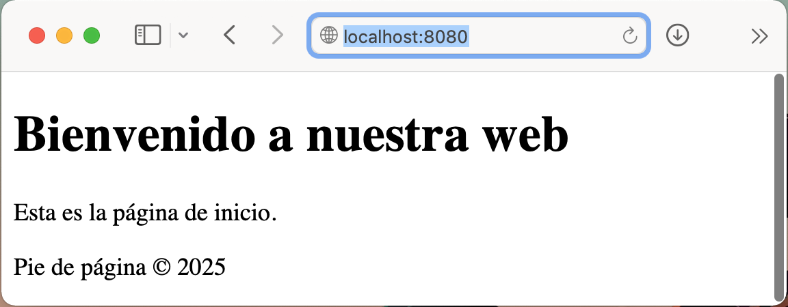
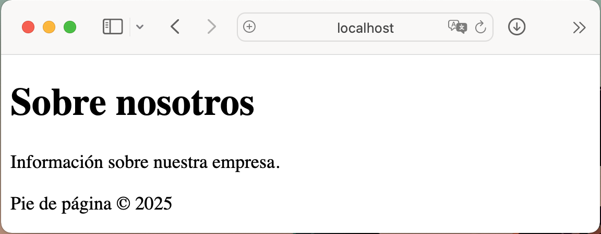
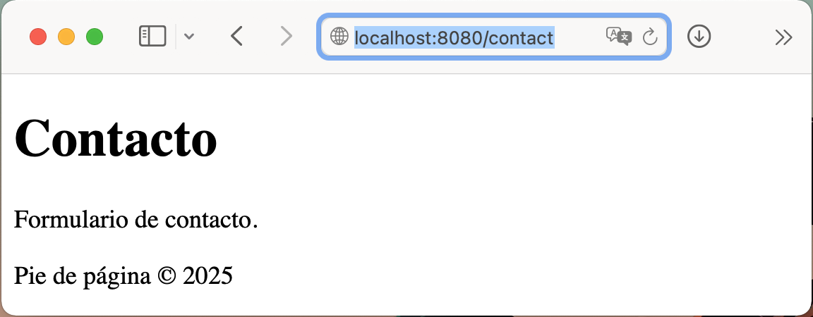
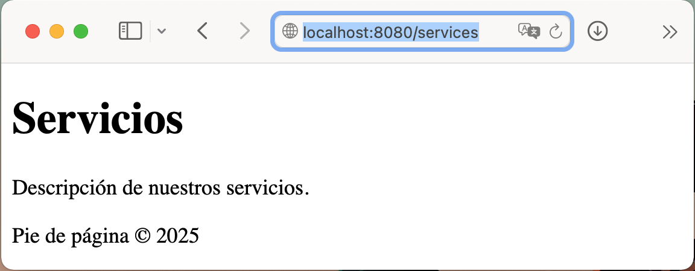
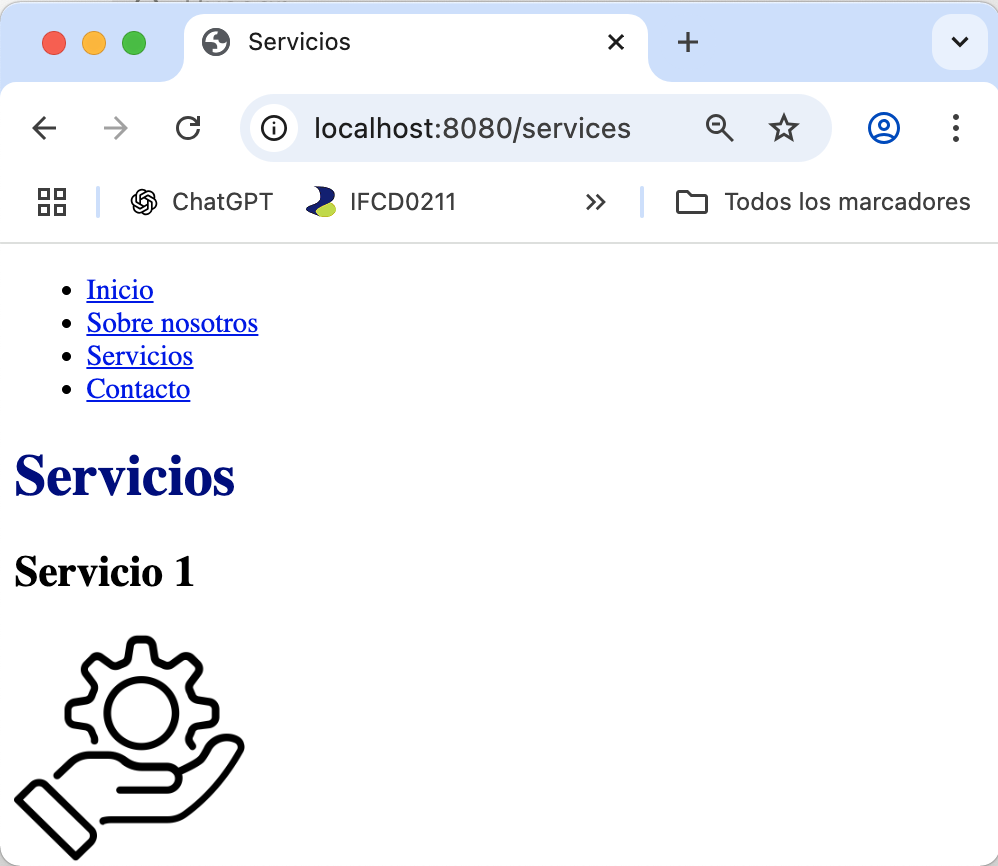
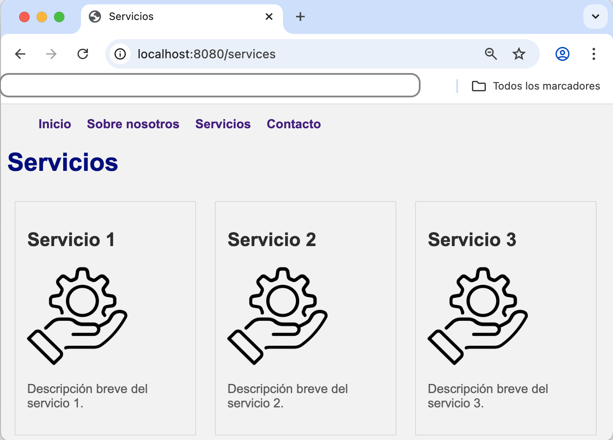

# Creación de Vistas en Laravel y uso de Blade

!!! quote "Autoría de este tema"

    El contenido de este tema (las lecciones, la actividad y los anexos) es obra de **Javier Beteta**, del curso [*Introducción a Laravel*](https://jbeteta-ies.github.io/2025_Laravel_32/). Adaptado para 2º DAW del IES Juan de Garay por Eva María Gómez Abad.

## Introducción a Blade

**Blade** es el motor de plantillas simple pero potente incluido en Laravel. A diferencia de otros motores de plantillas PHP, Blade no te impide usar código PHP simple en tus plantillas. De hecho, todas las plantillas de Blade se compilan en código PHP simple y se almacenan en caché hasta que se modifican, lo que significa que Blade prácticamente no añade ninguna sobrecarga a tu aplicación. Los archivos de plantilla de Blade usan la extensión `.blade.php` y suelen almacenarse en el directorio `resources/views`.

Durante este tema iremos realizaremos una práctica completa para entender cómo funciona Blade y cómo podemos usarlo para crear vistas en Laravel.

### Ventajas principales de Blade

- Permite reutilizar código con **layouts** y **partials**.
- Tiene una sintaxis muy clara y elegante.
- Es más rápido y organizado que escribir HTML puro.
- Permite incluir recursos estáticos (árbol de carpetas, CSS, imágenes) fácilmente.

## Creación de páginas HTML completas

Vamos a comenzar por crear varias páginas HTML básicas con todo su código HTML. Más adelante veremos cómo optimizar el código usando layouts, partials y componentes.

Vamos a crear 4 páginas básicas en `resources/views/landing/`:

- `index.blade.php`: página de inicio
- `about.blade.php`: Página típica about, datos de la empresa
- `services.blade.php`: Página con los servicios que ofrece la empresa
- `contact.blade.php`: Página de contacto

Vamos a crear las páginas de ejemplo.

!!! note "Página de inicio. `index.blade.php`"

    ```html
    <!DOCTYPE html>
    <html lang="es">
    <head>
        <meta charset="UTF-8">
        <title>Inicio</title>    
    </head>
    <body>
        <header>
            <h1>Bienvenido a nuestra web</h1>
        </header>

        <main>
            <p>Esta es la página de inicio.</p>
        </main>

        <footer>
            <p>Pie de página &copy; 2025</p>
        </footer>
    </body>
    </html>
    ```

!!! note "Página de sobre nosotros. `about.blade.php`"

    ```html
    <!DOCTYPE html>
    <html lang="es">
    <head>
        <meta charset="UTF-8">
        <title>Sobre nosotros</title>
    </head>
    <body>
        <header>
            <h1>Sobre nosotros</h1>
        </header>

        <main>
            <p>Información sobre nuestra empresa.</p>
        </main>

        <footer>
            <p>Pie de página &copy; 2025</p>
        </footer>
    </body>
    </html>
    ```

!!! note "Página de servicios. `services.blade.php`"

    ```html
    <!DOCTYPE html>
    <html lang="es">
    <head>
        <meta charset="UTF-8">
        <title>Servicios</title>
    </head>
    <body>
        <header>
            <h1>Servicios</h1>
        </header>

        <main>
            <p>Descripción de nuestros servicios.</p>
        </main>

        <footer>
            <p>Pie de página &copy; 2025</p>
        </footer>
    </body>
    </html>
    ```

!!! note "Página de contacto. `contact.blade.php`"

    ```html
    <!DOCTYPE html>
    <html lang="es">
    <head>
        <meta charset="UTF-8">
        <title>Contacto</title>
    </head>
    <body>
        <header>
            <h1>Contacto</h1>
        </header>

        <main>
            <p>Formulario de contacto.</p>
        </main>

        <footer>
            <p>Pie de página &copy; 2025</p>
        </footer>
    </body>
    </html>
    ```

!!! tip "Ubicación de las vistas"

    Las vistas se encuentran en `resources/views/landing/` y tienen la extensión `.blade.php`.

    ```text
    resources
    └── views
        └── landing
            ├── index.blade.php
            ├── about.blade.php
            ├── services.blade.php
            └── contact.blade.php
    ```

### Definir las rutas

Ahora vamos a definir las rutas para que las vistas tengan su punto de entrada. Vamos a `routes/web.php` y definimos las rutas para cada página usando `Route::view()`, que es una forma sencilla de devolver una vista sin necesidad de un controlador.

!!! note "routes/web.php"

    ```php
    <?php
    Route::view('/', 'landing.index')->name('home');
    Route::view('/about', 'landing.about')->name('about');
    Route::view('/services', 'landing.services')->name('services');
    Route::view('/contact', 'landing.contact')->name('contact');
    ```

    Cada ruta debe tener un nombre único para poder referenciarla fácilmente en los enlaces. De esta manera la ruta sólo estará definida en un único lugar y si cambia la URL, solo tenemos que actualizarla en un sitio. Esto nos ayudará a mantener el código limpio y evitar errores.

Probamos las rutas en el navegador, debemos ver las páginas HTML que hemos creado.

!!! success "Páginas creadas"

       

## Creación de un Layout base

Podemos darnos cuenta que todas las páginas comparten más del 90% de su estructura HTML, y eso es poco eficiente. Cualquier cambio en la cabecera o pie de página, tendríamos que hacerlo en cada archivo. Para ello `blade` nos permite crear un **layout** base que contenga la estructura común de las páginas, y que pueda ser reutilizado en todas las vistas.

Los `layouts` son plantillas que contienen la estructura común de las páginas. En Laravel, los layouts se crean en la carpeta `resources/views/landing/layouts/`.

!!! note "Ejemplo de layout base. `landing.blade.php`"

    ```html
    <!DOCTYPE html>
    <html lang="es">
    <head>
        <meta charset="UTF-8">
        <title>
            @yield('title')
        </title>
    </head>
    <body>
        <header>
            @yield('header')
        </header>

        <main>
            @yield('content')
        </main>

        <footer>
            <p>Pie de página &copy; 2025</p>
        </footer>
    </body>
    </html>
    ```

- `@yield('title')` es un marcador de posición que se reemplazará por el contenido de la sección `title` en las vistas que extiendan este layout.
- `@yield('header')` y `@yield('content')` son marcadores de posición para el contenido específico de cada vista.

**Modificar las vistas** para que extiendan el layout:

!!! note "Ejemplo de vista que extiende el layout. `index.blade.php`"

    ```html
    @extends('landing.layouts.landing')
    @section('title', 'Inicio')
    @section('header')
        <h1>Bienvenido a nuestra web</h1>
    @endsection
    @section('content')
        <p>Esta es la página de inicio.</p>
    @endsection
    ```

Ahora hacemos lo mismo con las otras vistas:

!!! note "Ejemplo de vista que extiende el layout. `about.blade.php`"

    ```html
    @extends('landing.layouts.landing')
    @section('title', 'Sobre nosotros')
    @section('header')
        <h1>Sobre nosotros</h1>
    @endsection
    @section('content')
        <p>Información sobre nuestra empresa.</p>
    @endsection
    ```

!!! note "Ejemplo de vista que extiende el layout. `services.blade.php`"

    ```html
    @extends('landing.layouts.landing')
    @section('title', 'Servicios')
    @section('header')
        <h1>Servicios</h1>
    @endsection
    @section('content')
        <p>Descripción de nuestros servicios.</p>
    @endsection
    ```

!!! note "Ejemplo de vista que extiende el layout. `contact.blade.php`"

    ```html
    @extends('landing.layouts.landing')
    @section('title', 'Contacto')
    @section('header')
        <h1>Contacto</h1>
    @endsection
    @section('content')
        <p>Formulario de contacto.</p>
    @endsection
    ```

!!! tip "Ventajas"

    Con los layouts, si quieres cambiar la estructura común (cabecera, pie de página), solo tienes que hacerlo en un único archivo. Seguimos manteniendo el código limpio y organizado. De manera que si por ejemplo queremos cambiar el pie de página, solo tenemos que modificar el layout y se reflejará en todas las páginas.

## Añadir un menú de navegación

Ahora vamos a poner en práctica lo aprendido anteriormente. Vamos a añadir un menú a nuestra páginas. Como en todas las páginas el menú es el mismo, lo añadiremos al layout. De esta manera vemos que añadieno el menú en un solo logar nos vale para todas las páginas. Solo hay que mantener un menú, siento insistir en lo mismo pero es muy importante.

En el layout, dentro del `header`, incluimos el menú de navegación:

Para ello, vamos a modificar la plantilla y vamos a añadir un menú de navegación:

!!! note "Menú de navegación"

    ```html
    <header>
        <nav>
            <ul>
                <li><a href="/">Inicio</a></li>
                <li><a href="/about">Sobre nosotros</a></li>
                <li><a href="/services">Servicios</a></li>
                <li><a href="/contact">Contacto</a></li>
            </ul>
        </nav>
        @yield('header')
    </header>   
    ```

Podemos probarlo y puede funionar. Pero no es la mejor forma de hacerlo. Puede dar problemas, por ejemplo, si cambiamos la URL de una de las páginas, tendríamos que cambiarlo en todas las vistas. Para evitar esto, Laravel nos permite nombrar las rutas y usar esos nombres para generar los enlaces. En resumen, en lugar de escribir las URLs directamente, usamos el nombre de la ruta.

!!! tip "Nombres de rutas"

    Recuerda como nombramos las rutas, por ejemplo la ruta de inicio:

    ```php
    <?php
    Route::view('/', 'landing.index')->name('home');
    ```

!!! note "Menú de navegación usando nombres de rutas"

    ```html
    <nav>
        <ul>
            <li><a href="{{ route('home') }}">Inicio</a></li>
            <li><a href="{{ route('about') }}">Sobre nosotros</a></li>
            <li><a href="{{ route('services') }}">Servicios</a></li>
            <li><a href="{{ route('contact') }}">Contacto</a></li>
        </ul>
    </nav>
    ```

!!! info "Buenas prácticas"

    Es mejor usar `{{ route('nombre') }}` en lugar de URLs escritas a mano, así si la ruta cambia solo lo actualizas en un lugar. De esta forma, si por lo que sea en un futuro hay que modificar la URL de una ruta (por SEO, por modificaciones en la web, etc), solo hay que cambiarla en un único sitio, en la definición de la ruta. Esto ayuda a mantener el código limpio y evitar errores.

## Uso de Partials

Pero aún podemos mejorar más el código. En un sitio web podemos tener más de una plantilla y el menú repite en todas ellas. Si queremos cambiar el menú, tendríamos que hacerlo en cada layout. Para evitar esto, `blade` nos permite crear **partials**. Utilizaresmos una plantilla llamada `_partials` para guardar fragmentos de código reutilizables, como el menú de navegación. En algunas carpetas `laravel` aconseja utilizar `_` para que siempre estén al principio del listado de archivos.

En `resources/views/_partials/`, creamos un archivo `nav.blade.php` para el menú:

!!! note "Partial del menú de navegación. `nav.blade.php`"

    ```html
    <nav>
        <ul>
            <li><a href="{{ route('home') }}">Inicio</a></li>
            <li><a href="{{ route('about') }}">Sobre nosotros</a></li>
            <li><a href="{{ route('services') }}">Servicios</a></li>
            <li><a href="{{ route('contact') }}">Contacto</a></li>
        </ul>
    </nav>
    ```

Incluimos el partial en el layout:

```php
@include('_partials.nav')
```

Ahora el layout queda así:

!!! note "Layout con menú incluido. `landing.blade.php`"

    ```html
    <!DOCTYPE html>
    <html lang="es">
    <head>
        <meta charset="UTF-8">
        <title>
            @yield('title')
        </title>
    </head>
    <body>
        <header>
            @include('_partials.nav')
            @yield('header')
        </header>

        <main>
            @yield('content')
        </main>

        <footer>
            <p>Pie de página &copy; 2025</p>
        </footer>
    </body>
    </html>
    ```

## Componentes en Blade

!!! info "Componente"

    Un componente de Blade es una unidad reutilizable de interfaz que encapsula un trozo de vista (y, opcionalmente, una clase PHP) con una API clara de props y slots. Se usa como si fuera una etiqueta HTML (), puede recibir y fusionar atributos y permite construir UI consistente y componible.

Ventajas:

- **Reutilizables**: extraes UI repetida (alertas, botones, tarjetas).
- **API declarativa**: props y slots claros; menos `@include` con arrays sueltos.
- **Encapsulan estilos/estructura** y permiten **fusionar atributos** del padre.
- **Cero boilerplate**: no creas clase; solo el `.blade.php`.
- **Composición**: pueden anidar otros componentes `<x-…>`.

### Convenciones y rutas

- Archivo: `resources/views/components/alert.blade.php` → uso: `<x-alert …/>`
- Subcarpetas: `resources/views/components/forms/input.blade.php` → `<x-forms.input …/>`
- Nombres con guion: `toast-notice.blade.php` → `<x-toast-notice …/>`

!!! tip "Carpeta de componentes"

    Los componentes se crean en la carpeta `resources/views/components/` por defecto. Si queremos usar otra carpeta, como `_components`, tenemos que registrarla en el `AppServiceProvider`.

### Ejemplo — `alert`

**Archivo:** `resources/views/components/alert.blade.php`

```html title="alert.blade.php"
@props([
  'type' => 'info',     // info | success | warning | error
  'title' => null,
])

@php
  $base = 'rounded-md p-4 border';
  $map = [
    'info'    => 'bg-blue-50 text-blue-800 border-blue-200',
    'success' => 'bg-green-50 text-green-800 border-green-200',
    'warning' => 'bg-yellow-50 text-yellow-800 border-yellow-200',
    'error'   => 'bg-red-50 text-red-800 border-red-200',
  ];
@endphp

<div {{ $attributes->merge(['class' => "$base ".($map[$type] ?? $map['info'])]) }}>
  @isset($title)
    <div class="font-semibold mb-1">{{ $title }}</div>
  @endisset

  <div>{{ $slot }}</div>

  @isset($actions)
    <div class="mt-3">{{ $actions }}</div>
  @endisset
</div>
```

**Uso:**

```html
<x-alert type="success" title="¡Listo!" class="mb-4">
  Los cambios se guardaron correctamente.
  <x-slot:actions>
    <a href="{{ route('items.index') }}" class="underline">Volver</a>
  </x-slot:actions>
</x-alert>
```

En este ejemplo, el componente `alert` tiene:

- Props: `type` (tipo de alerta) y `title` (título opcional).
- Slot principal: contenido de la alerta.
- Slot con nombre `actions`: para botones o enlaces adicionales.

### Patrones recomendados

- **Props con default** en `@props([...])`; pasa valores dinámicos con **dos puntos** (`:prop="…"`) para arrays/booleanos.
- **Clases condicionales** con `$attributes->class([...])`; deduplica y fusiona con lo que envíe el padre.
- **Slots con nombre** para zonas opcionales (`header`, `footer`, `actions`).
- **Evita lógica pesada** (consultas, cálculos complejos). Mantén el componente “presentacional”.
- **Organiza por dominios**: `components/cards/…`, `components/forms/…`, etc.
- **Comparado con `@include`**: los componentes ofrecen **API (props/slots)** y **fusión de atributos**; `@include` solo pega HTML.

### Continuamos con nuestra práctica

Ahora vamos a mejorar el diseño de la página de servicios. En lugar de mostrar una lista de servicios Queremos mostrar **tarjetas** en la página de servicios.

Primero creamos tarjetas manualmente en `services.blade.php`, dentro de la sección `content`:

!!! note "Tarjetas en `services.blade.php`"

    ```html
    <div class="card">
        <h2>Servicio 1</h2>
        <p>Descripción breve del servicio 1.</p>
    </div>

    <div class="card">
        <h2>Servicio 2</h2>
        <p>Descripción breve del servicio 2.</p>
    </div>

    <div class="card">
        <h2>Servicio 3</h2>
        <p>Descripción breve del servicio 3.</p>
    </div>
    ```

Esta sería una forma de hacerlo, pero no es la mejor. Si queremos añadir más servicios, tendríamos que repetir el mismo código HTML muchas veces. Para evitar esto `blade` nos permite crear **componentes**. Los componentes son bloques de código reutilizables que podemos usar en diferentes partes de la aplicación. En Laravel, los componentes se crean en la carpeta `resources/views/components/`.

Luego, creamos un componente en `resources/views/components/card.blade.php`:

!!! note "Componente tarjeta. `card.blade.php`"

    ```html
    <div class="card">
        <h2>{{ $title }}</h2>
        <p>{{ $content }}</p>
    </div>
    ```

Y lo usamos así en `services.blade.php`:

!!! note "Uso del componente tarjeta en `services.blade.php`"

    ```html
    @extends('landing.layouts.landing')
    @section('title', 'Servicios')
    @section('header')
        <h1>Servicios</h1>
    @endsection
    @section('content')
        @component('components.card')
            @slot('title', 'Servicio 1');
            @slot('content')
                <p>Descripción breve del servicio 1.</p>
            @endslot
        @endcomponent
        @component('components.card')
            @slot('title', 'Servicio 2');
            @slot('content')
                <p>Descripción breve del servicio 2.</p>
            @endslot
        @endcomponent
        @component('components.card')
            @slot('title', 'Servicio 3');
            @slot('content')
                <p>Descripción breve del servicio 3.</p>
            @endslot
        @endcomponent
    @endsection
    ```

!!! info "Ventaja"

    Con componentes evitamos repetir el mismo código HTML muchas veces. Los componentes estan parametrizados y son reutilizables. Si queremos cambiar el diseño de la tarjeta, solo tenemos que hacerlo en un único archivo.

### Ahora el componente con etiquetas `<x-...>`

Modificamos el componente para que reciba las propiedades `title` y `content`:

!!! tip "Carpeta de componentes"

    En el caso de utilizar este tipo de componentes con la sintaxis `<x-...>`, Laravel busca los componentes en la carpeta `resources/views/components/` por defecto. Si queremos usar otra carpeta, como `_components`, tenemos que registrarla en el `AppServiceProvider`.

    Así que movemos el componente `card.blade.php` a `resources/views/components/`. Para evitar confusiones, es mejor usar la carpeta por defecto `components`.

!!! note "Componente tarjeta con props. `card.blade.php`"

    ```html
    @props(['title'])
    <div class="card">
        @isset($title)
            <h2>{{ $title }}</h2>
        @endisset
        <div>
            <p>{{ $slot }}</p>
        </div>
    </div>
    ```

!!! note "Uso del componente tarjeta con `<x-...>` en `services.blade.php`"

    ```html
    @extends('landing.layouts.landing')
    @section('title', 'Servicios')

    @section('header')
        <h1>Servicios</h1>
    @endsection

    @section('content')
        <x-card title="Servicio 1">
            <p>Descripción breve del servicio 1.</p>
        </x-card>

        <x-card title="Servicio 2">
            <p>Descripción breve del servicio 2.</p>
        </x-card>

        <x-card title="Servicio 3">
            <p>Descripción breve del servicio 3.</p>
        </x-card>
    @endsection
    ```

Cualquiera de las dos formas de usar el componente es válida. La segunda puede ser más limpia y clara, la primera es más sencilla para los que empiezan.

## Incluir recursos estáticos (assets)

### Incluir imágenes

Dentro de las tarjetas podemos añadir imágenes. Vamos a incluir una carpeta llamada `assets` dentro de `public/` y dentro de esta carpeta creamos otra llamada `images/`. En esta carpeta vamos a incluir las imágenes que queramos usar en la aplicación. Copiamos una imagen de ejemplo en `public/assets/images/` y la llamamos `servicios.png`.

!!! note "Imagen de ejemplo"

    

Para añadir esta imagen de manera estática, modificamos la tarjeta:

!!! note "Componente tarjeta con imagen estática. `card.blade.php`"

    ```html
    <div class="card">
        <h2>{{ $title }}</h2>
        
        <p>{{ $content }}</p>
    </div>
    ```

Pero con esto no es la mejor forma de hacerlo. Laravel tiene una función llamada `asset()` que nos permite generar la URL correcta para acceder a los recursos estáticos. Así que lo mejor utilizar la función `asset()`:

!!! note "Componente tarjeta con imagen usando `asset()`. `card.blade.php`"

    ```html
    <div class="card">
        <h2>{{ $title }}</h2>
        
        <p>{{ $content }}</p>
    </div>
    ```

> Las imágenes deben estar en `public/assets/images/` y la función `asset()` generará la URL correcta para acceder a ellas.

### Incluir archivos CSS

Igual que hemos incluido las imágenes, podemos incluir archivos CSS. En la carpeta `assets/css/` creamos un archivo `style.css` y lo enlazamos en el layout. Este archivo contendrá los estilos CSS que queramos aplicar a la aplicación.

Aunque CSS no es objetivo del curso, vamos a ver cómo incluirlo en el layout. Y pondremos alagunas reglas para mejorar el diseño de nuestra web.

!!! note "Enlace al CSS en el layout. `landing.blade.php`"

    ```html
    <link rel="stylesheet" href="{{ asset('assets/css/style.css') }}">
    ```

El fichero puede tener el siguiente contenido de prueba:

!!! note "Archivo CSS de ejemplo. `style.css`"

    ```css
    h1 {
        color: darkblue;
    }
    ```

!!! success "Página de servicios con tarjetas"

    

Si probamos la aplicación, veremos que el título de cada página es azul oscuro.

### Mejorar el diseño

Vamos a mejorar el diseño de las tarjetas y del menú de navegación. En el archivo `style.css` añadimos los siguientes estilos:

!!! note "Archivo CSS de ejemplo. `style.css`"

    ```css
    body {
        font-family: Arial, sans-serif;
        background-color: #f4f4f4;
    }
    h1 {
        color: darkblue;
    }
    h2 {
        color: #333;
    }
    p {
        color: #666;
    }
    .card {
        border: 1px solid #ccc;
        padding: 15px;
        margin: 10px;
        display: inline-block;
        width: 200px;
    }

    nav ul {
        display: flex;
        gap: 20px;
        list-style: none;
    }

    nav a {
        text-decoration: none;
        font-weight: bold;
    }
    ```

!!! success "Página de servicios con diseño mejorado"

    

## Conclusión

En este tema hemos aprendido:

- Crear vistas en Blade.
- Reutilizar layouts y partials.
- Crear componentes para código repetitivo.
- Incluir imágenes y CSS en el proyecto.

Con estas bases, estamos preparados para empezar a trabajar en proyectos más complejos usando Laravel y Blade de forma profesional.
