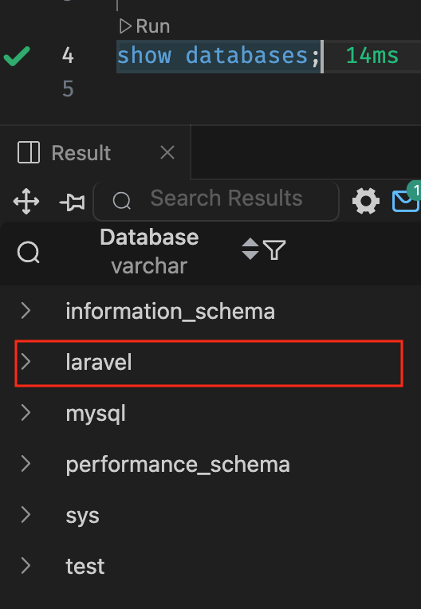
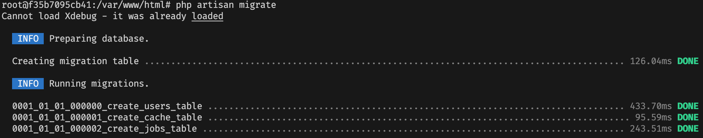
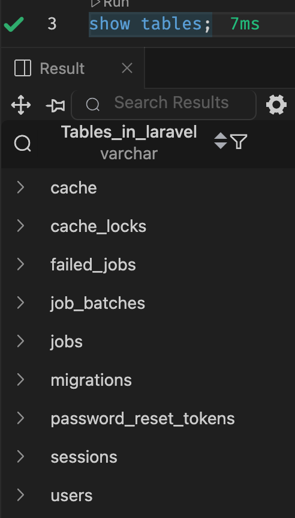
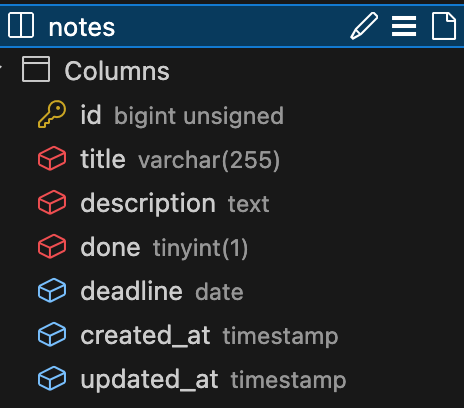

# Migraciones y Modelos en Laravel

!!! quote "Autoría de este tema"

    El contenido de este tema (las lecciones, la actividad y los anexos) es obra de **Javier Beteta**, del curso [*Introducción a Laravel*](https://jbeteta-ies.github.io/2025_Laravel_32/). Adaptado para 2º DAW del IES Juan de Garay por Eva María Gómez Abad.

## Introducción a las Migraciones

Las **migraciones** son una forma de controlar la estructura de la base de datos de tu aplicación a través de archivos PHP versionados. Permiten crear, modificar o eliminar tablas de forma organizada y controlada.

!!! info "Importante"

    Las migraciones funcionan como un "control de versiones" para la base de datos, similar a Git pero para el esquema de datos.

Hay que evitar modificar la base de datos directamente. En su lugar, se deben crear migraciones para reflejar los cambios. De esta forma, se mantiene un historial de cambios y se facilita la colaboración entre desarrolladores. Cualquier cambio en la estructura de la base de datos debe ser reflejado en una migración.

## Configuración de la Base de Datos en Laravel

Laravel utiliza el archivo `.env` para definir los datos de conexión a la base de datos.

Parámetros principales:

```bash
DB_CONNECTION=mysql 
DB_HOST=127.0.0.1
DB_PORT=3306
DB_DATABASE=nombre_base_datos
DB_USERNAME=usuario
DB_PASSWORD=contraseña
```

| Variable | Descripción |
|---|---|
| DB_CONNECTION | Tipo de base de datos (mysql, pgsql, sqlite, etc.) |
| DB_HOST | Dirección del servidor de base de datos |
| DB_PORT | Puerto de conexión a la base de datos |
| DB_DATABASE | Nombre de la base de datos |
| DB_USERNAME | Usuario para conectarse a la base de datos |
| DB_PASSWORD | Contraseña del usuario |

Cada vez que modifiques `.env`, debes reiniciar los contenedores Docker para aplicar cambios. Este fichero está en la raíz del proyecto y no debe ser compartido públicamente, ya que contiene información sensible. Tampoco se almacena en el repositorio de Git, ya que está en el `.gitignore`. Para compartir la configuración, se puede crear un archivo `.env.example` con los parámetros necesarios, pero sin datos sensibles. Este archivo sirve como plantilla para que otros desarrolladores creen su propio `.env`. De esta manera evitamos compartir información sensible y mantenemos la seguridad del proyecto.

Recuerda, antes de tocar el fichero `.env`, hacer una copia del mismo como `.env.example` para que otros desarrolladores puedan usarlo como plantilla. Así, cada uno podrá crear su propio `.env` con sus credenciales y configuraciones específicas.

```bash
cp .env .env.example
```

Esto crea una copia del archivo `.env` como `.env.example`. Este último puede ser compartido en el repositorio, pero no debe contener información sensible. Puedes añadir comentarios en el `.env.example` para explicar cada parámetro.

Luego, cada desarrollador puede copiar el `.env.example` a `.env` y modificarlo según sus necesidades.

```bash
cp .env.example .env
```

Esto crea un nuevo archivo `.env` basado en el ejemplo. Asegúrate de que el `.env` no se suba al repositorio, ya que contiene información sensible como contraseñas y claves de API.

## Bases de Datos soportadas por Laravel

Por defecto, Laravel soporta:

- MySQL / MariaDB
- PostgreSQL
- SQLite
- SQL Server

!!! tip "Consejo"

    Para proyectos educativos y sencillos, SQLite es muy recomendable por su facilidad de configuración. Es la base de datos que utilizará por defecto.

Para este curso usaremos `mysql` como base de datos. Si has seguido los temas anteriores ya debes tener acceso a una base de datos MySQL, dentro del `docker-compose` creado anteriormente. Asegúrate de que los parámetros de conexión en el archivo `.env` sean los siguientes:

!!! note "Parámetros de conexión"

    Asegúrate de que los parámetros de conexión en el archivo `.env` sean los siguientes:

    ```bash
    DB_CONNECTION=mysql
    DB_HOST=mysql
    DB_PORT=3306
    DB_DATABASE=laravel
    DB_USERNAME=alumno
    DB_PASSWORD=alumno
    ```

!!! info "DB_HOST"

    Normalmente aquí tendremos la *IP* del servidor de base de datos. En nuestro caso, como estamos trabajando con contenedores *docker* dentro de un *docker-compose*, el valor será `mysql`, que es el nombre del servicio definido en el `docker-compose.yml`. En el caso de tener un contenedor independiente, el valor será la *IP* del contenedor o `host.docker.internal` si la base de datos está en el mismo host.

Podemos utilizar cualquier herramienta para gestionar la base de datos, como [DBeaver](https://dbeaver.io/), [Adminer](https://www.adminer.org/), [MySQL Workbench](https://www.mysql.com/products/workbench/), etc. En este curso vamos utilizar una extensión de VSCode llamada `MySQL` de `Database Client`. Esta extensión permite conectarse a bases de datos MySQL y realizar consultas directamente desde el editor. Esto nos permite no tener que salir de VSCode cuando tengamos que interactuar con las bases de datos.

Creamos la base de datos `laravel`:

!!! note "Crear base de datos"

    ```sql
    CREATE DATABASE `laravel`
        DEFAULT SET = 'utf8mb4';
    ```

Puedes comprobar `SHOW DATABASES;` para ver que la base de datos ha sido creada correctamente.

!!! success "Base de datos creada"

    

!!! failure "Error de permisos"

    Es probable que al intentar crear la base de datos obtengas un error de permisos.

    !!! tip ""

        Access denied for user 'alumno'@'%' to database 'laravel'

    Esto es porque al inciciar el contenedor de MySQL, hemos creado un usuario `alumno` con permisos limitados. Para solucionar este problema, podemos conectarnos a MySQL como `root` y completar los permisos del usuario `alumno`. Para ello, ejecuta los siguientes comandos:

    ```bash
    docker compose exec mysql mysql -u root -p # password `administrador`
    ```

    ```sql
    GRANT ALL PRIVILEGES ON *.* TO 'alumno'@'%' IDENTIFIED BY 'alumno' WITH GRANT OPTION;
    FLUSH PRIVILEGES;
    ```

    Ahora puedes volver a crear la base de datos `Laravel` sin problemas.

## Migraciones por Defecto en Laravel

Ahora que hemos creado la nueva base de datos con la que trabajará `laravel`, y hemos modificado el fichero `.env` para que `laravel` se conecte a la base de datos, vamos a ver las migraciones que vienen por defecto en `laravel` y que necesitamos ejecutar antes de empezar a trabajar con `laravel`.

Cuando creamos un proyecto Laravel, ya existen tres migraciones iniciales:

| Migración | Descripción |
|---|---|
| `create_users_table.php` | Crea la tabla `users`. |
| `create_jobs_table.php` | Crea la tabla `jobs`. |
| `create_cache_table.php` | Crea la tabla `cache`. |

Podemos encontrar estas migraciones en la carpeta `database/migrations/`. Cada archivo tiene un nombre que incluye una marca de tiempo y una descripción de la migración. La marca de tiempo asegura que las migraciones se apliquen en el orden correcto.

## Crear una Base de Datos y Ejecutar Migraciones Iniciales

Si no lo hiciste anteriormente es el momento de crear la base de datos `Laravel` en MySQL.

!!! note "Crear base de datos `laravel`"

    ```sql
    CREATE DATABASE `laravel`
        DEFAULT CHARACTER SET = 'utf8mb4';
    ```

Recueda que en nuestro entorno para ejecutar comandos de Artisan, debes entrar en el contenedor de PHP. Para ello, ejecuta:

```bash
docker compose exec nombre_servicio bash      # recomendado
docker exec -it nombre_contenedor_php bash    # alternativa
```

Donde `nombre_contenedor_php` es el nombre del contenedor PHP que has creado. Puedes encontrarlo con el comando `docker ps`, y el `nombre_servicio` es el nombre del servicio PHP en el `docker-compose.yml` (`php`).

Para nuestro caso:

!!! note "Acceder al contenedor PHP"

    ```bash
    docker compose exec php bash                    # recomendado
    docker exec -it actividades-laravel-php-1 bash  # alternativa: nombre real del contenedor (docker ps)
    ```

Vamos a comenzar por ejecutar las migraciones por defecto. Para ello, ejecuta el siguiente comando:

!!! note "Ejecutar migraciones"

    Ejecuta el siguiente comando para ejecutar las migraciones por defecto:

    ```bash
    php artisan migrate
    ```

Esto ejecutará todas las migraciones que aún no se han aplicado. Si todo va bien, deberías ver un mensaje indicando que las migraciones se han ejecutado correctamente. Esto creará las tablas `users`, `jobs` y `cache` en la base de datos `laravel`. Puedes verificarlo conectándote a la base de datos con tu herramienta preferida y comprobando que las tablas han sido creadas correctamente.

!!! success "imagen migraciones"

    

Si todo ha ido bien debemos encontrar las siguientes tablas en la base de datos:

!!! success "Tablas creadas"

    

| Tabla | Descripción |
|---|---|
| `users` | Tabla de usuarios. |
| `jobs` | Tabla de trabajos en cola. |
| `cache` | Tabla de caché. |
| `cache_locks` | Tabla de bloqueos de caché. |
| `migrations` | Tabla de migraciones. |
| `failed_jobs` | Tabla de trabajos fallidos. |
| `password_resets` | Tabla de restablecimiento de contraseñas. |
| `personal_access_tokens` | Tabla de tokens de acceso personal. |
| `sessions` | Tabla de sesiones. |

La mayoría de las tablas son necesarias para el funcionamiento de `laravel`y algunas de ellas las veremos en este curso, otras se quedan fuera ya que el contenido del curso no nos alcanza. De momento nos importa la tabla `migrations`, donde se irán anotando cada una de las migraciones que se realizan con tal de que `laravel` pueda llevar un control de las mismas. La estudiamos en profundidad en el punto siguiente,

## La tabla `migrations`

Hechemos un vistazo a la tabla `migrations` para ver cómo funciona. Vamos a ver los campos que tiene:

- `id`: Identificador único de la migración.
- `migration`: Nombre de la migración.
- `batch`: Número de lote al que pertenece la migración. Este número se incrementa cada vez que se ejecuta una migración. Esto permite agrupar migraciones y revertirlas todas a la vez si es necesario.

Y qué registros tiene:

| id | migration | batch |
|---|---|---|
| 1 | 2023_10_01_000000_create_users_table | 1 |
| 2 | 2023_10_01_000000_create_jobs_table | 1 |
| 3 | 2023_10_01_000000_create_cache_table | 1 |

Aquí podemos ver que las tres migraciones iniciales pertenecen al mismo lote (batch 1). Esto significa que se ejecutaron todas juntas. Si ejecutamos una nueva migración, se creará un nuevo lote (batch 2) y así sucesivamente.

Cada vez que corres `php artisan migrate`, Laravel revisa esta tabla para decidir qué migraciones necesita aplicar. También sirve para saber qué migraciones ya se han ejecutado y cuáles no. Esto es útil para mantener un control de las migraciones y evitar que se apliquen varias veces. Podemos volver a ejecutar el comando `php artisan migrate` y ver que no se aplican las migraciones que ya están en la tabla `migrations`. Esto es porque Laravel revisa esta tabla antes de aplicar las migraciones y solo aplica las que no están en la tabla. El resultado será algo como esto:

!!! success "Resultado de la migración"

    ```text
    INFO: Nothing to migrate.
    ```

## Crear una nueva migración

Es importante seguir la convención de nombres para las migraciones. El nombre de la migración debe comenzar por la acción (`create`, `update`, `delete`, etc.)y luego el nombre del componente. Esto asegura que las migraciones se apliquen en el orden correcto. Por ejemplo, si creamos una migración para crear una tabla `notes`, el nombre del fichero será algo como `create_notes_table.php`. Laravel añadirá automáticamente la marca de tiempo al nombre del fichero. El nombre del fichero será algo como `2025_10_01_000000_create_notes_table.php`. Esto asegura que las migraciones se apliquen en el orden correcto. La marca de tiempo es importante porque Laravel utiliza esta información para determinar el orden en que se deben aplicar las migraciones. Si no seguimos esta convención, podríamos tener problemas al aplicar las migraciones.

Fijemonos que el nombre de la entidad que queremos crear está en mínusculas y en plural `...notes...`.

Para crear una nueva migración primero dbemos crear el fichero de migración. Para ello, usamos el comando:

!!! note "Crear migración"

    Usa el siguiente comando para crear una nueva migración:

    ```bash
    php artisan make:migration create_notes_table
    ```

Esto crea el archivo `2025_10_01_000000_create_notes_table.php` en `database/migrations/`:

```text
INFO  Migration [database/migrations/2025_10_06_143440_create_notes_table.php] created successfully.  
```

!!! failure "Creación de componentes `laravel`"

    Para crear la mayoría de los componentes de `laravel` (migraciones, modelos, controladores, etc.) se utiliza el comando `php artisan make:componente`, donde `componente` es el tipo de componente que queremos crear. **NUNCA** debemos crear estos componentes manualmente, ya que `laravel` nos proporciona una forma rápida y sencilla de crearlos.

## Definir la Estructura de una tabla

Ahora vamos a analizar el contenido del archivo de migración que acabamos de crear. Este archivo contiene dos métodos: `up()` y `down()`.

- El método `up()` se utiliza para definir la estructura de la tabla que queremos crear
- El método `down()` se utiliza para revertir los cambios realizados por el método `up()`.

Podemos comenzar por observar los `use`al principio del archivo:

| use | Descripción |
|---|---|
| `Illuminate\Database\Migrations\Migration` | Clase base para las migraciones. |
| `Illuminate\Database\Schema\Blueprint` | Clase para definir la estructura de la tabla. |
| `Illuminate\Support\Facades\Schema` | Clase para interactuar con el esquema de la base de datos. |

Dentro del método `up()`, defines la estructura de la tabla.

Ejemplo:

!!! note "Definir estructura de tabla"

    ```php
    <?php
    public function up(): void
    {
        Schema::create('notes', function (Blueprint $table) {
            $table->id();
            $table->string('title', 255)->notNullable();
            $table->text('description', 255)->notNullable();
            $table->boolean('done')->default(false);
            $table->timestamps();
        });
    }
    ```

Campos especiales:

| Campo | Descripción |
|---|---|
| **ìd()** | Crea una clave primaria autoincremental. |
| **timestamps()** | Crea los campos `created_at` y `updated_at` automáticamente. |

Tipos comunes de campos:

| Tipo | Descripción | Parámetros |
|---|---|---|
| `string` | Cadena de texto. | Parámetros: `(nombre, longitud)`. Longitud opcional, por defecto 255. El valor de longitud debe estar entre 0 y 255. |
| `text` | Texto largo. | Parámetros: `(nombre, longitud)`. Longitud opcional, por defecto 65535. El valor de longitud debe estar entre 0 y 65535. |
| `integer` | Número entero. | Parámetros: `(nombre, longitud)`. Longitud opcional, por defecto 11. El valor de longitud debe estar entre -2147483648 y 2147483647. |
| `boolean` | Valor booleano. | Parámetros: `(nombre)`. No requiere longitud. Los valores posibles son 0 o 1. |
| `date` | Fecha. | Parámetros: `(nombre)`. No requiere longitud. Formato por defecto: `YYYY-MM-DD`. |
| `enum` | Enum, para definir un conjunto de valores posibles. | Parámetros: `(nombre, longitud)`. Longitud opcional, por defecto 255. El valor de longitud debe estar entre 0 y 255. |
| `float` | Número de punto flotante. | Parámetros: `(nombre, precisión)`. Precisión opcional, por defecto 8. La precisión determina el número total de dígitos. |
| `double` | Número de punto flotante de doble precisión. | Parámetros: `(nombre, precisión)`. Precisión opcional, por defecto 8. La precisión determina el número total de dígitos. |
| `decimal` | Número decimal. | Parámetros: `(nombre, precisión, escala)`. La precisión es el número total de dígitos, y la escala es el número de dígitos a la derecha del punto decimal. |
| `json` | Campo para almacenar datos en formato JSON. | Parámetros: `(nombre, longitud)`. Longitud opcional, por defecto 65535. El valor de longitud debe estar entre 0 y 65535. |

#### Modificadores de Campos

| Modificador | Descripción |
|---|---|
| `nullable()` | Permite que el campo sea nulo. |
| `default(value)` | Establece un valor por defecto. |
| `unique()` | Establece el campo como único. |
| `index()` | Crea un índice para el campo. |
| `foreign()` | Define una clave foránea. |
| `unsigned()` | Establece el campo como sin signo. |
| `after(column)` | Coloca el campo después de otro campo. |
| `before(column)` | Coloca el campo antes de otro campo. |
| `primary()` | Establece el campo como clave primaria. |

Los modificadores se pueden combinar. Por ejemplo:

```php
<?php
$table->string('title', 255)->notNullable()->unique();
```

Esto crea un campo `title` de tipo `string` con una longitud máxima de 255 caracteres, que no puede ser nulo y debe ser único en la tabla.

## Ejemplo Práctico: Crear Tabla `notes`

Creamos la tabla `notes` con los campos:

- id
- title
- description
- done
- created_at y updated_at (timestamps)

Usando el código mostrado en el apartado anterior.

Una vez tengamos el fichero de migración creado, podemos ejecutarlo con el siguiente comando:

```bash
php artisan migrate
```

Esto ejecutará la migración y creará la tabla `notes` en la base de datos. Puedes verificarlo conectándote a la base de datos con tu herramienta preferida y comprobando que la tabla ha sido creada correctamente.

## Cómo Eliminar una Migración (función down())

Si en un momento queremos eliminar la tabla `notes`, podemos hacerlo en el método `down()` de la migración. **No** debes eliminar la tabla directamente desde la base de datos, ya que esto no actualizará la tabla `migrations` y podrías tener problemas al aplicar o revertir migraciones en el futuro.

Primero implementamos el método `down()` en la migración. Si creamos el fichero siguiendo la convención de nombres, el método `down()` debería verse así:

```php
<?php
Schema::dropIfExists('notes');
```

!!! note "Probamos los comandos"

    Ahora, ejecutamos los siguientes comandos:

    ```bash
    php artisan migrate # comprobar que la tabla ha sido creada.
    php artisan migrate:rollback # comprobar que la tabla ha sido eliminada.
    php artisan migrate # comprobar que la tabla ha sido creada de nuevo.
    ```

## Modificar una Tabla Existente

Supongamos que queremos añadir un campo `deadline`:

!!! note "Pasos para modificar una tabla"

    Pasos para modificar una tabla existente:

    1. Ejecutar rollback:

    ```bash
    php artisan migrate:rollback
    ```

    1. Modificar la migración anterior agregando:

    ```php
    <?php
    $table->date('deadline')->nullable();
    ```

    1. Ejecutar de nuevo:

    ```bash
    php artisan migrate
    ```

!!! success "tabla notes"

    

!!! tip "Buena práctica"

    **Nunca** debes modificar directamente las tablas en producción. Es mejor crear una nueva migración para alterar la tabla.

## 5.6.12 Comandos de Migraciones

| Comando | Descripción |
|---|---|
| `php artisan migrate` | Ejecuta migraciones pendientes. |
| `php artisan migrate:rollback` | Deshace la última migración ejecutada. |
| `php artisan migrate:reset` | Revierte todas las migraciones. |
| `php artisan migrate:refresh` | Resetea y vuelve a ejecutar todas las migraciones. |
| `php artisan migrate:fresh` | Borra todas las tablas y ejecuta todas las migraciones. |

Parámetros comunes:

- `php artisan migrate:rollback --step=N` para revertir N migraciones.
- `php artisan migrate --batch=N` para ejecutar migraciones de un lote específico.
- `php artisan migrate --path=/ruta/a/migracion` para ejecutar una migración específica.
- `php artisan migrate --pretend` para simular la ejecución de migraciones sin aplicarlas.

## Crear una Migración para actualizar una tabla

En el ejemplo anterior hemos modificado una tabla añadiento un campo `deadline`. Pero lo hemos hecho modificando la migración original. Pero esto no siempre es posible y por tanto no es una buena práctica. Imaginemos por un momento que la tabla `notes` ya está en producción y tiene datos. Si modificamos la migración original y ejecutamos `php artisan migrate:refresh`, perderemos todos los datos de la tabla. Por tanto, lo correcto es crear una nueva migración para modificar la tabla.

!!! failure "Eliminar y volver a crear la tabla"

    El `truco` de borrar la tabla y volver a crearla solo es válido en entornos de desarrollo, nunca en producción. **Cuando eliminamos la tabla y la volvemos a crear, perdemos todos los datos que había en la tabla**. Esto no es aceptable en un entorno de producción, ya que los datos son valiosos y no se pueden perder. En un entorno de desarrollo, esto puede ser aceptable si estamos probando cosas y no nos importa perder los datos. Pero en producción, esto es inaceptable y debemos crear una nueva migración para modificar la tabla sin perder los datos.

En este punto vamos a crear una nueva migración para añadir un campo `author` a la tabla `notes`. El campo será de tipo `string` y podrá ser nulo. Y En este caso vamos a modificar la tabla sin necesidad de hacer rollback, ya que la tabla `notes` ya está creada y tiene datos.

Puedes poblar la tabla `notes` con algunos datos de prueba si quieres comprobar que los datos no se pierden al ejecutar la migración.

Creamos una nueva migración:

!!! note "Crear migración para actualizar tabla"

    Usa el siguiente comando para crear una nueva migración para actualizar la tabla `notes`:

    ```bash
    php artisan make:migration update_notes_table
    ```

    En el método `up()`:

    ```php
    <?php
    Schema::table('notes', function (Blueprint $table) {
        $table->string('author')->after('description')->nullable();
    });
    ```

    En el `down()`:

    ```php
    <?php
    Schema::table('notes', function (Blueprint $table) {
        $table->dropColumn('author');
    });
    ```

Para ejecutar la migración:

!!! note "Ejecutar migración"

    Ejecuta el siguiente comando para ejecutar la migración:

    ```bash
    php artisan migrate
    ```

Puedes comprobar que existe un nuevo campo `author` en la tabla `notes`. Y que está en la posición correcta.

Para deshacer la migración, ejecuta:

!!! note "Deshacer migración"

    Ejecuta el siguiente comando para deshacer la migración:

    ```bash
    php artisan migrate:rollback
    ```

Esto revertirá la migración y eliminará el campo `author` de la tabla `notes`. Puedes verificarlo conectándote a la base de datos y comprobando que el campo ha sido eliminado correctamente.

## Introducción a los Modelos en Laravel

Los **modelos** son una parte fundamental de Laravel y nos permiten trabajar con la base de datos de forma más ágil. Cada modelo representa una tabla en la base de datos y nos permite interactuar con ella de forma sencilla mediante `Eloquent ORM`. Esto significa que podemos realizar operaciones CRUD (Crear, Leer, Actualizar, Eliminar) en la base de datos sin necesidad de escribir consultas SQL complejas. Los ficheros se encuentran en la carpeta `app/Models`. Por defecto, Laravel crea un modelo para cada tabla en la base de datos. Sin embargo, también podemos crear modelos personalizados para tablas específicas o para representar relaciones entre tablas.

## Carpeta `app/Models`

Aquí se almacenan todos los modelos de la aplicación.

Por convenciones:

- El modelo `Note` representa la tabla `notes`.
- El modelo `User` representa la tabla `users`.

Los modelos deben seguir la convención de nombres de Laravel. Por ejemplo, el modelo `Note` debe estar en un archivo llamado `Note.php` y debe estar en la carpeta `app/Models`. El nombre del modelo debe ser singular, mientras que el nombre de la tabla debe ser plural. Esto es importante porque Laravel utiliza esta convención para relacionar los modelos con las tablas de la base de datos.

## Crear un Modelo para la Tabla `notes`

Usamos el comando:

!!! note "Crear modelo"

    Usa el siguiente comando para crear un nuevo modelo:

    ```bash
    php artisan make:model Note
    ```

Esto crea `app/Models/Note.php`.

!!! note "Contenido del modelo"

    ```php
    <?php

    namespace App\Models;

    use Illuminate\Database\Eloquent\Model;

    class Note extends Model
    {
        //
    }
    ```

El modelo `Note` extiende la clase `Model`, que es la clase base para todos los modelos en Laravel. Esto nos permite utilizar todas las funcionalidades de `Eloquent ORM` en nuestro modelo `Note`. La clase `Model` proporciona métodos para interactuar con la base de datos, como `save()`, `delete()`, `find()`, entre otros.

## Asociar el Modelo a una tabla personalizada

Si hemos seguido las convenciones de Laravel, el modelo `Note` se asociará automáticamente a la tabla `notes`. Sin embargo, si la tabla tiene un nombre diferente, debemos especificarlo en el modelo. Por ejemplo, si la tabla se llama `app_notas`, el modelo debe verse así:

```php
<?php
namespace App\Models;
use Illuminate\Database\Eloquent\Model;
class Note extends Model
{
    // Especificar el nombre de la tabla
    protected $table = 'app_notas';
}
```

## Crear una nueva Nota con `Eloquent`

Este sería el código para crear una nueva nota:

```php
<?php
$note = new Note();
$note->title = 'Mi primer nota';
$note->description = 'Descripción de la nota';
$note->done = false;
$note->save();
```

Podemos observar que no hemos utilizado `sql`, estamos utilizando la clase `Model` de Laravel para interactuar con la base de datos. Esto es posible gracias a Eloquent ORM, que nos permite trabajar con la base de datos de forma más sencilla y rápida. Si analizamos el `use` podemos ver:

```php
<?php
use Illuminate\Database\Eloquent\Model;
```

Esto significa que estamos utlizando `Eloquent`, que es el ORM de Laravel. Eloquent nos permite interactuar con la base de datos de forma más sencilla y rápida, utilizando objetos en lugar de consultas SQL. Esto hace que el código sea más legible y fácil de mantener.

Lo iremos ampliando durante el curso, pero por ahora es suficiente.

Puedes probar a crear una nota y eliminarla:

Pero la antes, `¿Dónde ponemos este código?`, si aún no hemos visto los controladores. Hay varias opciones:

- Puedes crear un carchivo php y ejecutarlo desde la línea de comandos.
- Puedes crear una ruta temporal en `routes/web.php` y ejecutar el código desde ahí.

Vamos a tomar la seguna opción, por tanto iermos a `routes/web.php` y añadimos la siguiente ruta:

!!! note "Ruta temporal para crear una nota"

    ```php
    <?php
    use App\Models\Note;
    Route::get('/crear-nota', function () {
        $note = new Note();
        $note->title = 'Mi primer nota';
        $note->description = 'Descripción de la nota';
        $note->done = false;
        $note->save();
        return 'Nota creada';
    });
    ```

Ahora, si accedemos a `http://localhost:8080/crear-nota`, se ejecutará el código y se creará una nueva nota en la base de datos. Puedes verificarlo conectándote a la base de datos y comprobando que la nota ha sido creada correctamente.

!!! success "Nota creada"

    

Ahora podemos eliminar la nota creada. Para ello, añadimos otra ruta temporal en `routes/web.php`:

!!! note "Ruta temporal para eliminar una nota"

    ```php
    <?php
    use App\Models\Note;
    Route::get('/eliminar-nota', function () {
        $note = Note::first(); // Suponiendo que es la primera nota creada
        /** $note = Note::find(3); Si queremos acceder a un ID concreto */
        if ($note) {
            $note->delete();
            return 'Nota eliminada con éxito';
        }
        return 'No hay notas para eliminar';
    });
    ```

Ahora, si accedemos a `http://localhost:8080/eliminar-nota`, se ejecutará el código y se eliminará la nota con ID 3 de la base de datos. Puedes verificarlo conectándote a la base de datos y comprobando que la nota ha sido eliminada correctamente.

## Propiedades importantes en Modelos

Una vez hemos creado el modelo, podemos utilizar algunas propiedades importantes para definir su comportamiento. Estas propiedades nos permiten personalizar el modelo y adaptarlo a nuestras necesidades. Con estas propiedades podemos definir qué campos se pueden asignar masivamente, qué campos se deben ocultar en las respuestas JSON, y cómo se deben convertir los tipos de datos.

| Propiedad | Descripción |
|---|---|
| `$fillable` | Lista de campos que pueden ser asignados masivamente. |
| `$guarded` | Lista de campos que **no** pueden ser asignados. |
| `$casts` | Convierte automáticamente tipos de campos (ej: booleanos, fechas). |
| `$hidden` | Campos que no se deben mostrar en JSON. |

Por ejemplo en nuestra tabla `notes` podemos definir los campos que se pueden asignar masivamente:

```php
<?php
protected $fillable = ['title', 'description', 'done', 'deadline'];
protected $hidden = ['created_at', 'updated_at'];
protected $casts = [
    'done' => 'boolean',
    'deadline' => 'date',
];
protected $guarded = ['id'];
```

Esto significa que los campos `title`, `description`, `done` y `deadline` pueden ser asignados masivamente, mientras que el campo `id` no puede ser asignado. Además, los campos `created_at` y `updated_at` no se mostrarán en las respuestas JSON. El campo `done` se convertirá automáticamente a un booleano y el campo `deadline` se convertirá automáticamente a una fecha.

Esto es útil para proteger los campos que no queremos que sean modificados directamente, como el campo `id`. De esta manera los campos no pueden ser modificados directamente, sino que deben ser asignados a través de los métodos del modelo. Esto ayuda a mantener la integridad de los datos y evita errores al modificar los campos.

La propiedad `$casts` nos permite definir cómo se deben convertir los tipos de datos. Por ejemplo, si tenemos un campo `fecha` que es un date, podemos definirlo así:

```php
<?php
protected $casts = [
    'fecha' => 'date',
];
```

Esto significa que el campo `fecha` se convertirá automáticamente a un objeto `Carbon`, que es una biblioteca de PHP para trabajar con fechas y horas. Esto nos permite trabajar con fechas de forma más sencilla y rápida, utilizando métodos como `format()`, `addDays()`, entre otros.

Si la clave primaria no es `id`, podemos especificar el nombre de la clave primaria:

```php
<?php
protected $primaryKey = 'note_id';
```

Esto es útil si estamos utilizando una clave primaria diferente a la convencional. Por ejemplo, si estamos utilizando una clave primaria compuesta o si estamos utilizando un campo diferente como clave primaria. En este caso, debemos especificar el nombre de la clave primaria en el modelo para que Laravel pueda identificarla correctamente.

Un ejemplo de clave compuesta sería:

```php
<?php
protected $primaryKey = ['note_id', 'user_id'];
```

## Relación entre Modelos y Migraciones

- Cada **modelo** representa una tabla.
- Cada **migración** modifica la estructura de una tabla.
- Puedes crear modelo y migración a la vez:

```bash
php artisan make:model Nombre -m
```

Para comprobarlo vamos a crear un nuevo modelo `new Note` y su migración correspondiente:

!!! note "Crear modelo y migración"

    Usa el siguiente comando para crear un nuevo modelo y su migración correspondiente:

    ```bash
    php artisan make:model NewNote -m
    ```

Debemos obtener una salida similar a esta:

```bash title="Crear modelo y migración"
root@f35b7095cb41:/var/www/html# php artisan make:model NewNote -m

   INFO  Model [app/Models/NewNote.php] created successfully.  

   INFO  Migration [database/migrations/2025_10_06_160944_create_new_notes_table.php] created successfully.  
```

Esto creará el modelo `NewNote` y la migración correspondiente para crear la tabla `new_notes`. Puedes verificarlo en la carpeta `app/Models` y en la carpeta `database/migrations`. Esto es útil para crear un nuevo modelo y su migración correspondiente de forma rápida y sencilla. Recuerda que si ya existe el modelo o la migración, Laravel te mostrará un error indicando que ya existe. Esto es útil para crear un nuevo modelo y su migración correspondiente de forma rápida y sencilla. Recuerda que si ya existe el modelo o la migración, Laravel te mostrará un error indicando que ya existe.

!!! tip "camel-case"

    Fíjate que el nombre del modelo está en `CamelCase` y el nombre de la tabla está en `snake_case` y en plural. Esto es importante porque Laravel utiliza estas convenciones para relacionar los modelos con las tablas de la base de datos.

!!! info "Importante"

    No siempre que creamos una migración creamos un modelo, pero siempre que trabajamos con un modelo debemos tener su tabla correspondiente.
