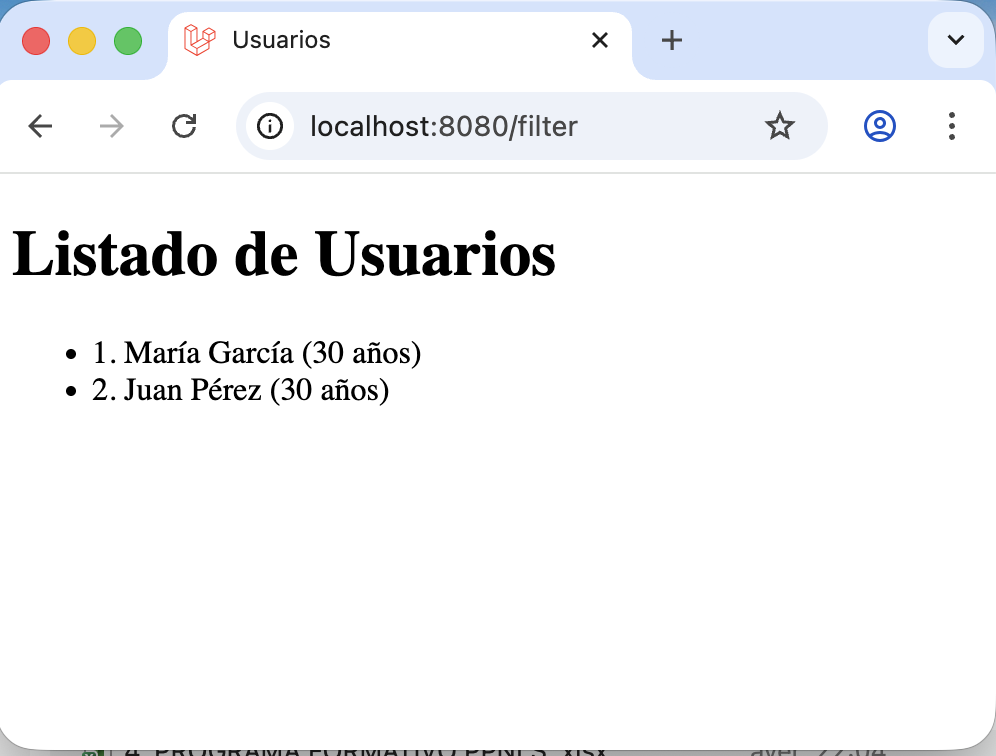

# Controladores

!!! quote "Autoría de este tema"

    El contenido de este tema (las lecciones, la actividad y los anexos) es obra de **Javier Beteta**, del curso [*Introducción a Laravel*](https://jbeteta-ies.github.io/2025_Laravel_32/). Adaptado para 2º DAW del IES Juan de Garay por Eva María Gómez Abad.

## Introducción

Los **controladores** son el componente que conecta las **rutas** con los **modelos** y las **vistas**. Con este tema completaremos el ciclo de creación de una aplicación web en Laravel siguiendo el patrón MVC.

!!! info ""

    Un controlador recibe las solicitudes de los usuarios, consulta los modelos si necesita datos, y devuelve una respuesta adecuada (generalmente una vista).

## Preparación del Entorno

### Crear la Base de Datos

1. Crear una base de datos nueva llamada `laravel` en tu gestor de base de datos (MySQL, SQLite, etc.). Si la tenemos creada del tema anterior podemos usar:

    !!! note "Eliminar las migraciones si las hubiera"

        ```sql
        php artisan migrate:reset
        ```

2. Configurar la conexión en el archivo `.env`:

    !!! note "Archivo .env"

        ```text
        DB_CONNECTION=mysql
        DB_HOST=mysql
        DB_PORT=3306
        DB_DATABASE=laravel
        DB_USERNAME=alumno
        DB_PASSWORD=alumno
        ```

3. Modificar la migración `create_users_table.php`, hemos añadido los campos `age`, `address` y `zipCode`:

    !!! note "create_users_table.php"

        ```php
        <?php
        Schema::create('users', function (Blueprint $table) {
                $table->id();
                $table->string('name');
                $table->string('email')->unique();
                $table->string('password');
                $table->unsignedInteger('age')->default(18);
                $table->string('address')->nullable();
                $table->unsignedBigInteger('zipCode')->nullable();
                $table->rememberToken();
                $table->timestamps();
            });
        ```

### Ejecutar las Migraciones

Una vez hemos modificado la migración de `users`, ejecutamos el comando para crear la tabla:

!!! note "Ejecutar migraciones"

    ```bash
    php artisan migrate
    ```

Comprobar que se crean las tablas correctamente.

## Creación del Primer Circuito MVC

Vamos a crear un circuito básico que nos permita ver cómo funcionan los controladores, las vistas y los modelos en Laravel. Para ello crearemos una aplicación (circuito completo) que muestre una lista de usuarios.

### Crear un Controlador

Hasta ahora hemos trabajado con las vistas `blade` y los modelos. Pero para completar el ciclo MVC, necesitamos un controlador que conecte las vistas con los modelos. El controlador se encargará de recibir las peticiones del usuario, consultar los modelos y devolver la vista correspondiente.

Crear un nuevo controlador `UserController`, para ello vamos a usar el comando de Artisan. Los controladores los denominamos con el sufijo `Controller` y los colocamos en la carpeta `app/Http/Controllers`.

!!! note "Crear controlador"

    ```bash
    php artisan make:controller UserController
    ```

y obtenemos el siguiente resultado:

!!! success "http/Controllers/UserController.php"

    ```php
    <?php

    namespace App\Http\Controllers;

    use Illuminate\Http\Request;

    class UserController extends Controller
    {
        //
    }
    ```

Esta clase será la base de nuestro controlador. Se encarga de gestionar las peticiones HTTP y devolver las respuestas adecuadas. En este caso, el controlador `UserController` se encargará de gestionar las peticiones relacionadas con los usuarios. En este momento no tiene ningún método, pero podemos añadir los que necesitemos.

### Implementación Básica del Controlador

Crear un método `index()`, este método mostrará de momento un mensaje de depuración. Este método se encargará de gestionar la petición GET a la ruta `/` y devolverá una vista con el listado de usuarios.

!!! note "Método index()"

    ```php
    <?php
    public function index() {
        dd('Hola desde UserController@index');
    }
    ```

### Asociar la Ruta con el Controlador

En `routes/web.php`:

!!! note "Definir ruta"

    ```php
    <?php

    use Illuminate\Support\Facades\Route;
    use App\Http\Controllers\UserController;

    Route::get('/', [UserController::class, 'index'])->name('user.index');
    ```

### Comprobaciones Iniciales

Acceder a [http://localhost:8080/](http://localhost:8080/) y comprobar que aparece el mensaje de depuración. Debe aparecer el mensaje `Hola desde UserController@index`, que creamos en la función `index()` del controlador `UserController`.

Si no aparece, comprobar que el servidor de desarrollo está en marcha y que la ruta está correctamente configurada.

### Crear la Vista de Usuarios

Pero el objetivo no es mostrar un mensaje de depuración, sino una vista con el listado de usuarios. Para ello, vamos a crear una vista `users/index.blade.php` que mostrará el listado de usuarios. Recuerda que la carpeta `views` está dentro de la carpeta `resources`. Vamos a crear una carpeta `users` dentro de `views` y dentro de esta carpeta crearemos el archivo `index.blade.php`.

Crear un archivo `/users/index.blade.php` con contenido:

!!! note "users/index.blade.php"

    ```html
    <!DOCTYPE html>
    <html lang="en">
    <head>
        <meta charset="UTF-8">
        <meta name="viewport" content="width=device-width, initial-scale=1.0">
        <meta http-equiv="X-UA-Compatible" content="ie=edge">
        <title>Usuarios</title>
    </head>
    <body>
        <h1>Lista de usuarios</h1>
    </body>
    </html>
    ```

### Probar el Circuito

Ahora hay que completar el controlador para que devuelva la vista que acabamos de crear. Para ello, en el método `index()` del controlador `UserController`, vamos a devolver la vista `users/index.blade.php`:

!!! note "Devolver vista"

    ```php
    <?php
    public function index() {
        return view('users.index');
    }
    ```

Acceder de nuevo a la URL y comprobar que se carga la vista.

## Trabajar desde el controlador con el Modelo

El siguiente paso es recuperar los datos de la base de datos. Para ello, vamos a usar el modelo `User` que hemos creado anteriormente. Este modelo se encarga de gestionar la tabla `users` de la base de datos.

### 1. Recuperar Información con `all()`

Ahora vamos a modificar el método `index()` del controlador `UserController` para que recupere todos los usuarios de la base de datos y los pase a la vista.

Para ello primero tenemos que hacer referencia al modelo `User` en la parte superior del controlador:

!!! note "Importar modelo User"

    ```php
    <?php
    use App\Models\User;
    ```

Ahora podemos utilizar los métodos del modelo `User` para recuperar los datos. Como `User` extiende de `Model`, podemos usar el método `all()` para recuperar todos los usuarios de la base de datos. Este método devuelve una colección de usuarios que podemos pasar a la vista. Internemante está ejecutando una sentencia `sql` como la siguiente:

```sql
SELECT * FROM users;    
```

Más adelante nos pararemos a ver estos métodos estáticos que ofrecen los modelos de Eloquent.

El equivalente a la sentencia SQL anterior en Eloquent es:

```php
<?php
$usuarios = User::all();
```

El modelo quedará como sigue:

!!! note "UserController.php"

    ```php
    <?php
    use App\Models\User;
    use Illuminate\Http\Request;
    namespace App\Http\Controllers;

    class UserController extends Controller
    {
        public function index() {
            $usuarios = User::all();
            return view('users.index');
        }
    }
    ```

### 2. Pasar Datos a la Vista

Si analizamos la clase anterior, vemos que tenemos aún un problema. No estamos pasando los datos a la vista. Para ello, tenemos que modificar la línea que devuelve la vista para que pase la colección de usuarios a la vista.

!!! note "Pasar datos a la vista"

    ```php
    <?php
    return view('users.index', ['usuarios' => $usuarios]);
    ```

De esta manera le pasamos un array asociativo a la vista, donde la clave `usuarios` contendrá la colección de usuarios que hemos recuperado de la base de datos. En `Laravel`cuando en un array asociativo la clave y el valor son iguales, podemos usar la sintaxis simplificada:

!!! note "Sintaxis simplificada"

    ```php
    <?php
    return view('users.index', compact('usuarios'));
    ```

La función `compact()` crea un array asociativo con las variables que le pasamos como parámetros. En este caso, creará un array con la clave `usuarios` y el valor de la variable `$usuarios`. Si tuvieramos que pasar más variables, podríamos hacerlo de la siguiente manera:

!!! note "Pasar más variables"

    ```php
    <?php
    return view('users.index', 
                compact('usuarios', 
                            'otraVariable', 
                            'otraVariable2'
                        )
                );
    ```

Ahora el método `index()` del controlador quedará así:

!!! note "UserController.php"

    ```php
    <?php
    public function index() {
        $usuarios = User::all();
        return view('users.index', compact('usuarios'));
    }
    ```

### 3. Modificar la Vista para Mostrar Datos

Vamos a modificar la vista `users/index.blade.php` para que muestre el listado de usuarios. Para ello, vamos a usar la sintaxis de `Blade` para mostrar los datos.

!!! note "users/index.blade.php"

    ```html
    <h1>Listado de Usuarios</h1>
     <ul>
         @foreach ($usuarios as $usuario)
            <li>{{ $loop->iteration }}. 
                {{ $usuario->name }} 
                ({{ $usuario->age }} años)
            </li>
         @endforeach
     </ul>
    ```

La directiva `@foreach` nos permite recorrer la colección de usuarios y mostrar cada uno de ellos. La variable `$loop` es una variable especial que nos permite acceder a información sobre el bucle, como el índice actual (`$loop->iteration`) o si es el primer o último elemento del bucle. Otras opciones son:

| Opción | Descripción |
|---|---|
| `$loop->iteration` | Indica el número de iteración actual (empezando desde 1). |
| `$loop->count` | Indica el número total de elementos en el bucle. |
| `$loop->first` | Indica si es el primer elemento del bucle. |
| `$loop->last` | Indica si es el último elemento del bucle. |
| `$loop->index` | Indica el índice actual del bucle (empezando desde 0). |
| `$loop->remaining` | Indica cuántos elementos quedan por recorrer. |
| `$loop->depth` | Indica la profundidad del bucle (en caso de bucles anidados). |

Vamos a probar ahora si estas modificaciones funcionan correctamente. Acceder a la URL [http://localhost:8080/](http://localhost:8080/) y comprobar que se muestra el listado de usuarios. Podemos ver que sólo se muestra el título de la página, ya que no tenemos usuarios en la base de datos. Para poder mejorar esta situación vamos a añadir un mensaje que indique que no hay usuarios disponibles. Para ello utilizaremos la directiva `@if` de `Blade`:

!!! note "users/index.blade.php"

    ```html
    <h1>Listado de Usuarios</h1>

    @if ($usuarios->isEmpty())
        <p>No hay usuarios disponibles.</p>
    @else
        <ul>
            @foreach ($usuarios as $usuario)
                <li>{{ $loop->iteration }}. 
                    {{ $usuario->name }} ({{ $usuario->age }} años)
                </li>
            @endforeach            
        </ul>
    @endif
    ```

Podemos ver que hemos añadido una comprobación para ver si la colección de usuarios está vacía. Si está vacía, mostramos un mensaje indicando que no hay usuarios disponibles. Si hay usuarios, mostramos el listado.

**Uso de @switch**

`Blade` también nos permite usar la directiva `@switch` para realizar comprobaciones múltiples. En este caso, vamos a comprobar la edad de cada usuario y mostrar un mensaje diferente según su edad.

!!! note "users/index.blade.php"

    ```html
    @foreach ($usuarios as $usuario)
        @switch(true)
            @case($usuario->age < 18)
                <p>{{ $usuario->name }} es menor de edad.</p>
                @break

            @case($usuario->age >= 18 && $usuario->age <= 65)
                <p>{{ $usuario->name }} es adulto.</p>
                @break

            @default
                <p>{{ $usuario->name }} es jubilado.</p>
        @endswitch
    @endforeach
    ```

En este caso, estamos comprobando la edad de cada usuario y mostrando un mensaje diferente según su edad. La directiva `@switch` nos permite realizar comprobaciones múltiples de una manera más legible que usando múltiples `if`.

### 4. Crear Datos de Prueba

Ahora que tenemos el circuito completo, vamos a crear algunos usuarios de prueba para poder ver cómo funciona la aplicación. Lo lógico sería tener un formulario para crear usuarios, pero para simplificar el proceso, vamos a crear un método en el controlador que inserte un usuario de prueba directamente en la base de datos. Para ello, vamos a crear un método `create()` en el controlador `UserController` que se encargará de crear un usuario de prueba. Este método se encargará de insertar un usuario en la base de datos y redirigir a la vista de listado de usuarios. Este método se llamará cuando accedamos a la ruta `/create`.

#### Crear Ruta y Método Create

Para crear los usuarios vamos a aprovechar y utilizar diferentes formas de insertar datos en la base de datos. Vamos a crear un usuario de prueba directamente en el controlador y otro usuario usando el método `create()` del modelo `User`. Para ello, vamos a crear un nuevo método `create()` en el controlador `UserController` que se encargará de crear los usuarios.

Para el password vamos a usar el método `Hash::make()` para encriptar la contraseña. Este método se encarga de encriptar la contraseña usando el algoritmo de encriptación que tengamos configurado en el archivo `.env`. Por defecto, Laravel usa el algoritmo `bcrypt`, que es un algoritmo seguro y recomendado para encriptar contraseñas. Para poder usar este método, tenemos que importar la clase `Hash` en la parte superior del controlador:

!!! note "Importar clase Hash en UserController.php"

    ```php
    <?php
    use Illuminate\Support\Facades\Hash;
    ```

Por último vamos a utilizar la función `redirect()` para redirigir al usuario a la vista de listado de usuarios después de crear el usuario. Esta función se encarga de redirigir al usuario a la ruta que le indiquemos. En este caso, redirigimos a la ruta `user.index`, que es la ruta que hemos creado anteriormente para mostrar el listado de usuarios. Así una vez creados los usuarios nos redirigiremos a la vista de listado de usuarios. Resaltar que en la redirección utilizamos el nombre de la ruta que hemos creado anteriormente, `user.index`, en lugar de la URL completa. Esto es una buena práctica, ya que si cambiamos la URL de la ruta, no tendremos que modificar el código del controlador.

!!! warning "$fillable"

    Acordarse de modificar el modelo y añadir a `$fillable` los campos que vamos a insertar. En este caso, los campos `name`, `email`, `password`, `age`, `address` y `zipCode`. De esta manera, Eloquent podrá insertar los datos en la base de datos sin problemas.

!!! note "UserController.php"

    ```php
    <?php
    public function create() {
        // creamos el usuario María utilizando el modelo
        $usuario = new User();
        $usuario->name = 'María García';
        $usuario->email = 'mgarcia@example.com';
        $usuario->password = Hash::make('123456');
        $usuario->age = 30;
        $usuario->address = 'Calle Mayor 1';
        $usuario->zipCode = 28080;
        $usuario->save();

        // creamos el usuario Juan Pérez utilizando el método create()
        User::create([
            'name' => 'Juan Pérez',
            'email' => 'jperez@example.com',
            'password' => Hash::make('password'),
            'age' => 25,
            'address' => 'Calle Falsa 123',
            'zipCode' => 28080
        ]);

        // creamos el usuario José Flores utilizando el método create()
        User::create([
            'name' => 'José Flores',
            'email' => 'jflores@example.com',
            'password' => Hash::make('flores'),
            'age' => 25,
            'address' => 'Calle Falsa 123',
            'zipCode' => 28080
        ]);

        // redirigimos a la vista de listado de usuarios
        return redirect()->route('user.index');
    }
    ```

Una vez hemos modificado el controlador, tenemos que crear la ruta que se encargará de gestionar la petición a la URL `/create`. Esta ruta se encargará de llamar al método `create()` del controlador `UserController` y crear los usuarios. Para ello, vamos a crear una nueva ruta en el archivo `routes/web.php` que se encargará de gestionar la petición a la URL `/create`. En el archivo `routes/web.php` añadimos la siguiente línea:

!!! note "Definir ruta create"

    ```php
    <?php
    Route::get('/create', [UserController::class, 'create'])->name('user.create');
    ```

#### Comprobaciones

Acceder a `/create`. Si todo va bien primero se crearán los usuarios y luego se nos redirigirá a la vista de listado de usuarios. Por tanto nos debe aparecer el listado de usuarios con los tres usuarios que hemos creado. Si no aparece, comprobar que el servidor de desarrollo está en marcha y que la ruta está correctamente configurada.

[http://localhost:8080/create](http://localhost:8080/create)

## Consultas avanzadas desde el controlador

Ahora que tenemos los usuarios creados y hemos visto conseguido crear un circuito MVC completo. Vamos a ver de qué manera podemos realizar consultas más avanzadas desde el controlador. Para ello, vamos a ver cómo podemos filtrar los usuarios según diferentes criterios. Vamos a ver cómo podemos filtrar los usuarios por edad, código postal y otros criterios.

### Uso de where()

El método `where()` nos permite filtrar los resultados de la consulta según diferentes criterios. Este método se encarga de añadir una cláusula `WHERE` a la consulta SQL que se genera. Por ejemplo, si queremos filtrar los usuarios por edad, podemos hacerlo de la siguiente manera:

```php
<?php
$usuarios = User::where('age', '>=', 18)->get();
```

El segundo parámetro es el operador de comparación que queremos usar. Podemos usar los siguientes operadores:

| Operador | Descripción |
|---|---|
| `=` | Igual |
| `!=` | Diferente |
| `>` | Mayor que |
| `>=` | Mayor o igual que |
| `<` | Menor que |
| `<=` | Menor o igual que |
| `LIKE` | Coincide con patrón |
| `NOT LIKE` | No coincide con patrón |

Un ejemplo de que podemos usar el operador `LIKE` para filtrar los usuarios por nombre, por ejemplo si queremos filtrar los usuarios que empiezan por `M`:

```php
<?php
$usuarios = User::where('name', 'LIKE', 'M%')->get();
```

### Encadenar where()

Encadenar `where()` nos permite añadir múltiples condiciones a la consulta. Sería como añadir múltiples cláusulas `WHERE` encadenadas por `AND` a la consulta SQL. Por ejemplo, si queremos filtrar los usuarios por edad y código postal, podemos hacerlo de la siguiente manera:

```php
<?php
$usuarios = User::where('age', '>=', 18)
                ->where('zipCode', '=', 28080)
                ->get();
```

### Otros métodos de consulta

| Método | Descripción | Ejemplo |
|---|---|---|
| `whereBetween()` | Filtra los resultados según un rango de valores. | `User::whereBetween('age', [18, 30])->get();` |
| `whereIn()` | Filtra los resultados según una lista de valores. | `User::whereIn('zipCode', [28080, 28081])->get();` |
| `orWhere()` | Añade una cláusula `OR` a la consulta. | `User::orWhere('age', '<', 18)->get();` |
| `orderBy()` | Ordena los resultados según un campo. | `User::orderBy('name')->get();` |
| `first()` | Devuelve el primer resultado de la consulta. | `User::orderBy('name')->first();` |
| `find()` | Busca un registro por su ID. | `User::find(1);` |
| `findOrFail()` | Busca un registro por su ID y lanza una excepción si no lo encuentra. | `User::findOrFail(1);` |

## Ejemplos de consultas avanzadas

Vamos a ver algunos ejemplos de consultas avanzadas que podemos realizar desde el controlador. Estos ejemplos nos ayudarán a entender cómo podemos usar los métodos de Eloquent para realizar consultas más complejas.

Primero puedes descargar este [fichero SQL](https://jbeteta-ies.github.io/2025_Laravel_32/content/T05/resources/users.sql) y ejecutarlo en tu base de datos para tener más usuarios de prueba.

Una vez tenemos los usuarios de prueba, podemos realizar las siguientes consultas:

!!! note "Consultas avanzadas"

    ```php
    <?php

    // Ejemplo 1: Usar 'where' con AND
    $usuarios = User::where('age', '>=', 18)
                    ->where('zipCode', '=', 28080)
                    ->get();

    // Ejemplo 2: Usar 'where' con OR
    $usuarios = User::where('age', '>=', 18)
                    ->orWhere('zipCode', '=', 28080)
                    ->get();

    // Ejemplo 3: Usar 'where' con BETWEEN
    $usuarios = User::whereBetween('age', [18, 30])
                    ->get();

    // Ejemplo 4: Usar 'where' con LIKE (búsqueda por patrón)
    $usuarios = User::where('name', 'like', 'Juan%')
                    ->get();

    // Ejemplo 5: Usar 'where' con NOT LIKE
    $usuarios = User::where('name', 'not like', 'Juan%')
                    ->get();

    // Ejemplo 6: Usar 'whereIn' para buscar por múltiples valores
    $usuarios = User::whereIn('zipCode', [28080, 28081, 28082])
                    ->get();

    // Ejemplo 7: Usar 'whereNull' para encontrar valores nulos
    $usuarios = User::whereNull('address')
                    ->get();

    // Ejemplo 8: Usar 'whereNotNull' para encontrar valores no nulos
    $usuarios = User::whereNotNull('address')
                    ->get();

    // Ejemplo 9: Usar 'orWhereIn' con 'or' y 'whereIn'
    $usuarios = User::where('age', '>=', 18)
                    ->orWhereIn('zipCode', [28080, 28081])
                    ->get();

    // Ejemplo 10: Usar 'whereDate' para filtrar por fecha
    $usuarios = User::whereDate('created_at', '2025-10-08')
                    ->get();

    // Ejemplo 11: Usar 'whereDay' para filtrar por el día
    $usuarios = User::whereDay('created_at', 8)
                    ->get();

    // Ejemplo 12: Usar 'whereMonth' para filtrar por el mes
    $usuarios = User::whereMonth('created_at', '10')
                    ->get();
    ```

Puedes modificar el controlador, vamos a añadir un nuevo método `filter()` que se encargará de realizar pruebas de estas consultas avanzadas y mostrar los resultados en la vista. Para ello, vamos a crear un nuevo método `filter()` en el controlador `UserController` que se encargará de realizar las consultas avanzadas y mostrar los resultados en la vista. Este método se llamará cuando accedamos a la ruta `/filter`.

!!! note "UserController.php"

    ```php
    <?php
    public function filter() {
    $usuarios = User::where('age', '>=', 18)
                    ->where('zipCode', '=', 28080)
                    ->get();
    return view('users.index', compact('usuarios'));
    }
    ```

Y añadimos la ruta correspondiente en `routes/web.php`:

!!! note "Definir ruta filter"

    ```php
    <?php
    Route::get('/filter', [UserController::class, 'filter'])->name('user.filter');
    ```

El ejemplo anterior y utilizando los datos de prueba del curso debe devolver los siguientes usuarios:

!!! success "resultado"

    

## Resumen de todo lo aprendido

- Creación del circuito MVC completo.
- Recuperación de datos con Eloquent.
- Buenas prácticas de organización.

!!! warning "Nota"

    Eloquent facilita mucho el trabajo, pero a veces no controlamos el SQL exacto que se genera.

!!! info "Consejo"

    En un uso correcto de Eloquent, no es necesario preocuparse por el SQL generado. Eloquent se encarga de optimizar las consultas y generar el SQL adecuado. Sin embargo, es importante conocer cómo funciona Eloquent y cómo se generan las consultas para poder optimizar el rendimiento de la aplicación.

Para otros casos más complejos, podemos usar SQL puro o el constructor de consultas de Laravel. En este caso, Eloquent no es la mejor opción, tenemos otras opciones que analizaremos a continuación.

## Acceso a Base de Datos Alternativo

### Uso de SQL Puro con DB Raw

Laravel nos ofrece la clase `DB` para acceder a la base de datos de forma más directa. Esta clase nos permite ejecutar consultas SQL puras y obtener los resultados en forma de array. Para ello, podemos usar el método `select()` de la clase `DB`.

```php
<?php
$usuarios = DB::select(DB::raw('SELECT * FROM users'));
```

Si por ejemplo tenemos las tablas `users` y `posts`, podemos hacer una consulta SQL que una ambas tablas:

```php
<?php
$usuarios = DB::select(
    DB::raw('
        SELECT users.*, posts.title 
        FROM users 
            INNER JOIN posts ON users.id = posts.user_id')
        );
```

Esto nos devolverá un array con los resultados de la consulta. Sin embargo, al usar SQL puro, no tenemos acceso a las funcionalidades de Eloquent, como la paginación o la relación entre modelos. Por lo tanto, es recomendable usar Eloquent siempre que sea posible.

En el caso de que nuestras consultas tengan parámetros, es importante usar consultas preparadas para evitar inyecciones SQL. Para ello, podemos usar el método `select()` de la clase `DB` con parámetros:

```php
<?php
$edad = 18;
$zipCode = 28080;
$usuarios = DB::select(
    DB::raw('SELECT * FROM users WHERE age >= ? AND zipCode = ?'),
    [$edad, $zipCode]
);
```

Otra manera es utilizar `named bindings` para pasar los parámetros:

```php
<?php
$edad = 18;
$zipCode = 28080;
$usuarios = DB::select(
    DB::raw('SELECT * FROM users WHERE age >= :age AND zipCode = :zipCode'),
        [
            'age' => $edad, 
            'zipCode' => $zipCode
        ]
);
```

!!! warning "Importante"

    Al usar SQL puro, es importante tener cuidado con las consultas para evitar inyecciones SQL. Siempre que sea posible, es recomendable usar Eloquent o el constructor de consultas de Laravel para evitar este tipo de problemas.

### Métodos estáticos de DB

Laravel también nos ofrece métodos estáticos para acceder a la base de datos de forma más sencilla. Estos métodos nos permiten realizar operaciones CRUD (Crear, Leer, Actualizar y Borrar) de forma más sencilla. Por ejemplo, para insertar un nuevo usuario en la tabla `users`, podemos usar el método `insert()` de la clase `DB`.

Primero tenemos el método ::table() que nos permite acceder a una tabla específica de la base de datos. Este método nos devuelve una instancia de la clase `QueryBuilder`, que nos permite realizar consultas a la base de datos de forma más sencilla. Por ejemplo, para acceder a la tabla `users`, podemos usar el siguiente código:

```php
<?php
$usuarios = DB::table('users')->get();
```

Esto nos devolverá una colección de usuarios. A partir de aquí, podemos usar los métodos de la clase `QueryBuilder` para realizar consultas a la base de datos. Por ejemplo, para filtrar los usuarios por edad, podemos usar el método `where()`:

| Método | Descripción | Ejemplo |
|---|---|---|
| `insert()` | Inserta un nuevo registro en la tabla. | `DB::table('users')->insert(['name' => 'Pedro', 'email' => 'correo@example.com', 'password' => Hash::make('password')]);` |
| `update()` | Actualiza un registro en la tabla. | `DB::table('users')->where('id', 1)->update(['name' => 'Pedro Modificado']);` |
| `delete()` | Elimina un registro de la tabla. | `DB::table('users')->where('id', 1)->delete();` |
| `get()` | Recupera todos los registros de la tabla. | `DB::table('users')->get();` |
| `find()` | Busca un registro por su ID. | `DB::table('users')->find(1);` |
| `first()` | Recupera el primer registro de la tabla. | `DB::table('users')->first();` |
| `where()` | Filtra los resultados según una condición. | `DB::table('users')->where('age', '>=', 18)->get();` |
| `whereIn()` | Filtra los resultados según una lista de valores. | `DB::table('users')->whereIn('zipCode', [28080, 28081])->get();` |
| `orderBy()` | Ordena los resultados según un campo. | `DB::table('users')->orderBy('name')->get();` |
| `count()` | Cuenta el número de registros de la tabla. | `DB::table('users')->count();` |
| `sum()` | Suma un campo de la tabla. | `DB::table('users')->sum('age');` |
| `avg()` | Calcula el promedio de un campo de la tabla. | `DB::table('users')->avg('age');` |
| `max()` | Devuelve el valor máximo de un campo de la tabla. | `DB::table('users')->max('age');` |
| `min()` | Devuelve el valor mínimo de un campo de la tabla. | `DB::table('users')->min('age');` |

### Comparativa

| Técnica | Ventajas | Inconvenientes |
|---|---|---|
| Eloquent | Código limpio y fácil de mantener. | Menos control sobre SQL generado. |
| DB Raw | Total control del SQL. | Mayor riesgo de errores o inyecciones. |
| DB Table | Punto intermedio: estructura clara, control aceptable. | Menos flexibilidad que DB Raw. |

## Otras Opciones ORM en PHP

### **Eloquent (Laravel)**

- **Estilo activo ("Active Record")**: Cada modelo representa una tabla y cada instancia una fila.
- **Simplicidad**: Muy expresivo y fácil de aprender; integradísimo en Laravel.
- **Consultas rápidas**: Métodos como `where`, `orderBy`, `first`, `get` son encadenables.
- **Relaciones**: Define relaciones como `hasOne`, `hasMany`, `belongsTo`, etc.
- **Migraciones y Seeders**: Integración directa para manejar la estructura y datos de la base.
- **Eventos del modelo**: Hooks como `creating`, `updating`, `deleting`.
- **Carga perezosa y ansiosa** (`lazy/eager loading`): Optimización de consultas relacionadas.
- **Limitaciones**: No es lo más flexible para consultas muy complejas o estructuras fuera del estándar relacional.

---

### **Doctrine (Symfony y otros)**

- **Estilo de "Data Mapper"**: Los objetos son independientes de la base de datos.
- **ORM altamente flexible**: Perfecto para proyectos con modelos complejos o sistemas DDD (Domain-Driven Design).
- **Unit of Work**: Maneja cambios en objetos y sincroniza en lote a la base de datos.
- **Consultas DQL (Doctrine Query Language)**: Un lenguaje similar a SQL pero orientado a objetos.
- **Migraciones poderosas**: Control detallado del esquema de la base de datos.
- **Muy configurado por anotaciones, XML o YAML**: Más configuración que Eloquent, pero más potencia.
- **Más pesado de aprender**: Pero excelente para proyectos grandes o altamente customizados.

---

### **Propel**

- **Estilo activo (Active Record)**: Como Eloquent, los objetos representan directamente filas.
- **Generador de código**: Genera las clases PHP a partir de un esquema de base de datos o XML.
- **Consultas orientadas a objetos**: Fluent interface para construir consultas.
- **Soporte para múltiples bases de datos**: Puede trabajar con más de un motor en el mismo proyecto.
- **Migraciones**: Sistema de migraciones incorporado.
- **Algo menos popular hoy**: Ha sido desplazado en popularidad por Eloquent y Doctrine en nuevos proyectos.
- **Ideal para proyectos donde quieres definir tu modelo primero y generar el código después.**

---

### **RedBeanPHP**

- **Cero configuración**: No defines esquemas ni modelos manualmente.
- **Auto-creación de tablas y columnas**: A medida que insertas datos, RedBeanPHP crea lo necesario.
- **Muy sencillo y rápido de usar**: Perfecto para prototipos o pequeños proyectos.
- **Modo congelado (`freeze`) para producción**: Para evitar cambios automáticos en el esquema.
- **ORM basado en Active Record**: Pero muy dinámico (menos control sobre la estructura a mano).
- **Limitaciones**: No es ideal para bases de datos muy complejas o requerimientos de optimización avanzada.

---

### **Resumen general**

| ORM | Estilo | Ideal para | Principal ventaja |
|---|---|---|---|
| **Eloquent** | Active Record | Aplicaciones Laravel y CRUD rápidos | Sencillez y fluidez |
| **Doctrine** | Data Mapper | Grandes sistemas, arquitecturas complejas | Flexibilidad y control total |
| **Propel** | Active Record | Sistemas donde defines primero el esquema | Generación automática de modelos |
| **RedBeanPHP** | Active Record (muy dinámico) | Prototipos, apps pequeñas | Cero configuración |
