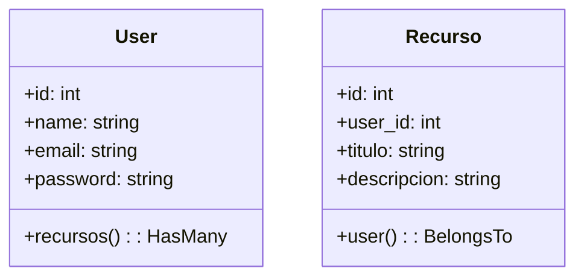

# Relaciones en Laravel.

!!! quote "Autoría"

    Contenido original de **Javier Beteta** en el curso [*Introducción a Laravel*](https://jbeteta-ies.github.io/2025_Laravel_32/) ([ver esta página en el original](https://jbeteta-ies.github.io/2025_Laravel_32/content/T05/unidad05_02/)). Adaptado para 2º DAW del IES Juan de Garay por Eva María Gómez Abad.

En Laravel, las relaciones entre modelos se definen utilizando métodos específicos en cada modelo. Estas relaciones permiten acceder a los datos relacionados de manera sencilla y eficiente. En esta sección, como ejemplo, nos centraremos en la relación **uno a muchos**, que es una de las más comunes en el desarrollo de aplicaciones.

## Objetivo

- Mostrar cómo acceder desde el **modelo padre** a sus elementos relacionados.
- Entender cómo funciona el método `hasMany()` cuando se usa desde el lado de la vista.
- Ver cómo `with('recursos')` optimiza las consultas evitando múltiples accesos a base de datos.

## Ejemplo: Usuarios → Recursos

Para este ejemplo, aprovechando que en el punto anterior ya hemos creado el modelo `User`, vamos a crear un nuevo modelo llamado `Recurso` que estará relacionado con `User` de forma que:



# 1. Crear la Migración de **recursos**

Vamos a intorudicr una relación uno a muchos (que suele ser la más común en bases de datos). Como ya tenemos la tabla `users`, vamos a crear la tabla `recursos` que tendrá una clave foránea apuntando a `users`. De manera que *un usuario puede tener muchos recursos*.

Primero explicamos que una relación **uno a muchos** en Laravel se construye añadiendo una **foreign key** que apunte al modelo padre.

Tal y como vimos al final del punto anterior podemos crear la migración y el modelo con un solo comando:

!!! note "Crear modelo y migración"

    ```bash
    php artisan make:model Recurso -m
    ```

Contenido recomendado para la migración:

!!! note "Migración de recursos"

    ```php
    <?php
    Schema::create('recursos', function (Blueprint $table) {
        $table->id();
        $table->foreignId('user_id')->constrained()->onDelete('cascade');
        $table->string('titulo');
        $table->text('descripcion')->nullable();
        $table->timestamps();
        });
    ```

Importante:

- `user_id` es la clave foránea.
- `constrained()` busca la tabla `users` automáticamente.
- `onDelete('cascade')` borra los recursos del usuario si eliminamos al usuario.
- Cada recurso estará siempre asociado a un usuario válido.

!!! tip "Claves foráneas en Laravel"

    Si hemos mantenido la convención de nombrado, Laravel detectará automáticamente la relación entre `user_id` y `users.id`. Si no, podríamos especificar la tabla y columna manualmente con `constrained('users', 'id')`.

Ejecutar:

!!! note "Ejecutar migración"

    ```bash
    php artisan migrate
    ```

---

# 2. Crear el Modelo **Recurso**

Y modificamos el modelo:

!!! note "Modelo Recurso"

    ```php
    <?php
    class Recurso extends Model
    {
        protected $fillable = ['user_id', 'titulo', 'descripcion'];

        public function user()
        {
            return $this->belongsTo(User::class);
        }
    }
    ```

- `Recurso` es la **tabla hija**.
- `belongsTo(User::class)` indica que cada recurso tiene *un solo* usuario dueño.

---

# 3. Modificar el Modelo User

Para añadir la relación inversa:

!!! note "Modelo User"

    ```php
    <?php
    class User extends Model
    {
        public function recursos()
        {
            return $this->hasMany(Recurso::class);
        }
    }
    ```

Explicación:

- `User` es la **tabla padre**.
- `hasMany(Recurso::class)` significa que un usuario tiene cero, uno o muchos recursos.

# 4. Crear Controlador de **Recursos**

```bash
php artisan make:controller RecursoController
```

Ejemplo de método para mostrar recursos:

!!! note "RecursoController.php"

    ```php
    <?php
    public function index()
    {
        $recursos = Recurso::with('user')->get();

        return view('recursos.index', compact('recursos'));
    }
    ```

Ejemplo de método para crear un recurso nuevo asociado a un usuario:

!!! note "RecursoController.php"

    ```php
    <?php
    public function createForUser($id)
    {
        $user = User::findOrFail($id);

        Recurso::create([
            'user_id' => $user->id,
            'titulo' => 'Recurso de ejemplo',
            'descripcion' => 'Texto demostrativo para el alumno'
        ]);

        return redirect()->route('recursos.index');
    }
    ```

---

# 5. Rutas

En `web.php`:

!!! note "Rutas para recursos"

    ```php
    <?php
    use App\Http\Controllers\RecursoController;

    Route::get('/recursos', [RecursoController::class, 'index'])->name('recursos.index');
    Route::get('/recursos/create/{id}', [
            RecursoController::class, 'createForUser'
            ])->name('recursos.createForUser');
    ```

---

# 6. Crear Vista de Listado

Archivo: `resources/views/recursos/index.blade.php`

!!! note "Vista de recursos"

    ```html
    <h1>Listado de Recursos</h1>

    <ul>
    @foreach ($recursos as $recurso)
        <li>
            <strong>{{ $recurso->titulo }}</strong><br>
            Usuario: {{ $recurso->user->name }}<br>
            Descripción: {{ $recurso->descripcion }}
        </li>
    @endforeach
    </ul>
    ```

Esto les permite:

- Ver cómo acceder a la relación `$recurso->user`
- Entender cómo funciona `with('user')`
- Observar cómo Eloquent resuelve la relación automáticamente

!!! tip "Relación Uno a Muchos en Laravel"

    > Una relación **uno a muchos** en Laravel se implementa añadiendo una clave foránea en la tabla “hija” que referencia a la tabla “padre”.
    >
    > El modelo “padre” define un método `hasMany()`, y el modelo “hijo” un `belongsTo()`.
    >
    > Laravel resuelve la relación automáticamente, generando las consultas SQL necesarias para obtener los recursos de un usuario o el usuario al que pertenece un recurso.

---

# 7. Listar usuarios con sus recursos

Ahora que sabemos obtener los recursos y su usuario, vamos a ver la relación **desde el otro lado**: obtener los usuarios que tienen recursos y mostrarlos con un listado anidado.

## Controlador

Añadimos un método en `UserController`:

!!! note "UserController.php"

    ```php
    <?php
    public function usersWithResources()
    {
        $usuarios = User::with('recursos')
                        ->has('recursos')
                        ->get();

        return view('users.withResources', compact('usuarios'));
    }
    ```

## Ruta

!!! note "Ruta para usuarios con recursos"

    ```php
    <?php
    Route::get('/usersWithResources', [
                    UserController::class, 'usersWithResources'
                    ])->name('users.withResources');
    ```

## Vista (`resources/views/users/withResources.blade.php`)

!!! note "Vista de usuarios con recursos"

    ```html
    <h1>Usuarios con recursos</h1>

    <ul>
    @foreach ($usuarios as $usuario)
        <li>
            <strong>{{ $usuario->name }}</strong> ({{ $usuario->email }})

            <ul>
                @foreach ($usuario->recursos as $recurso)
                    <li>
                        {{ $recurso->titulo }}
                        @if($recurso->descripcion)
                            – {{ $recurso->descripcion }}
                        @endif
                    </li>
                @endforeach
            </ul>
        </li>
    @endforeach
    </ul>
    ```

# 8. Conclusión

En esta sección hemos visto cómo definir y utilizar relaciones **uno a muchos** en Laravel. Hemos aprendido a crear migraciones con claves foráneas, definir los métodos de relación en los modelos, y acceder a los datos relacionados desde los controladores y las vistas. Esta es una parte fundamental del desarrollo de aplicaciones con Laravel, ya que la mayoría de las aplicaciones requieren manejar relaciones entre diferentes entidades.
