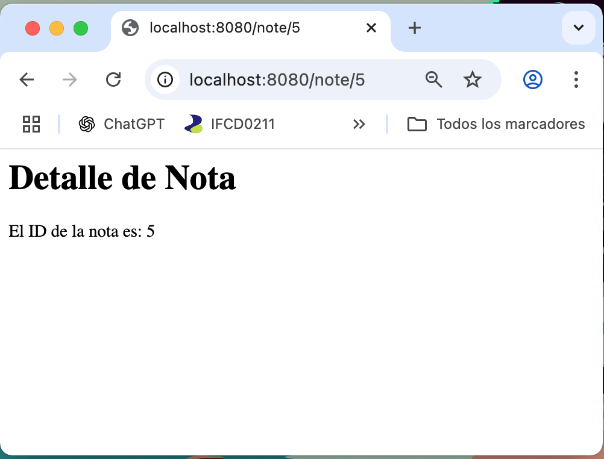
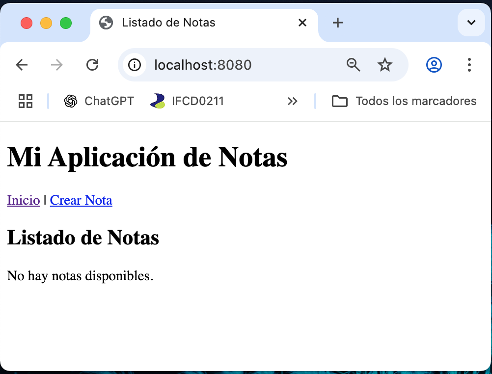
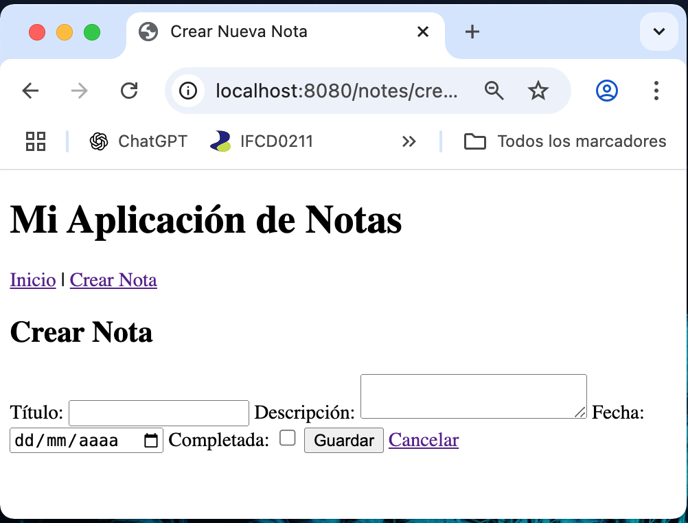
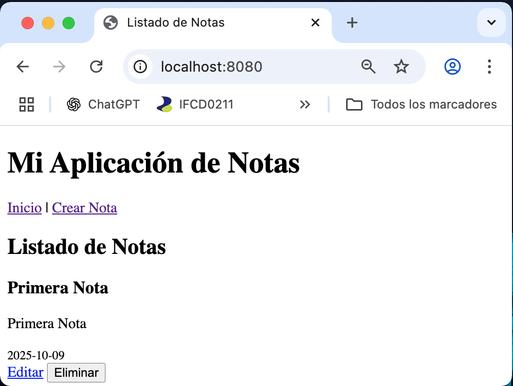
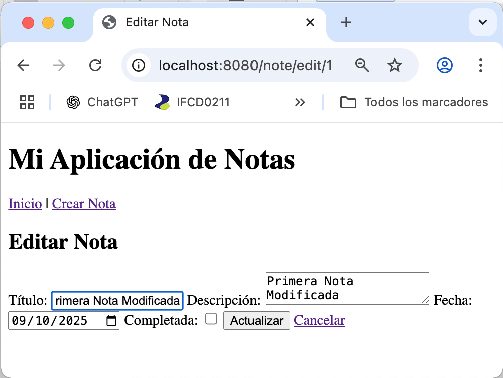
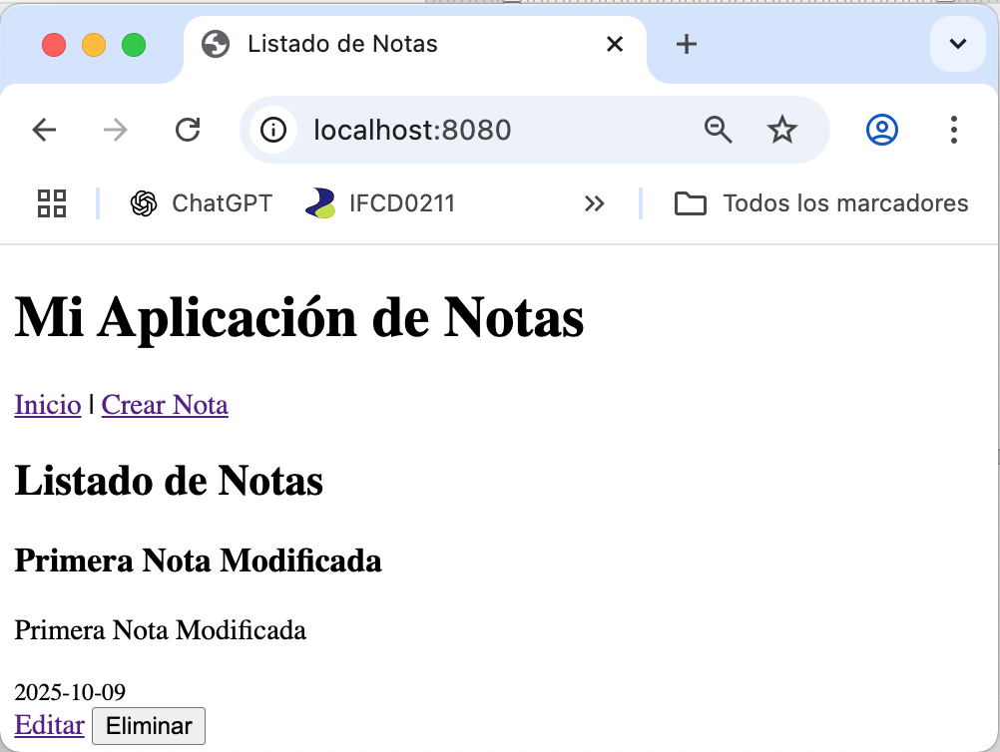
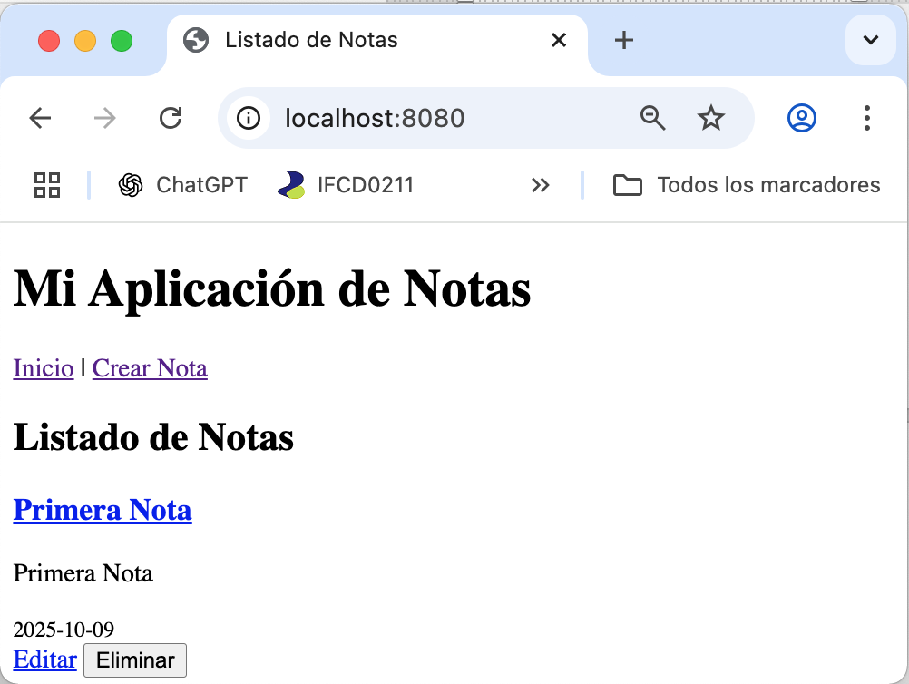
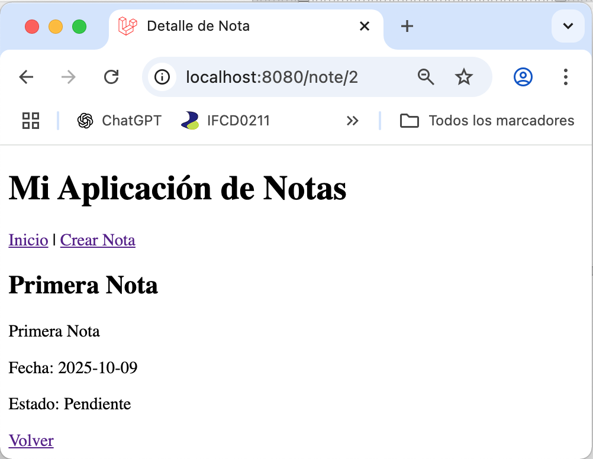
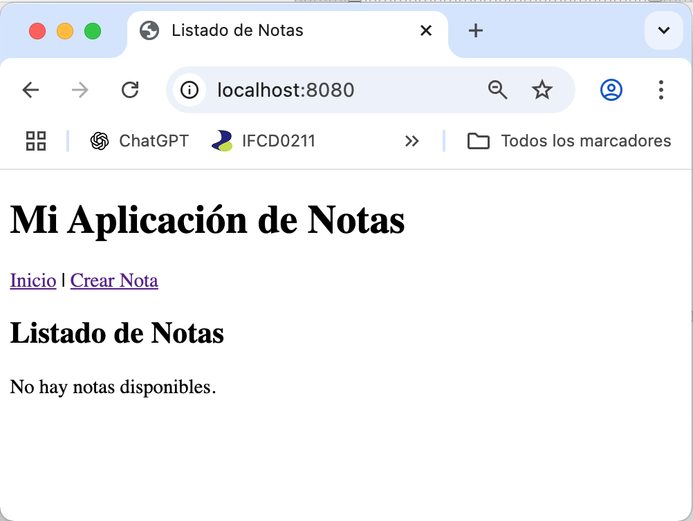

# Desarrollo de un CRUD

!!! quote "Autoría de este tema"

    El contenido de este tema (las lecciones, la actividad y los anexos) es obra de **Javier Beteta**, del curso [*Introducción a Laravel*](https://jbeteta-ies.github.io/2025_Laravel_32/). Adaptado para 2º DAW del IES Juan de Garay por Eva María Gómez Abad.

## Introducción a CRUD

El término **CRUD** corresponde a las operaciones básicas que se realizan en la mayoría de las aplicaciones que gestionan datos:

- **C**reate (Crear): Insertar nuevos datos.
- **R**ead (Leer): Consultar y visualizar datos.
- **U**pdate (Actualizar): Modificar datos existentes.
- **D**elete (Eliminar): Borrar datos.

En Laravel, la implementación de un CRUD completo nos permite comprender cómo los **Modelos**, **Controladores** y **Vistas** interactúan entre sí para ofrecer una experiencia de usuario completa.

!!! tip "Desarrollo de CRUDs"

    Dominar el desarrollo de CRUDs es básico para cualquier programador web, ya que casi todas las aplicaciones web tienen que manejar datos de algún tipo, y estas son las acciones fundamentales que se realizan sobre esos datos.

Además, este tema nos va a servir para aprender el funcionamiento de los formularios en Laravel.

## Rutas Dinámicas y Controladores

### Parámetros dinámicos en rutas

En Laravel, podemos definir rutas que aceptan **parámetros dinámicos**. Estos parámetros permiten que una misma ruta atienda solicitudes distintas según el valor proporcionado. Podemos permitirnos el *símil* de que el nombre de la ruta es el nombre de la función y los parámetros son los argumentos que recibe esa función. Por tanto nos va a permitir generar una respuesta dinámica en función de los parámetros que reciba.

**Ejemplo sencillo:**

```php title="Ruta con Parámetro Dinámico"
<?php
Route::get('/nota/{id}', function ($id) {
    return "Mostrando la nota con ID: $id";
});
```

En este caso, `id` es un parámetro dinámico. Si accedemos a `http://localhost:8080/nota/5`, Laravel mostrará: "Mostrando la nota con ID: 5".

**Múltiples parámetros:**

```php title="Ruta con Múltiples Parámetros"
<?php
Route::get('/usuario/{id}/nota/{nota_id}', function ($id, $nota_id) {
    return "Usuario $id - Nota $nota_id";
});
```

!!! warning "Importante"

    El orden de los parámetros en la URL debe coincidir exactamente con el orden de los parámetros en la función anónima o el controlador.

### Crear un circuito MVC rápido para rutas dinámicas

**Modelo:** Vamos a utilizar una tabla `notes` con los campos:

- `id` (entero, autoincremental)
- `title` (string)
- `description` (text)
- `date` (date)
- `done` (boolean)

Vamos a crear la migración de la nota y el controador:

!!! note "Crear Migración y Modelo"

    ```bash
    php artisan make:migration create_notes_table
    php artisan make:model Note
    ```

Podemos crearla migración y la nota con un solo comando:

!!! note "Crear Modelo y Migración"

    ```bash
    php artisan make:model Note -m
    ```

Ahora vamos al archivo de migración `database/migrations/xxxx_xx_xx_create_notes_table.php` y añadimos los campos:

!!! note "Migración"

    ```php
    <?php
    use Illuminate\Database\Migrations\Migration;
    use Illuminate\Database\Schema\Blueprint;
    use Illuminate\Support\Facades\Schema;

    class CreateNotesTable extends Migration
    {
        /**
         * Run the migrations.
         *
         * @return void
         */
        public function up()
        {
            Schema::create('notes', function (Blueprint $table) {
                $table->id();
                $table->string('title');
            $table->text('description');
            $table->date('date');
            $table->boolean('done')->default(false);
            $table->timestamps();
        });
    }
    public function down()
    {
        Schema::dropIfExists('notes');
    }
    ```

Por último, ejecutamos la migración:

!!! note "Ejecutar Migración"

    ```bash
    php artisan migrate
    ```

Si tenemos algún problema porque no hemos creado la base de datos desde 0, podemos eliminar las migraciones anteiores con:

!!! note "Resetear Migraciones"

    ```bash
    php artisan migrate:reset
    ```

**Modelo Note:**

Ahora vamos a implementar el modelo `Note`. Vamos a definir los campos que se pueden asignar en masa y los que no:

!!! note "Modelo"

    ```php
    <?php
    namespace App\Models;
    use Illuminate\Database\Eloquent\Model;

    class Note extends Model
    {
        protected $fillable = ['title', 'description', 'date', 'done'];
        protected $guarded = ['id'];
    }
    ```

- `$fillable`: Define qué campos se pueden asignar en masa.
- `$guarded`: Define qué campos **no** se pueden asignar.

**Controlador NoteController:**

!!! note "Crear Controlador"

    ```bash
    php artisan make:controller NoteController
    ```

Ahora codificamos el controlador `app/Http/Controllers/NoteController.php`:

!!! note "método show, para mostrar un ID"

    ```php
    <?php
    public function show($id)
    {
        return view('notes.show', compact('id'));
    }
    ```

**Ruta asociada:**

Ahora que ya tenemos el controlador y el método que manejará la ruta, y el modelo que se conectará con la base de datos, vamos a definir la ruta en `routes/web.php`:

!!! note "Ruta con Parámetro Dinámico y Controlador"

    ```php
    <?php
    use App\Http\Controllers\NoteController;

    Route::get('/note/{id}', [NoteController::class, 'show'])->name('note.show');
    ```

**Vista `resources/views/notes/show.blade.php`:**

Por último nos queda crear la vista que mostrará la información de la nota con el ID recibido:

!!! note "Vista show.blade.php"

    ```html
    <h1>Detalle de Nota</h1>
    <p>El ID de la nota es: {{ $id }}</p>
    ```

Con esto, accediendo a `/note/5` veremos "El ID de la nota es: 5".

!!! success "imagen /note/5"

    

!!! tip "función compact()"

    La función `compact('variable')` crea un array asociativo `['variable' => $variable]` que puede ser pasado a la vista. Es una forma rápida y limpia de pasar datos. Sólo la puedo utilizar si el valor de la clave es el mismo que el nombre de la variable.

### Parámetros opcionales y valores por defecto

Podemos definir parámetros **opcionales** añadiendo un signo de interrogación `?`:

```php title="Ruta con Parámetro Opcional"
<?php
Route::get('/saludo/{nombre?}', function ($nombre = 'Invitado') {
    return "Hola, $nombre";
});
```

- Si accedemos a `/saludo/Laura`, veremos "Hola, Laura".
- Si accedemos a `/saludo`, veremos "Hola, Invitado".

!!! warning "Reglas para Parámetros Opcionales"

    - El parámetro opcional debe ser el último de la URL.
    - Hay que asignar un **valor por defecto** en la función.

### Importancia del orden de las rutas

Laravel evalúa las rutas en el **orden en que se definen**.

**Ejemplo de conflicto:**

```php title="Orden de Rutas"
<?php
Route::get('/nota/nueva', function() { return 'Crear nueva nota'; });
Route::get('/nota/{id}', function($id) { return "Nota ID: $id"; });
```

- Primero debe definirse `/nota/nueva` porque si no, Laravel intentará interpretar `nueva` como un `id`.
- El orden correcto es siempre de **rutas más específicas a más generales**.

!!! warning "Consejo"

    Primero define todas las rutas fijas y luego las rutas con parámetros dinámicos.

## Desarrollo del CRUD para notas

### Listar todas las notas

Primero creamos la ruta y el método para listar todas las notas.

**Ruta:**

!!! note "Ruta para Listar Notas"

    ```php
    <?php
    use App\Http\Controllers\NoteController;

    Route::get('/', [NoteController::class, 'index'])->name('note.index');
    ```

**Controlador:**

!!! note "método index, para listar todas las notas"

    ```php
    <?php
    use App\Models\Note;
    public function index()
    {
        $notes = Note::all();
        return view('notes.index', compact('notes'));
    }
    ```

**Explicación de @forelse vs @foreach:**

- `@foreach` se utiliza para recorrer elementos, pero no gestiona si el array está vacío.
- `@forelse` permite recorrer elementos y además definir qué hacer si no hay elementos.

Ejemplo:

```html title="Listado de Notas"
@forelse ($notes as $note)
    <p>{{ $note->title }}</p>
@empty
    <p>No hay notas disponibles.</p>
@endforelse
```

En el ejemplo anterior, si `$notes` está vacío, se mostrará "No hay notas disponibles."

**Crear layout base en `resources/views/layouts/app.blade.php`:**

!!! note "Layout"

    ```html
    <!DOCTYPE html>
    <html lang="es">
    <head>
        <meta charset="UTF-8">
        <title>@yield('title')</title>
    </head>
    <body>
        <header>
            <h1>Mi Aplicación de Notas</h1>
            <nav>
                <a href="{{ route('note.index') }}">Inicio</a> |
                <a href="{{ route('note.create') }}">Crear Nota</a>
            </nav>
        </header>
        <main>
            @yield('content')
        </main>
    </body>
    </html>
    ```

**Vista de Listado `resources/views/notes/index.blade.php`:**

En este formulario vamos a adelantar algunas cosas que ampliaremos más adelante. Para poner el enlace a eliminar una nota, vamos a utilizar un formulario con el método `POST` y la directiva `@method('DELETE')`. Esta directiva simula el método HTTP DELETE en formularios HTML (que solo permiten GET y POST). Más adelante explicaremos esto con más detalle. Hasta aquí nada especialmente llamativo. Pero también veréis que está la directiva `@csrf`. Esta directiva genera un campo oculto con un token que protege el formulario contra ataques CSRF (Cross-Site Request Forgery). Más adelante también explicaremos esto con más detalle. En `laravel` esta protección es automática, pero hay que incluir la directiva `@csrf` en los formularios para que funcione correctamente.

!!! note "Listado de Notas"

    ```html
    @extends('layouts.app')

    @section('title', 'Listado de Notas')

    @section('content')
        <h2>Listado de Notas</h2>

        @forelse ($notes as $note)
            <div>
                <h3><a href="{{ route('note.show', $note->id) }}">{{ $note->title }}</a></h3>
                <p>{{ $note->description }}</p>
                <small>{{ $note->date }}</small>
                <div>
                    <a href="{{ route('note.edit', $note->id) }}">Editar</a>
                    <form action="{{ route('note.destroy', $note->id) }}" method="POST" style="display:inline">
                        @csrf
                        @method('DELETE')
                        <button type="submit">Eliminar</button>
                    </form>
                </div>
            </div>
        @empty
            <p>No hay notas disponibles.</p>
        @endforelse
    @endsection
    ```

---

### Crear una Nueva Nota

Para poder crear una nota necesitamos tres cosas:

1. Una ruta que muestre el formulario de creación, `/note/create`.
2. Un método en el controlador que maneje esa ruta y muestre la vista con el formulario: `function create()`.
3. Una vista que contenga el formulario de creación: `resources/views/notes/create.blade.php`.

**Ruta para formulario de creación:**

!!! note "Ruta para Crear Nota"

    ```php
    <?php
    Route::get('/note/create', [NoteController::class, 'create'])->name('note.create');
    ```

**Controlador:**

!!! note "método create, para mostrar el formulario de creación"

    ```php
    <?php
    public function create()
    {
        return view('notes.create');
    }
    ```

**Vista `resources/views/notes/create.blade.php`:**

!!! note "Formulario de Crear Nota"

    ```html
    @extends('layouts.app')

    @section('title', 'Crear Nueva Nota')

    @section('content')
        <h2>Crear Nota</h2>
        <form action="{{ route('note.store') }}" method="POST">
            @csrf
            <label>Título:</label>
            <input type="text" name="title" required>

            <label>Descripción:</label>
            <textarea name="description" required></textarea>

            <label>Fecha:</label>
            <input type="date" name="date" required>

            <label>Completada:</label>
            <input type="checkbox" name="done">

            <button type="submit">Guardar</button>
            <a href="{{ route('note.index') }}">Cancelar</a>
        </form>
    @endsection
    ```

---

### Guardar la Nueva Nota

Al igual que en el caso anterior, para guardar la nota necesitamos dos cosas. Una ruta que maneje el envío del formulario y un método en el controlador que procese los datos y guarde la nota en la base de datos. Al final, redirigiremos a la lista de notas.

**Ruta para guardar:**

!!! note "Ruta para Guardar Nota"

    ```php
    <?php
    Route::post('/note/store', [NoteController::class, 'store'])->name('note.store');
    ```

**Controlador:**

Para guardar la nota, podemos usar diferentes métodos. Aquí mostramos dos formas:

!!! note "Guardar Nota"

    ```php
    <?php
    public function store(Request $request)
    {
        $note = new Note();
        $note->title = $request->input('title');
        $note->description = $request->input('description');
        $note->date = $request->input('date');
        $note->done = $request->input('done') ? 1 : 0;
        $note->save();
        // Redirigir a la lista de notas
        return redirect()->route('note.index');
    }
    ```

O usando el método `create`:

!!! note "Guardar Nota"

    ```php
    <?php
    public function store(Request $request)
    {
        Note::create($request->all());
        return redirect()->route('note.index');
    }
    ```

!!! tip "Nota sobre campos checkbox"

    En el caso de los campos `checkbox`, si no se marca, no se envía ningún valor, es decir, en el request no existirá la clave `done` y por tanto este campo no se actualizará.

    Para solucionarlo, podemos usar una expresión ternaria:

    ```php
    $done = $request->input('done') ? 1 : 0;
    ```

    para asignar un valor por defecto de `0` cuando no se marque el checkbox. O simplememnte comprobar si el campo existe en el request y asignar `1` si existe o `0` si no existe

Por tanto tenemos que modificar el método `store` para que el campo `done` se actualice correctamente:

!!! note "Guardar Nota"

    ```php
    <?php
    public function store(Request $request)
    {
        $data = $request->all();
        $data['done'] = $request->has('done');

        Note::create($data);

        return redirect()->route('note.index');
    }
    ```

**Explicaciones Adicionales:**

- `@csrf` protege contra ataques CSRF (Cross-Site Request Forgery).
- `$request->all()` devuelve todos los datos enviados en el formulario.
- Laravel valida automáticamente que el token CSRF esté presente. Si no lo está, lanzará un error.

¿Cómo funciona CSRF?

- Laravel genera un token único para cada sesión de usuario.
- Este token se incluye en cada formulario generado por Laravel.
- Cuando se envía el formulario, Laravel verifica que el token enviado coincida con el de la sesión.
- Si no coinciden, Laravel lanza un error 419 (Page Expired).
- Esto previene que un atacante envíe formularios en nombre del usuario sin su consentimiento.

---

### Editar una Nota

**Ruta para formulario de edición:**

!!! note "Ruta para Editar Nota"

    ```php
    Route::get('/note/edit/{note}', [NoteController::class, 'edit'])->name('note.edit');
    ```

**Controlador:**

Tenemos varias formas de recibir el parámetro `note`. En esta primer recibimos el ID y buscamos la nota, para poder pasarla a la vista:

!!! note "método edit, para mostrar el formulario de edición"

    ```php
    <?php
    public function edit($id)
    {
        $note = Note::findOrFail($id);
        return view('notes.edit', compact('note'));
    }
    ```

En esta segunda forma, recibimos el modelo `Note`. De esta manera es Laravel el que se encarga de buscar la nota. Cuando trabajamos con modelos, esta es la forma recomendada:

!!! note "método edit, con inyección de modelo"

    ```php
    <?php
    public function edit(Note $note)
    {
        return view('notes.edit', compact('note'));
    }
    ```

**Vista `resources/views/notes/edit.blade.php`:**

En este caso la ruta la hemos definido con el método `PUT`. Este método es el que se utiliza para actualizar los datos de un recurso existente. Pero ¿cómo hacerlo si las opciones de `form` solo permiten `GET` y `POST`?. Laravel nos ofrece una solución sencilla: la directiva `@method('PUT')`. Esta directiva simula el método PUT en formularios HTML. Esta directiva debe estar dentro del formulario y antes de los inputs.

```html title="Editar Nota"
<form id="sample-form" action="somepage.php" method="POST">
    @csrf
    @method('PUT')
    <!-- Otros campos del formulario -->
</form>
```

Con este formato el formulario se enviará como un PUT, aunque el método del formulario sea POST.

!!! note "Formulario de Editar Nota"

    ```html
    @extends('layouts.app')

    @section('title', 'Editar Nota')

    @section('content')
        <h2>Editar Nota</h2>
        <form action="{{ route('note.update', $note->id) }}" method="POST">
            @csrf
            @method('PUT')
            <label>Título:</label>
            <input type="text" name="title" value="{{ $note->title }}" required>

            <label>Descripción:</label>
            <textarea name="description" required>{{ $note->description }}</textarea>

            <label>Fecha:</label>
            <input type="date" name="date" value="{{ $note->date }}" required>

            <label>Completada:</label>
            <input type="checkbox" name="done" {{ $note->done ? 'checked' : '' }}>

            <button type="submit">Actualizar</button>
            <a href="{{ route('note.index') }}">Cancelar</a>
        </form>
    @endsection
    ```

    - `@method('PUT')` simula el método HTTP PUT en formularios HTML (que solo permiten GET y POST).

---

### Actualizar la Nota

**Ruta para actualizar:**

!!! note "Ruta para Actualizar Nota"

    ```php
    <?php
    Route::put('/note/update/{note}', [NoteController::class, 'update'])->name('note.update');
    ```

**Controlador:**

En este caso también tenemos dos formas de recibir el parámetro `Note $note`. En esta primer caso recibimos la *nota* y `laravel` por inyección de modelo la busca por nosotros y en el segundo caso recibimos el *ID* y buscamos la nota nosotros.

!!! note "método update, con inyección de modelo"

    ```php
    <?php
    public function update(Request $request, Note $note)
    {
        $note->update($request->all());
        return redirect()->route('note.index');
    }
    ```

!!! note "método update, buscando por ID"

    ```php
    <?php
    public function update(Request $request, $id)
    {
        $note = Note::findOrFail($id);
        $note->update($request->all());
        return redirect()->route('note.index');
    }
    ```

!!! tip "Problema con los checkbox en update"

    En este caso tenemos el mismo problema que en el método `store` con el campo `done`. Si no se marca el checkbox, no se envía ningún valor y por tanto este campo no se actualizará. Para solucionarlo, podemos usar una expresión ternaria para asignar un valor por defecto de `0` cuando no se marque el checkbox. O simplememnte comprobar si el campo existe en el request y asignar `1` si existe o `0` si no existe.

!!! note "método update, con solución para checkbox"

    ```php
    <?php
    public function update(Request $request, Note $note)
    {
        $data = $request->all();
        $data['done'] = $request->has('done');          
        $note->update($data);
        return redirect()->route('note.index');
    }
    ```

### Mostrar una Nota Individual

**Ruta para mostrar:**

!!! note "Ruta para Mostrar Nota"

    ```php
    <?php
    Route::get('/note/show/{note}', [NoteController::class, 'show'])->name('note.show');
    ```

**Controlador:**

En este caso también tenemos dos formas de recibir el parámetro `Note $note`. En esta primer caso recibimos la *nota* y `laravel` por inyección de modelo la busca por nosotros y en el segundo caso recibimos el *ID* y buscamos la nota nosotros.

!!! note "método show, buscando por ID"

    ```php
    <?php
    public function show($id)
    {
        $note = Note::findOrFail($id);
        return view('notes.show', compact('note'));
    }
    ```

!!! note "método show, para mostrar una nota individual"

    ```php
    <?php
    public function show(Note $note)
    {
        return view('notes.show', compact('note'));
    }
    ```

**Vista `resources/views/notes/show.blade.php` actualizada:**

!!! note "Mostrar Nota"

    ```html
    @extends('layouts.app')

    @section('title', 'Detalle de Nota')

    @section('content')
        <h2>{{ $note->title }}</h2>
        <p>{{ $note->description }}</p>
        <p>Fecha: {{ $note->date }}</p>
        <p>Estado: {{ $note->done ? 'Completada' : 'Pendiente' }}</p>
        <a href="{{ route('note.index') }}">Volver</a>
    @endsection
    ```

---

### Eliminar una Nota

**Ruta para eliminar:**

!!! note "Ruta para Eliminar Nota"

    ```php
    <?php
    Route::delete('/note/destroy/{note}', [NoteController::class, 'destroy'])->name('note.destroy');
    ```

**Controlador:**

Como en los casos anteriores, tenemos dos formas de recibir el parámetro `Note $note`. En esta primer caso recibimos la *nota* y `laravel` por inyección de modelo la busca por nosotros y en el segundo caso recibimos el *ID* y buscamos la nota nosotros.

!!! note "método destroy, buscando por ID"

    ```php
    <?php
    public function destroy($id)
    {
        $note = Note::findOrFail($id);
        $note->delete();
        return redirect()->route('note.index');
    }
    ```

!!! note "método destroy, para eliminar una nota"

    ```php
    <?php
    public function destroy(Note $note)
    {
        $note->delete();
        return redirect()->route('note.index');
    }
    ```

    - El método `delete()` elimina el registro de la base de datos.

### Prueba completa del CRUD

Ahora vamos probar todas las funcionalidades del CRUD:

!!! info "Aspecto del ejemplo"

    Al no utilizar nada de CSS, el aspecto es muy básico. En un proyecto real, se debería aplicar estilos CSS para mejorar la apariencia y usabilidad.

1. **Listar Notas:** Accede a la ruta `/` para ver el listado de notas.

    !!! success "imagen /"

        

2. **Crear Nota:** Haz clic en "Crear Nota", rellena el formulario y envíalo.

    Al hacer click en "Crear Nota" se accede a `/note/create`:

    !!! success "imagen /note/create"

        

    Una vez rellenado el formulario lo enviamos al servidor (ruta `/note/store`) y volvemos al listado de notas.

    !!! success "imagen /"

        

    Podemos ver la nota creada y como aparecen los enlaces para editar y eliminar.

3. **Editar Nota:** Haz clic en "Editar" junto a una nota, modifica los datos y envía el formulario.

    Al hacer click en "Editar" se accede a `/note/edit/{id}`:

    !!! success "imagen /note/edit/1"

        

    Una vez modificado el formulario lo enviamos al servidor (ruta `/note/update/{id}`) que actualiza la nota y nos redirecciona al listado de notas.

    !!! success "imagen /"

        

4. **Mostrar Nota:** Haz clic en el título de una nota para ver sus detalles.

    Al hacer click en el título de una nota se accede a `/note/show/{id}`:

    !!! success "imagen /"

        

    !!! success "imagen /note/show/1"

        

    Una vez vista pulsamos volver y nos redirecciona al listado de notas.

5. **Eliminar Nota:** Haz clic en "Eliminar" junto a una nota. Al hacer click en "Eliminar" se envía un formulario con método `DELETE` a la ruta `/note/destroy/{id}` que elimina la nota y nos redirecciona al listado de notas.

    !!! warning "Confirmación de Eliminación"

        En un proyecto real, es recomendable añadir una confirmación antes de eliminar una nota para evitar eliminaciones accidentales.

    !!! success "imagen /"

        

### Tipado en los métodos del controlador

**Ejemplo de tipado correcto:**

```php
<?php
public function update(
            Request $request, 
            Note $note
        ): RedirectResponse
{
    $note->update($request->all());
    return redirect()->route('note.index');
}
```

- Tipar los parámetros mejora la legibilidad y control de errores.
- Tipar el tipo de retorno ayuda a Laravel a validar internamente las respuestas.

!!! tip "Tipos comunes de retorno"

    - `View` para devolver vistas. `use Illuminate\View\View`
    - `RedirectResponse` para redirecciones. `use Illuminate\Http\RedirectResponse`
    - `JsonResponse` para APIs. `use Illuminate\Http\JsonResponse`
