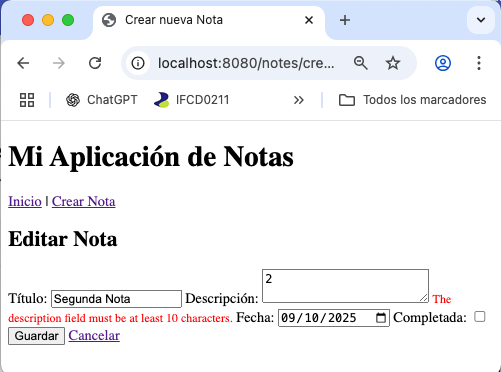
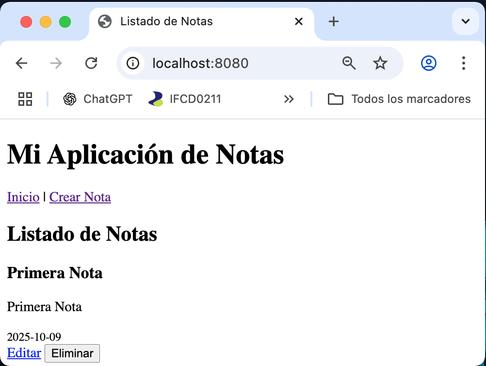

# Validaciones, Rutas Resource y Mensajes del Sistema

!!! quote "Autoría"

    Contenido original de **Javier Beteta** en el curso [*Introducción a Laravel*](https://jbeteta-ies.github.io/2025_Laravel_32/) ([ver esta página en el original](https://jbeteta-ies.github.io/2025_Laravel_32/content/T07/unidad07_01/)). Adaptado para 2º DAW del IES Juan de Garay por Eva María Gómez Abad.

## Validación de Datos

### ¿Qué es la validación y por qué es necesaria?

La validación es el proceso mediante el cual se verifica que los datos enviados por el usuario cumplen con unas reglas antes de ser almacenados en la base de datos.

Laravel ofrece un sistema de validación muy robusto, que nos permite validar datos tanto desde el controlador como mediante clases personalizadas.

!!! tip "Importante"

    Siempre debemos validar los datos **antes de almacenarlos** y **antes de actualizarlos**. Nunca debemos asumir que lo que llega del formulario es seguro o correcto.

### Validar desde el controlador usando `$request->validate()`

#### Aclaración sobre el campo `done`

En este caso vamos a utilizar un `checkbox` para marcar si la nota está completada o no. En el formulario, si el checkbox está marcado, se enviará `done=on`, y si no está marcado, no se enviará nada. Para evitar problemas con el `on` vamos a modificar la vista de creación y edición de notas para que el valor enviado sea `1` o `nada` en el caso de no estar marcado.

!!! note "Checkbox en los formularios crear y editar"

    ```html
    <input type="checkbox" name="done" value="1">
    ```

El método `$request->validate()` es una forma rápida y sencilla de validar los datos directamente en el controlador. Recibe un array con las reglas de validación para cada campo. Si la validación falla, Laravel redirige automáticamente al formulario anterior con los errores y los datos antiguos.

Este método permite validar directamente dentro del método del controlador:

!!! note "Función store()"

    ```php
    <?php
    public function store(Request $request)
    {
        $validated = $request->validate([
            'title' => 'required|string|max:255',
            'description' => 'required|string|min:10',
            'date' => 'required|date',
            'done' => 'nullable|boolean'
        ]);

        Note::create($validated);
        return redirect()->route('note.index')->with('success', 'Nota creada correctamente.');
    }
    ```

Cuando la validación falla, Laravel redirige automáticamente al formulario anterior. Una buena técnica es utilizar el método `old()` para recuperar el valor anterior del campos de manera que el usuario no tenga que volver a escribirlo.

```html
<input name="title" value="{{ old('title') }}">
```

Haremos esto en todos los campos. Cuídado con los `textarea` que no tienen `value` y con los `checkbox`. Por ejemlo, para el `checkbox`:

```html
<input type="checkbox" name="done" value="1" {{ old('done') ? 'checked' : '' }}>
```

Esto mostrará el checkbox marcado si el valor anterior era

1

.

#### Reglas comunes de validación:

| Regla | Descripción |
|---|---|
| `required` | El campo es obligatorio |
| `string` | Debe ser una cadena de texto |
| `min:n` | Longitud mínima de caracteres |
| `max:n` | Longitud máxima de caracteres |
| `date` | Debe ser una fecha válida |
| `boolean` | true/false, 0/1, "yes"/"no" |
| `nullable` | El campo puede estar vacío |

### Crear una clase de validación personalizada

Aunque en la documentación oficial de Laravel podemos encontrar un sinfín de reglas de validación, a veces necesitamos una validación más compleja o personalizada. Para ello como ejemplo vamos a crear una vlase de validación para un DNI español, que tiene un formato específico de 8 dígitos seguidos de una letra mayúscula.

1. Primer paso, crear la clase de validación personalizada:

```bash
php artisan make:rule isDNI
```

Esto creará una clase en `app/Rules/isDNI.php`.

Ahora vamos a ver cómo sería la implementación de esta clase para validar un DNI español:

```php title="Clase de validación personalizada para DNI"
<?php
namespace App\Rules;

use Closure;
use Illuminate\Contracts\Validation\ValidationRule;

class isDNI implements ValidationRule
{
    public function validate(string $attribute, mixed $value, Closure $fail): void
    {
        $value = strtoupper($value);

        if (!preg_match('/^\d{8}[A-Z]$/', $value)) {
            $fail('El :attribute no tiene un formato válido.');
            return;
        }

        $numero = substr($value, 0, 8);
        $letra = substr($value, -1);

        $letras = 'TRWAGMYFPDXBNJZSQVHLCKE';
        $letraCorrecta = $letras[$numero % 23];

        if ($letra !== $letraCorrecta) {
            $fail('El :attribute no es un DNI válido.');
        }
    }
}
```

Ahora ya lo podemos usar en nuestras reglas de validación:

```php
<?php
use App\Rules\DniValido;
$request->validate([
    'dni' => ['required', new DniValido],
]);
```

### Crear una clase FormRequest personalizada

Las clases `FormRequest` son una forma más estructurada de manejar la validación. Permiten separar la lógica de validación del controlador, lo que hace que el código sea más limpio y mantenible. Normalmente se crean para escenarios de validación compleja. Estas clases encapsulan la lógica de validación y autorización de una petición HTTP específica. Ahora, como ejemplo, vamos a crear una clase `NoteRequest` para manejar la validación de las notas.

Comando:

```bash
php artisan make:request NoteRequest
```

Esto creará una clase en `app/Http/Requests/NoteRequest.php`

**Método `authorize()`**

Este método define si el usuario tiene permiso para hacer esta petición. Para este curso lo dejaremos en `true`:

!!! tip "Importante"

    Si este método devuelve `false`, la validación no se ejecutará y se lanzará un error 403 (Forbidden).

!!! note "Autorizar la petición"

    ```php
    <?php
    public function authorize()
    {
        return true;
    }
    ```

**Método `rules()`**

Ahora vamos a definir unas reglas de validación de ejmeplo para nuestro ejemplo de notas:

!!! note "Ejemplo de reglas"

    ```php
    <?php
    public function rules()
    {
        return [
            'title' => 'required|string|max:255',
            'description' => 'required|string|min:10',
            'date' => 'required|date',
            'done' => 'nullable|boolean'
        ];
    }
    ```

**Uso en el controlador:**

En el controlador, en lugar de usar `Request $request`, usaremos `NoteRequest $request`. Laravel se encargará de validar automáticamente los datos antes de ejecutar el método.

!!! note "Almacenar una nota"

    ```php
    <?php
    public function store(NoteRequest $request)
    {
        $data = $request->all();
        $data['done'] = $request->has('done') ? 1 : 0; // Convert checkbox to boolean
        Note::create($data);
        return redirect()->route('note.index');
    }
    ```

Antes de modificar el `update()`recordar que en la vista de edición el checkbox se envía como `done=on` o no se envía nada. Hacemos en esta vista lo mismo que en la de creación:

```html
<input type="checkbox" name="done" value="1" {{  ($note->done) ? 'checked' : '' }}>
```

Hacemos lo mismo para el método `update()`:

!!! note "Actualizar una nota"

    ```php
    <?php
    public function update(NoteRequest $request, Note $note)
    {
        $note->update($request->all());
        return redirect()->route('note.index');
    }
    ```

## Mostrar Errores de Validación

### Mostrar errores en el formulario

Para el usuario es importante recibir feedback inmediato sobre los errores en el formulario. Laravel facilita esto con la variable `$errors` disponible en las vistas.

Puedes mostrar un error específico junto a cada campo:

```html
<input name="title" value="{{ old('title') }}">
@error('title')
    <small style="color:red">{{ $message }}</small>
@enderror
```

### Resaltar campos con error (CSS)

También puedes añadir una clase CSS al campo si tiene error, para destacarlo visualmente según diseño de la aplicación:

```html title="Resaltar campos con CSS"
<input name="title" class="@error('title') is-invalid @enderror">
```

Y luego en CSS puedes estilizar la clase `.is-invalid`.

### Mostrar todos los errores juntos

!!! note "Mostrar errores en la parte superior del formulario"

    ```html
    @if ($errors->any())
        <div class="alert alert-danger">
            <ul>
                @foreach ($errors->all() as $error)
                    <li>{{ $error }}</li>
                @endforeach
            </ul>
        </div>
    @endif
    ```

### Modificar la vista de edición como lo hicimos en la de creación

La vista de creación debe haber quedado así:

!!! note "Vista de creación"

    ```html
    @extends('layouts.app')

    @section('title', 'Crear nueva Nota')

    @section('content')
        <h2>Editar Nota</h2>
        <form action="{{ route('note.store') }}" method="POST">
            @csrf
            <label>Título:</label>
            <input type="text" name="title" value="{{ old('title') }}" required>
            @error('title')
                <small style="color:red">{{ $message }}</small>
            @enderror

            <label>Descripción:</label>
            <textarea name="description" required>{{ old('description') }}</textarea>
            @error('description')
                <small style="color:red">{{ $message }}</small>
            @enderror

            <label>Fecha:</label>
            <input type="date" name="date" value="{{ old('date') }}" required>
            @error('date')
                <small style="color:red">{{ $message }}</small>
            @enderror

            <label>Completada:</label>
            <input type="checkbox" name="done" {{ old('done') ? 'checked' : '' }}>

            <button type="submit">Guardar</button>
            <a href="{{ route('note.index') }}">Cancelar</a>
            @error('done')
                <small style="color:red">{{ $message }}</small>
            @enderror
        </form>
    @endsection
    ```

también modificamos la vista del formulario de edición para mostrar los mensajes de error:

!!! note "Vista de edición"

    ```html
    @extends('layouts.app')

    @section('title', 'Editar Nota')

    @section('content')
        <h2>Editar Nota</h2>
        <form action="{{ route('note.update', $note->id) }}" method="POST">
            @csrf
            @method('PUT')
            <label>Título:</label>
            <input type="text" name="title" value="{{ $note->title }}" required>
            @error('title')
                <small style="color:red">{{ $message }}</small>
            @enderror

            <label>Descripción:</label>
            <textarea name="description" required>{{ $note->description }}</textarea>
            @error('description')
                <small style="color:red">{{ $message }}</small>
            @enderror

            <label>Fecha:</label>
            <input type="date" name="date" value="{{ $note->date }}" required>
            @error('date')
                <small style="color:red">{{ $message }}</small>
            @enderror

            <label>Completada:</label>
            <input type="checkbox" name="done" {{ $note->done ? 'checked' : '' }}>

            <button type="submit">Actualizar</button>
            <a href="{{ route('note.index') }}">Cancelar</a>
            @error('done')
                <small style="color:red">{{ $message }}</small>
            @enderror
        </form>
    @endsection
    ```

Algunos métodos interesantes de laravel que no hemos utilizado pero que se usan a menudo son:

| Clase | Método | Descripción |
|---|---|---|
| `Illuminate\Support\Facades\Validator` | `make()` | Crear un validador |
| `Illuminate\Support\Facades\Validator` | `fails()` | Verificar si la validación falló |
| `Illuminate\Support\Facades\Validator` | `errors()` | Obtener los errores de validación |
| `Illuminate\Support\Facades\Validator` | `validate()` | Validar y redirigir automáticamente |
| `Illuminate\Support\Facades\Request` | `old()` | Obtener el valor anterior de un campo |
| `Illuminate\Support\Facades\Request` | `flash()` | Guardar datos en la sesión para la siguiente petición |

Ahora vamos a probar a crear una nota con una descripción inferir a los 10 caracteres y veremos el mensaje de error.

!!! success "Validación de datos"

     { width=400px }

Ahora corregimos el error y vemos que la nota se crea correctamente. Además nos aparece un mensaje de éxito.

!!! success "Validación de datos"

     { width=400px }

Ahora podéis comprobar que:

- En la edición las validaciones y mensajes de éxito funcionan igual.
- El campo ´done´ funciona correctamente tanto en creación como en edición.

!!! failure "campo `done`"

    Si has seguido al pie de la letra las instrucciones, el campo `done` no va a funcionar. Al añadir la clase `NoteRequest` pedimos que el campo sea `boolean` pero a este punto está llegando un `on` cuando el checkbox está marcado, o nada cuando no lo está. Y por tanto no llegaremos nunca a que se ejecute el método `store()` o `update()`, que es donde estábamos manejando el valor del checkbox.

**Solución**

Necesitamos que cuando se valida el campo `done`, si está marcado llegue como `true` y si no está marcado como `false`. Ya que en la validación hemos especificado que debe ser un booleano. Para ello vamos a usar el método `prepareForValidation()` que nos permite modificar los datos antes de que se apliquen las reglas de validación.

!!! note "Modificar datos antes de validar"

    Añadimos este método en la clase `NoteRequest`:

    ```php
    <?php
    protected function prepareForValidation()
    {
        $this->merge([
            'done' => $this->done ? true : false,
        ]);
    }
    ```

De esta manera nos aseguramos que el campo `done` siempre llega como `1` o `0`, y por tanto la validación funciona correctamente.

!!! info "prepareForValidation()"

    Este método es muy útil para modificar cualquier dato antes de que se aplique la validación. Por ejemplo, podríamos usarlo para formatear fechas, convertir cadenas a mayúsculas/minúsculas. No siempre la información que llega del formulario está en el formato que necesitamos para validar o almacenar. Y que no esté en el formato no significa que no sea válido. Pero la validación de `laravel` es estricta y debemos asegurarnos que los datos cumplen las reglas que hemos definido.

---

### Traducir los mensajes de error

Laravel trae sus mensajes de error por defecto en inglés. Hasta la versión los ficheros de traducción se encontraban en `resources/lang/en/validation.php`. A partir de Laravel 10 es necesario activar el sistema de traducción para que se publiquen los archivos de idioma. Para ello ejecutamos el siguiente comando:

```bash
php artisan lang:publish
```

Esto creará los archivos de traducción en `src/lang/`. Ahora si queremos traducir los mensajes de error al castellano, por ejemplo, podemos copiar el archivo `src/lang/en/validation.php` a `src/lang/es/validation.php` y traducir los mensajes.

Para que Laravel use el idioma español, debemos configurar el valor de `locale` en el archivo `config/app.php`:

```php
'locale' => 'es',
```

## Mensajes de Éxito

Para mejorar la experiencia del usuario, es buena práctica mostrar mensajes de éxito o error después de operaciones como crear, actualizar o eliminar. PPara ello vamos a usar los mensajes flash, que permiten mandar un mensaje entre peticiones almacenándolo en la sesión.

### Flash de sesión con `with()`

Este método permite guardar un mensaje en la sesión que se mostrará en la siguiente petición. Vamos a usarlo para mostrar un mensaje de éxito después de crear o actualizar o eliminar una nota.

En la función `store()` del controlador:

```php
<?php
return redirect()->route('note.index')->with('success', 'Nota guardada correctamente.');
```

En la función `update()`:

```php
<?php
return redirect()->route('note.index')->with('success', 'Nota actualizada correctamente.');
```

En la función

destroy()

:

```php
<?php
return redirect()->route('note.index')->with('danger', 'Nota eliminada correctamente.');
```

### Mostrar el mensaje en la vista (por ejemplo, en layout):

!!! note "Mostrar mensaje de éxito"

    ```html
    @if (session('success'))
        <div class="alert alert-success">
            {{ session('success') }}
        </div>
    @endif
    @if (session('danger'))
        <div class="alert alert-danger">
            {{ session('danger') }}
        </div>
    @endif
    ```

O incluirlo como partial:

**_partials/messages.blade.php**

!!! note "Partial para mensajes"

    ```html
    @if (session('success'))
        <div class="alert alert-success" 
                style="padding: 10px; margin-bottom: 20px; 
                        background-color: #d4edda; 
                        color: #155724; 
                        border-color: #c3e6cb; 
                        border-radius: 5px;">
            {{ session('success') }}
        </div>
    @endif
    @if (session('danger'))
        <div class="alert alert-danger" 
            style="padding: 10px; margin-bottom: 20px; 
                    background-color: #f8d7da; 
                    color: #721c24; 
                    border-color: #f5c6cb; 
                    border-radius: 5px;">
            {{ session('danger') }}
        </div>
    @endif
    ```

Y en el layout:

```html
@include('_partials.messages')
```

## Rutas Resource

### ¿Qué son?

Las rutas `Route::resource()` generan automáticamente todas las rutas necesarias para un CRUD completo. De esta manera nos ahorramos definir todas las rutas para todos los modelos.

```php
<?php
Route::resource('note', NoteController::class);
```

### Acciones generadas

| Ruta | Método | Acción |
|---|---|---|
| GET /note | index | Mostrar todas las notas |
| GET /note/create | create | Formulario para nueva nota |
| POST /note | store | Guardar nueva nota |
| GET /note/{note} | show | Mostrar una nota |
| GET /note/{note}/edit | edit | Formulario para editar |
| PUT/PATCH /note/{note} | update | Actualizar nota |
| DELETE /note/{note} | destroy | Eliminar nota |

### Personalización

- Solo algunas rutas:

```php
<?php
Route::resource('note', NoteController::class)->only(['index', 'show']);
```

- Excluir algunas:

```php
<?php
Route::resource('note', NoteController::class)->except(['destroy']);
```

### Ver rutas disponibles

```bash
php artisan route:list
```

Te muestra todas las rutas definidas, su método, URI y nombre.

### Crear un controlador tipo resource

```bash
php artisan make:controller NoteController --resource
```

Este comando crea todos los métodos básicos (`index`, `create`, `store`, `show`, `edit`, `update`, `destroy`).

## Conclusiones

- Validar datos es esencial para proteger la integridad de la base de datos.
- Los mensajes de error y éxito mejoran la experiencia del usuario.
- Las rutas resource simplifican la estructura del código.
