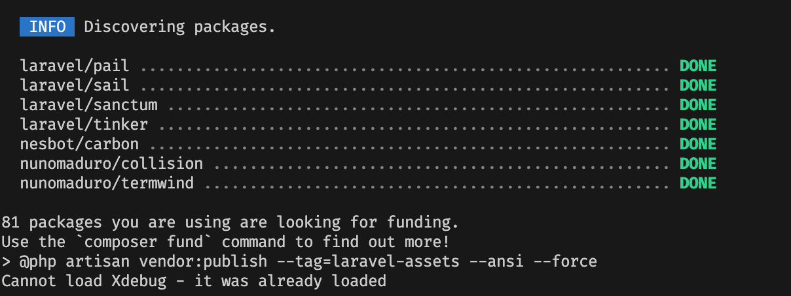
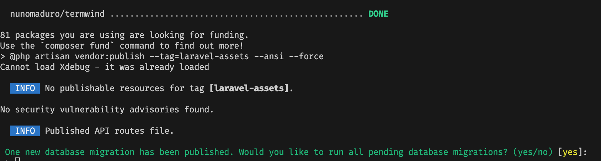
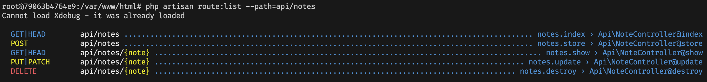
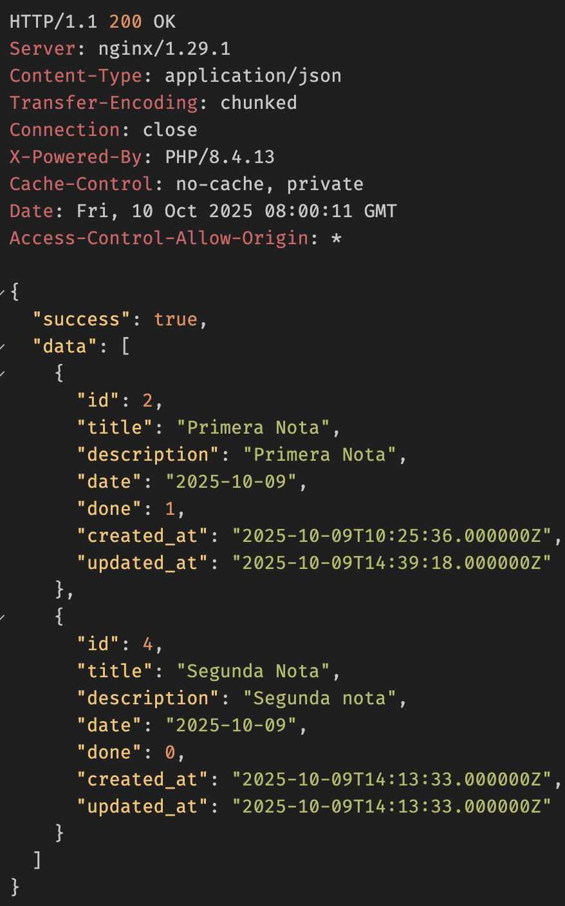
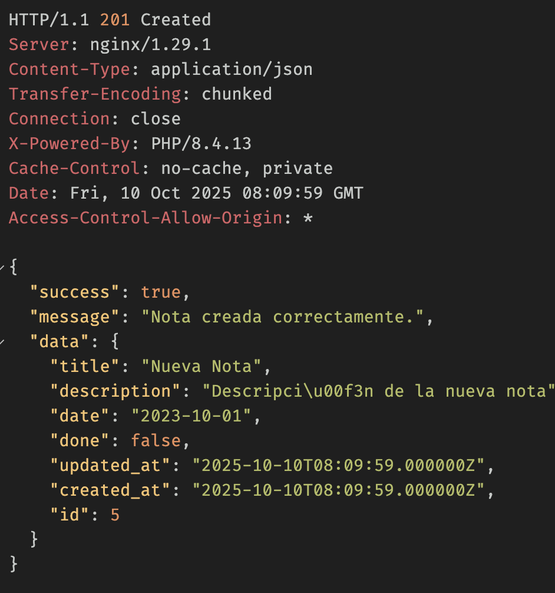
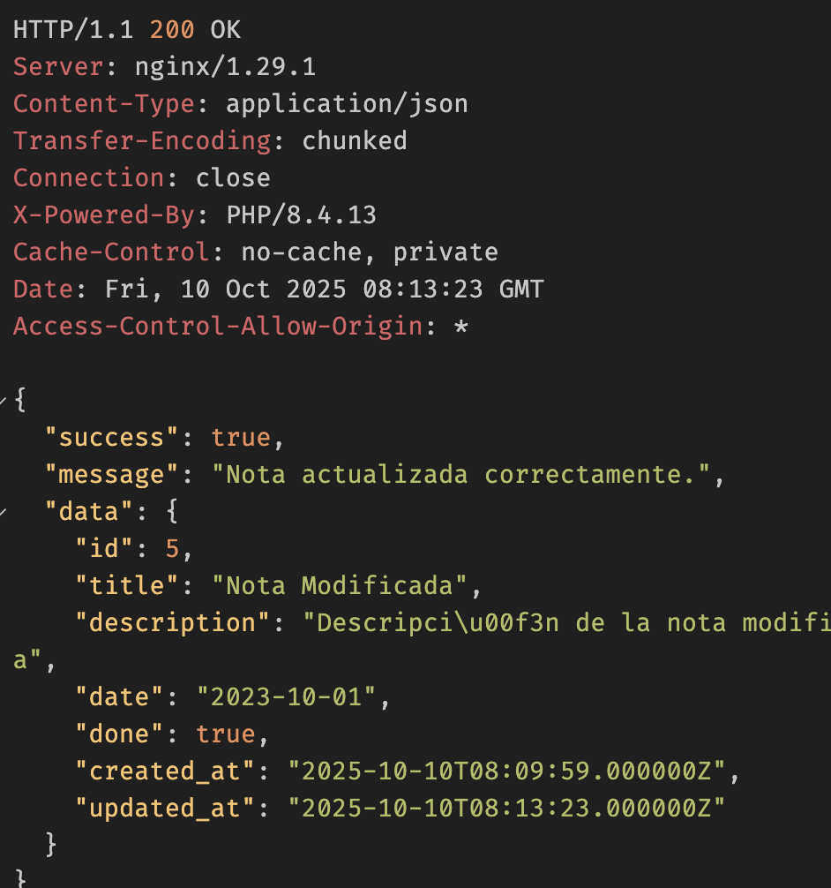
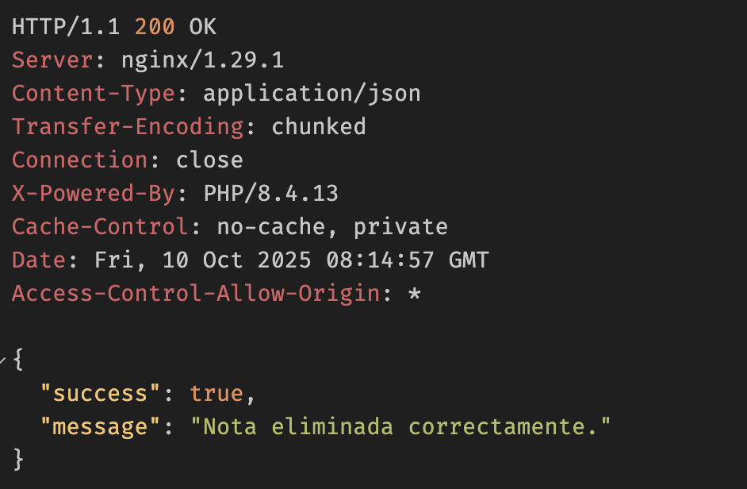
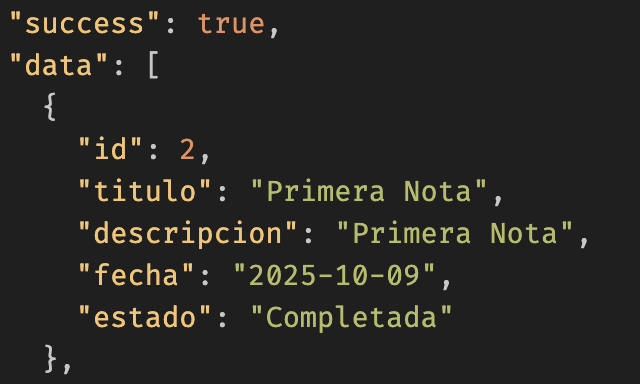
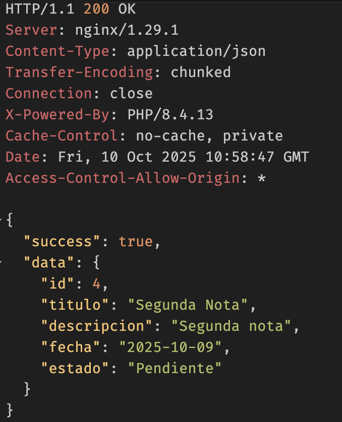

# Creación de APIs REST en Laravel

!!! quote "Autoría"

    Contenido original de **Javier Beteta** en el curso [*Introducción a Laravel*](https://jbeteta-ies.github.io/2025_Laravel_32/) ([ver esta página en el original](https://jbeteta-ies.github.io/2025_Laravel_32/content/T08/unidad08_01/)). Adaptado para 2º DAW del IES Juan de Garay por Eva María Gómez Abad.

## Rutas API

En **Laravel 12**, a diferencia de versiones anteriores, el archivo `routes/api.php` **no viene incluido por defecto**. Laravel ahora permite habilitarlo opcionalmente para mantener la aplicación más ligera si no vas a construir una API.

### Activar el sistema de rutas API

Para trabajar con rutas API, primero debemos ejecutar el siguiente comando Artisan:

!!! note "Instalar soporte de rutas API"

    ```bash
    php artisan install:api
    ```

Este comando:

- Crea automáticamente el archivo `routes/api.php`.
- Registra el archivo en el sistema de rutas.
- Aplica el middleware `api` a las rutas definidas allí.
- Añade el prefijo `/api` a todas las rutas de ese archivo.

En el proceso nos pude pedir crear una nueva migración para la tabla `api_tokens`, podemos decir que sí aunque de momento no la vamos a utilizar ya que no hemos visto la autenticación.

!!! info "Confirmación de creación de migración"

     

### ¿Dónde se registra esta configuración?

Laravel configura los archivos de rutas en `bootstrap/app.php`. Una vez activadas, podrás ver una línea como esta:

!!! info "Registro de rutas API con prefijo"

    ```php
    <?php
    ->withRouting(
        api: __DIR__.'/../routes/api.php',
        apiPrefix: 'api',
        // ...
    )
    ```

!!! tip "parámetro `apiPrefix`"

    Laravel no añade este prefijo automáticamente, pero su valor por defecto es `api`. Por tanto añadir esta línea o no es equivalente. Pero yo recomiendo ponerla explícitamente para tener claro que las rutas de `api.php` van con el prefijo `/api`.

Si quieres cambiar el prefijo, por ejemplo a `api/admin`, puedes modificar la clave `apiPrefix`:

!!! info "Personalizar prefijo de rutas API"

    ```php
    <?php
    ->withRouting(
        api: __DIR__.'/../routes/api.php',
        apiPrefix: 'api/admin',
    )
    ```

A partir de este momento, cualquier ruta definida en `routes/api.php` responderá a URLs que empiecen por `/api/` (o el prefijo que hayas definido).

!!! tip "Importante"

    El archivo `web.php` sigue existiendo por defecto y está pensado para rutas que devuelven vistas HTML. Por tanto, recuerda usar `api.php` exclusivamente para tu API REST.

    Laravel carga cada archivo de rutas con su configuración correspondiente desde `bootstrap/app.php`:

    - `routes/web.php` -> grupo de middleware `web`
    - `routes/api.php` -> grupo de middleware `api` y prefijo `/api`

---

## Introducción

Una **API** (Application Programming Interface) permite a aplicaciones diferentes comunicarse entre sí, intercambiando datos en formatos como JSON. Las APIs REST usan los verbos HTTP (GET, POST, PUT, DELETE) para definir operaciones sobre recursos.

Laravel ofrece todas las herramientas necesarias para construir APIs modernas, organizadas y seguras. En este tema construiremos paso a paso una API para el recurso `Note`, que ya conocemos de los temas anteriores.

---

## Definir Rutas de API

### Ficheros de rutas y su organización

Laravel separa las rutas para aplicación web y API:

| Archivo | Propósito |
|---|---|
| `routes/web.php` | Rutas para la interfaz web HTML |
| `routes/api.php` | Rutas para la API, normalmente consumidas por clientes que esperan JSON |

Estas rutas se cargan mediante la configuración definida en `bootstrap/app.php`.

Cuando activamos el soporte para API con `php artisan install:api`, Laravel registra el archivo `routes/api.php`, le aplica el prefijo `/api` y asocia estas rutas al grupo de middleware `api`.

Este grupo está pensado para rutas **stateless** (sin sesión ni CSRF) y permite, entre otras cosas, la resolución automática de parámetros de ruta a modelos mediante `SubstituteBindings`.

Por defecto, este grupo incluye la resolución de *route model binding* mediante `SubstituteBindings`. Si además queremos limitación de peticiones (`throttle`) u otros middlewares, podemos añadirlos explícitamente en la configuración de middleware o en las rutas.

!!! info "Ejemplo del prefijo automático"

    ```php title="routes/api.php"
    <?php
    Route::get('/notes', function () {
        return ['mensaje' => 'Esta es la API de notas'];
    });
    ```

    Accediendo a

    http://localhost:8000/api/notes

    , obtendrás:

    { "mensaje": "Esta es la API de notas" }

Hay que fijarse que no es necesario añadir `/api` en la ruta, Laravel lo añade automáticamente. Pero sí hay que ponerlo en las peticiones.

### Middleware aplicado a las rutas API

Las rutas definidas en `routes/api.php` quedan asociadas automáticamente al grupo de middleware `api`.

En la estructura moderna de Laravel, este grupo se configura en `bootstrap/app.php`.

Por ejemplo, si definimos una ruta como:

```php
<?php
Route::get('/notes/{note}', [NoteController::class, 'show']);
```

y en el controlador usamos:

```php
<?php
public function show(Note $note): JsonResponse
{
    return response()->json([
        'success' => true,
        'data' => $note
    ], 200);
}
```

!!! tip "Route Model Binding"

    Este comportamiento se basa en el *route model binding* de Laravel, que permite convertir automáticamente los parámetros de la URL en modelos de Eloquent.

Laravel intentará buscar automáticamente la nota por su identificador. Si no existe, devolverá un error 404.

Si queremos añadir limitación de peticiones (`throttle`) al grupo `api`, podemos hacerlo explícitamente en la configuración de middleware o en rutas concretas.

---

### Control de errores en la API

En una API REST es importante devolver siempre respuestas en formato JSON, también cuando ocurre un error.

#### Uso de route model binding

Cuando usamos parámetros tipados en el controlador:

```php
<?php
public function show(Note $note): JsonResponse
```

Laravel resuelve automáticamente el modelo. Si no existe, devuelve un error **404 Not Found**.

Este mismo comportamiento se aplica en métodos como `update()` y `destroy()`:

```php
<?php
public function update(NoteRequest $request, Note $note): JsonResponse
{
    $note->update($request->validated());

    return response()->json([
        'success' => true,
        'message' => 'Nota actualizada correctamente.',
        'data' => $note
    ], 200);
}

public function destroy(Note $note): JsonResponse
{
    $note->delete();

    return response()->json([
        'success' => true,
        'message' => 'Nota eliminada correctamente.'
    ], 200);
}
```

#### Uso alternativo con findOrFail

También podemos usar:

```php
<?php
$note = Note::findOrFail($id);
```

Si no existe, Laravel lanza una excepción y devuelve un 404.

#### Asegurar respuestas JSON en errores

En clientes como REST Client, Postman o frontend, es recomendable enviar:

```http
Accept: application/json
```

Además, podemos forzar que todas las rutas de la API devuelvan JSON configurando `bootstrap/app.php`:

```php
<?php
->withExceptions(function (Exceptions $exceptions): void {
    $exceptions->shouldRenderJsonWhen(function (Request $request, Throwable $e) {
        return $request->is('api/*') || $request->expectsJson();
    });
})
```

#### Conclusión

- Usar **route model binding** es la opción más limpia.
- Laravel devuelve automáticamente **404** si el recurso no existe.
- No es necesario usar `try-catch` en cada método.
- La mejor práctica es centralizar el formato JSON de errores.

## Crear Controlador para la API

Antes de generar el controlador, debemos asegurarnos de que existe la tabla `notes` en nuestra base de datos.En caso de no tenerla, podemos crearla con el siguiente comando:

!!! note "Crear migración para tabla notes"

    ```bash
    php artisan make:migration create_notes_table
    ```

Esto generará un archivo de migración en `database/migrations` que podemos editar para definir la estructura de la tabla `notes`.

Asegúrate de que la migración tenga el siguiente contenido:

!!! note "Migración para la tabla notes"

    ```php
    <?php
    use Illuminate\Database\Migrations\Migration;
    use Illuminate\Database\Schema\Blueprint;
    use Illuminate\Support\Facades\Schema;
    class CreateNotesTable extends Migration
    {
        public function up()
        {
            Schema::create('notes', function (Blueprint $table) {
                $table->id();
                $table->string('title');
                $table->text('description');
                $table->date('date');
                $table->boolean('done')->default(false);
                $table->timestamps();
            });
        }

        public function down()
        {
            Schema::dropIfExists('notes');
        }
    }
    ```

Después de editar la migración, ejecuta el siguiente comando para crear la tabla:

```bash
php artisan migrate
```

Esto creará la tabla

notes

en tu base de datos.

También podemos crear el modelo `Note` con el siguiente comando:

```bash
php artisan make:model Note
```

Esto generará el modelo

Note

en

app/Models/Note.php

.

### Generar un controlador API

Usamos el flag `--api` para generar un controlador que sólo incluye los métodos necesarios para una API CRUD:

!!! note "Crear controlador API NoteController"

    ```bash
    php artisan make:controller Api/NoteController --api
    ```

Esto creará el archivo en `app/Http/Controllers/Api/NoteController.php` con los métodos: `index`, `store`, `show`, `update`, `destroy`.

!!! note "Controlador NoteController"

    ```php
    <?php
    namespace App\Http\Controllers\Api;
    use App\Http\Controllers\Controller;
    use App\Models\Note;
    use Illuminate\Http\JsonResponse;
    use Illuminate\Http\Request;
    class NoteController extends Controller
    {
        public function index(): JsonResponse
        {
            // Listar todas las notas
        }

        public function show(Note $note): JsonResponse
        {
            // Mostrar una nota por ID
        }

        public function store(Request $request): JsonResponse
        {
            // Crear una nueva nota
        }

        public function update(Request $request, Note $note): JsonResponse
        {
            // Actualizar una nota existente
        }

        public function destroy(Note $note): JsonResponse
        {
            // Eliminar una nota
        }
    }
    ```

El controlador `NoteController` extiende de `Controller` y usa el modelo `Note` para interactuar con la base de datos.

### Crear las rutas API para Notes

En `routes/api.php`:

!!! note "Ruta resource para Notes"

    ```php
    <?php
    use App\Http\Controllers\Api\NoteController;

    Route::apiResource('notes', NoteController::class);
    ```

Por seguridad, podemos utilizar `only()` para definir las rutas que queremos habilitar:

```php
<?php
Route::apiResource('notes', NoteController::class)->only([
    'index', 'show', 'store', 'update', 'destroy'
]);
```

Esto generará automáticamente las rutas necesarias para el controlador

NoteController

usando el método

apiResource

. Laravel se encarga de crear las rutas RESTful para los métodos del controlador.

Esto define rutas como:

- GET `/api/notes`
- GET `/api/notes/{note}`
- POST `/api/notes`
- PUT/PATCH `/api/notes/{note}`
- DELETE `/api/notes/{note}`

Puedes comprobarlas con:

```bash
php artisan route:list --path=api/notes
```

!!! info "Resultado de `route:list`"

    

---

## Implementar el CRUD API para Notes

### Modelo Note

Asegúrate de que el modelo `Note` está correctamente definido con `$fillable`:

!!! note "Modelo Note con fillable"

    ```php
    <?php
    class Note extends Model
    {
        protected $fillable = ['title', 'description', 'date', 'done'];
    }
    ```

---

## Códigos de Estado HTTP en APIs

En una API REST, es importante devolver **códigos de estado HTTP apropiados** para indicar si la operación fue exitosa o si ocurrió un error.

A continuación, una tabla con los códigos más comunes y su uso recomendado:

| Código | Nombre | Cuándo se usa |
|---|---|---|
| `200 OK` | Éxito | La petición fue exitosa (por ejemplo, GET, PUT, DELETE) |
| `201 Created` | Recurso creado | Se ha creado un nuevo recurso correctamente (por ejemplo, POST) |
| `204 No Content` | Sin contenido | La petición fue exitosa pero no se devuelve ningún contenido (opcional tras DELETE) |
| `400 Bad Request` | Petición incorrecta | Cuando el cliente envía datos inválidos |
| `401 Unauthorized` | No autorizado | Cuando el usuario no está autenticado |
| `403 Forbidden` | Prohibido | El usuario está autenticado pero no tiene permisos |
| `404 Not Found` | No encontrado | El recurso solicitado no existe |
| `422 Unprocessable Entity` | Entidad no procesable | Validaciones fallidas en los datos enviados |
| `500 Internal Server Error` | Error del servidor | Error inesperado en el servidor |

!!! info "¿Por qué usamos 200, 201 y 204 en este tema?"

    - Usamos **200 OK** en respuestas normales donde devolvemos datos (GET, PUT, DELETE).
    - Usamos **201 Created** al crear un recurso con POST para indicar que se creó exitosamente.
    - Usaríamos **204 No Content** si quisiéramos responder a un DELETE sin mensaje (aunque aquí devolvemos mensaje con 200).

---

## Implementar métodos del controlador

Antes de implementar los métodos del controlador, asegúrate de importar las clases necesarias:

!!! info "Importar clases en NoteController"

    ```php
    <?php
    use Illuminate\Http\JsonResponse;
    use Illuminate\Http\Request;
    ```

### Método index() – Listar notas

!!! note "Listar todas las notas"

    ```php
    <?php
    public function index(): JsonResponse
    {
        return response()->json([
            'success' => true,
            'data' => Note::all()
        ], 200);
    }
    ```

### Método show() – Mostrar una nota

!!! note "Mostrar una nota por ID"

    ```php
    <?php
    public function show(Note $note): JsonResponse
    {
        return response()->json([
            'success' => true,
            'data' => $note
        ], 200);
    }
    ```

### Método store() – Crear una nota

!!! note "Guardar nueva nota"

    ```php
    <?php
    public function store(Request $request): JsonResponse
    {
        $note = Note::create($request->all());
        return response()->json([
            'success' => true,
            'message' => 'Nota creada correctamente.',
            'data' => $note
        ], 201);
    }
    ```

### Método update() – Modificar nota

!!! note "Actualizar una nota"

    ```php
    <?php
    public function update(Request $request, Note $note): JsonResponse
    {
        $note->update($request->all());
        return response()->json([
            'success' => true,
            'message' => 'Nota actualizada correctamente.',
            'data' => $note
        ], 200);
    }
    ```

### Método destroy() – Eliminar nota

!!! note "Eliminar una nota"

    ```php
    <?php
    public function destroy(Note $note): JsonResponse
    {
        $note->delete();
        return response()->json([
            'success' => true,
            'message' => 'Nota eliminada correctamente.'
        ], 200);
    }
    ```

---

### Testing de la API

Para probar la API vamos a usar una extensión de *Code* *llamada `REST Client`* que permite hacer peticiones HTTP directamente desde el editor. También puedes usar herramientas como `Postman` o `Insomnia`.

Para ello vamos a crear un archivo `notes.rest` en la raíz del proyecto por ejemplo.

Vamos a escribir nuestra primera petición para listar todas las notas:

!!! note "Peticiones REST Client"

    ```html
    ###
    GET http://localhost:8080/api/notes
    Accept: application/json
    ```

!!! info "Petición GET"

    

Para lanzar la petición, sitúate en la línea `GET ...` y pulsa el botón `Send Request` que aparece encima.

Debes obtener una respuesta como esta:

!!! info "Respuesta GET"

    

En este caso teníamos dos notas creadas previamente, de un tema anterior.

Vamos a crear una nueva nota con el método `POST`:

!!! note "Crear nueva nota"

    ```http
    ###
    POST http://localhost:8080/api/notes HTTP/1.1
    Accept: application/json
    content-type: application/json

    {
        "title": "Nueva Nota",
        "description": "Descripción de la nueva nota",
        "date": "2023-10-01",
        "done": false
    }
    ```

Debemos recibir una respuesta como esta:

!!! info "Respuesta POST"

    

En este código hay que observar varias cosas:

1. La URL de la petición es `http://localhost:8080/api/notes`, que es la ruta que hemos definido en nuestro archivo de rutas.
2. El método HTTP utilizado es `POST`, lo que indica que estamos creando un nuevo recurso.
3. Hemos especificado la cabecera `content-type: application/json` para indicar que el cuerpo de la petición es un JSON.
4. En el cuerpo de la petición, estamos enviando un objeto JSON con los datos de la nueva nota que queremos crear.
5. Hemos dejado una línea en blanco entre las cabeceras y el cuerpo de la petición, que es obligatorio en HTTP.

Ahora vamos a modificar la nota creada anteriormente con el método `PUT`. Pero antes necesitamos su ID, para ello repetimos la petición `GET` para listar todas las notas y ver el ID de la nota que acabamos de crear. En mi caso es la nota con ID 5.

!!! note "Modificar nota con ID 5"

    ```http
    ###
    PUT http://localhost:8080/api/notes/5 HTTP/1.1
    Accept: application/json
    content-type: application/json

    {
        "id": 5,
        "title": "Nota Modificada",
        "description": "Descripción de la nota modificada",
        "date": "2023-10-01",
        "done": true
    }
    ```

La estructura es similar a la petición `POST`, pero en este caso el método es `PUT` y la URL incluye el ID de la nota que queremos modificar.

Debemos recibir una respuesta como esta:

!!! info "Respuesta PUT"

    

Finalmente vamos a eliminar la nota con ID 5 usando el método `DELETE`:

!!! note "Eliminar nota con ID 5"

    ```http
    ###
    DELETE http://localhost:8080/api/notes/5
    Accept: application/json
    ```

La petición es muy sencilla, sólo necesitamos el método `DELETE` y la URL con el ID de la nota que queremos eliminar.

Debemos recibir una respuesta como esta:

!!! info "Respuesta DELETE"

    

Con esto hemos probado todas las operaciones CRUD de nuestra API REST para el recurso `Note`. En el siguiente apartado vamos a ver cómo mejorar la salida de los datos usando `API Resources`, podemos tomar el control del formato de los datos que devolvemos.

## API Resources

Laravel permite transformar la salida de tus APIs con clases Resource que te dan control sobre el formato.

### Crear un API Resource

!!! note "Crear NoteResource"

    ```bash
    php artisan make:resource NoteResource
    ```

Crea el archivo en `App\Http\Resources\NoteResource.php`

### Personalizar la transformación

Vamos a modificar la salida de los datos en `NoteResource.php`. Por ejemplo, podemos cambiar los nombres de los campos y añadir un campo calculado `estado` que indique si la nota está completada o pendiente:

!!! note "Ejemplo de transformación en NoteResource"

    ```php
    <?php
    public function toArray($request)
    {
        return [
            'id' => $this->id,
            'titulo' => $this->title,
            'descripcion' => $this->description,
            'fecha' => $this->date,
            'estado' => $this->done ? 'Completada' : 'Pendiente'
        ];
    }
    ```

### Usar el recurso en el controlador

Añadimos la importación al controlador `NoteController`:

!!! note "Importar NoteResource en NoteController"

    ```php
    <?php
    use App\Http\Resources\NoteResource;
    ```

Modificamos el método `index()` para devolver una colección de `NoteResource`:

!!! note "Devolver colección con estado y mensaje"

    ```php
    <?php
    return response()->json([
        'success' => true,
        'data' => NoteResource::collection(Note::all())
    ], 200);
    ```

De esta manera, la respuesta incluirá el estado y el mensaje de éxito. Vamos a comprobarlo con una petición `GET` a `/api/notes`:

!!! info "Respuesta GET con NoteResource"

    

En los demás métodos no devolvemos una colección sino un solo elemento. Por ello por ejemplo para el método `show()` podemos hacer lo siguiente:

!!! note "Devolver una sola nota con NoteResource"

    ```php
    <?php
    public function show(Note $note): JsonResponse
    {
        return response()->json([
            'success' => true,
            'data' => new NoteResource($note)
        ], 200);
    }
    ```

!!! info "Respuesta GET /api/notes/{id} con NoteResource"

    

Ahora sería aplicable a todos los métodos que devuelven un solo elemento, como `store()`y `update()`. Al `destroy()` no puesto que no devuelve los datos de la nota eliminada.

---

## Validación de los datos

Al igual que en los formularios, es importante validar los datos que recibimos en la API. `Laravel` ofrece un sistema de validación muy potente. Empezaremos por validar los datos en el método `store()` y `update()`. Para ello vamos a crear la clase `NoteRequest`:

!!! tip "Eliminar NoteRequest"

    En el tema anterior creamos la clase `NoteRequest` para validar los datos del formulario. Si la tienes creada, elimínala para evitar conflictos.

!!! note "Crear NoteRequest"

    ```bash
    php artisan make:request NoteRequest
    ```

Esto generará el archivo en `app/Http/Requests/NoteRequest.php`.

!!! note "Clase NoteRequest"

    ```php
    <?php
    namespace App\Http\Requests;
    use Illuminate\Foundation\Http\FormRequest;
    use Illuminate\Contracts\Validation\Validator;
    use Illuminate\Http\Exceptions\HttpResponseException;
    use Illuminate\Validation\ValidationException;

    class NoteRequest extends FormRequest
    {
        public function authorize(): bool
        {
            return true;
        }

        public function rules(): array
        {
            return [
                'title' => 'required|string|max:255',
                'description' => 'required|string',
                'date' => 'required|date',
                'done' => 'boolean'
            ];
        }

    }
    ```

esta función al igual que en los formularios, define las reglas de validación. En este caso:

- `title`: requerido, cadena de texto, máximo 255 caracteres.
- `description`: requerido, cadena de texto.
- `date`: requerido, debe ser una fecha válida.
- `done`: booleano (opcional).

En caso de error en la validación, Laravel devolverá automáticamente un error 422 con los detalles del error.

!!! note "Ejemplo de error de validación"

    ```json
    {
        "message": "The given data was invalid.",
        "errors": {
            "title": [
                "The title field is required."
            ]
        }
    }
    ```

Podemos personalizar la respuesta de error en el método `failedValidation()` en la clase `NoteRequest`:

Debemos añadir las importaciones necesarias al principio del archivo:

!!! note "Importar clases en NoteRequest"

    ```php
    <?php
    use Illuminate\Contracts\Validation\Validator;
    use Illuminate\Http\Exceptions\HttpResponseException;
    use Illuminate\Validation\ValidationException;
    ```

!!! note "Personalizar la respuesta de error"

    ```php
    <?php
    protected function failedValidation(Validator $validator)
    {
        throw new HttpResponseException(response()->json([
            'success' => false,
            'message' => 'Error de validación',
            'errors' => $validator->errors()
        ], 422, [], JSON_UNESCAPED_UNICODE));
    }
    ```

!!! tip "parámetros JSON"

    En los parámetros de `json()` podemos añadir el tercer parámetro `JSON_UNESCAPED_UNICODE` para evitar que los caracteres especiales se escapen. Esto es útil si estás trabajando con caracteres no ASCII. Sino los acentos y caracteres especiales se escaparán y no se verán correctamente en la respuesta.

Ahora para que las validaciones funcionen debemos ajustar los métodos `store()` y `update()` del controlador para usar `NoteRequest` en lugar de `Request`:

!!! note "Usar NoteRequest en NoteController"

    ```php
    <?php
    use App\Http\Requests\NoteRequest;
    ```

    ```php
    <?php
    public function store(NoteRequest $request): JsonResponse
    {
        $note = Note::create($request->validated());
        return response()->json([
            'success' => true,
            'message' => 'Nota creada correctamente.',
            'data' => new NoteResource($note)
        ], 201);
    }

    public function update(NoteRequest $request, Note $note): JsonResponse
    {
        $note->update($request->validated());
        return response()->json([
            'success' => true,
            'message' => 'Nota actualizada correctamente.',
            'data' => new NoteResource($note)
        ], 200);
    }
    ```

Se puede observar en los dos métodos que hemos cambiado `$request->all()` por `$request->validated()`. Esto asegura que sólo los datos que pasaron la validación se usan para crear o actualizar la nota.

Por ejemplo, imaginemos que tenemos la siguiente validación, una clase que solo admite los campos `name` y `email`:

```php
<?php
class StoreUserRequest extends FormRequest
{
    public function rules()
    {
        return [
            'name'  => ['required', 'string'],
            'email' => ['required', 'email'],
        ];
    }
}
```

Ahora el cliente envía el siguiente JSON:

```json
{
    "name": "John Doe",
    "email": "john.doe@example.com",
    "role": "admin"
}
```

El campo `role` no está definido en las reglas de validación, por lo que será ignorado cuando usemos `$request->validated()`. Esto ayuda a prevenir la asignación masiva de campos no deseados.

En resumen:

```json
$request->validated();
// => ['name' => 'John Doe', 'email' => 'john.doe@example.com']

$request->all();
// => ['name' => 'John Doe', 'email' => 'john.doe@example.com', 'role' => 'admin']
```

Recordemos que si `role` no está en `$fillable` en el modelo, no se asignará de todas formas. Pero es una buena práctica usar `validated()` para asegurarnos de que sólo los datos permitidos se procesan.

## Ejemplos de peticiones

Si todo ha ido bien aquí tenemos una API REST completa para el recurso `Note` que podemos probar con herramientas como `Postman` o `RestClient`:

???+ example "Ejemplo uso de `api`con API RestClient"

    === "GET api/notes"

        ```http
        ### listar todas las notas
        GET http://localhost:8080/api/notes
        Accept: application/json
        ```

    === "POST api/notes"

        ```http
        ### Creamos la primera nota
        POST http://localhost:8080/api/notes HTTP/1.1
        Accept: application/json
        content-type: application/json

        {
            "title": "First Note",
            "description": "This is the first note",
            "date": "2023-10-01",
            "done": false
        }
        ```

    === "PUT api/notes/{note}"

        ```http
        ### Modificamos la primera nota
        PUT http://localhost:8080/api/notes/1 HTTP/1.1
        Accept: application/json
        content-type: application/json

        {
            "id": 1,
            "title": "First Note",
            "description": "This is the first note, modified",
            "date": "2023-10-01",
            "done": true
        }
        ```

    === "GET api/notes/{note}"

        ```http
        ### Mostrar la nota con id 1
        GET http://localhost:8080/api/notes/1
        Accept: application/json
        ```

    === "DELETE api/notes/{note}"

        ```http
        ### Eliminar la nota con id 1
        DELETE http://localhost:8080/api/notes/1
        Accept: application/json
        ```

## Conclusiones

- Las **APIs REST** son ideales para aplicaciones SPA, móviles o integraciones.
- Laravel permite definir rutas específicas para API con **prefijos automáticos** y **middleware** personalizado.
- Los controladores API están enfocados a **respuestas JSON**.
- **`ApiResource`** permite estructurar y controlar la salida de tus datos.
