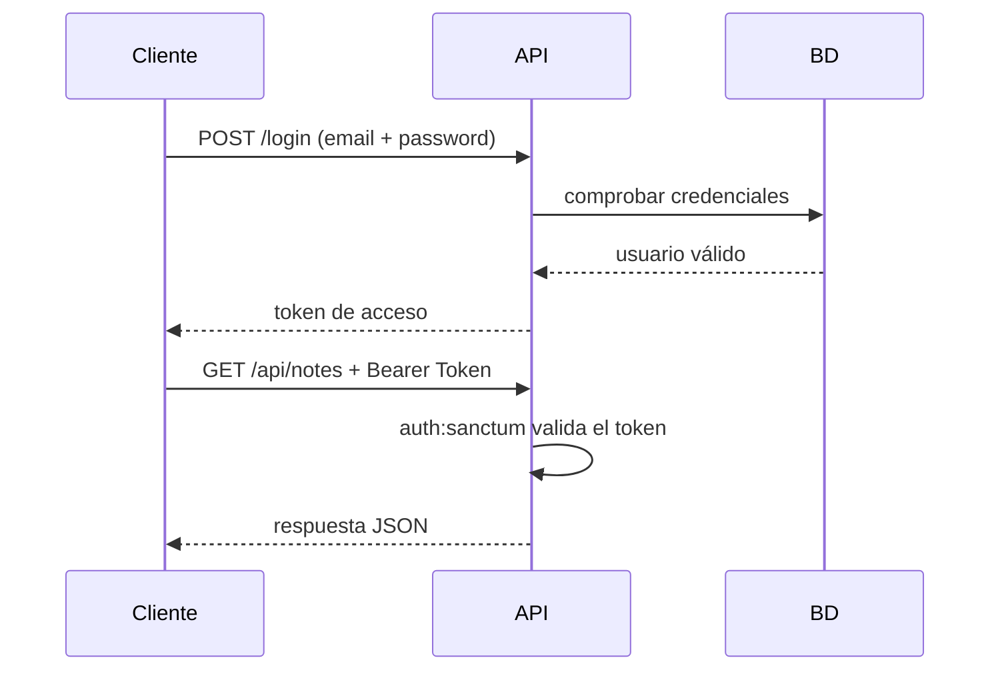
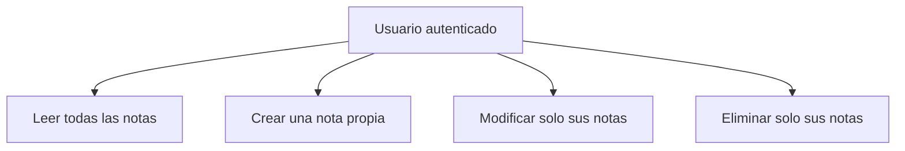
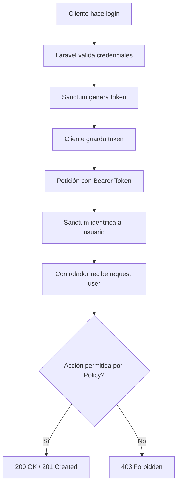

# Autenticación con Sanctum en Laravel

## Introducción

En los temas anteriores hemos construido una API REST para gestionar notas. Sin embargo, hasta ahora cualquier cliente podía acceder a las rutas y modificar datos sin demostrar su identidad.

En una aplicación real esto no es aceptable. Necesitamos responder a dos preguntas:

1. **¿Quién eres?** → **Autenticación**
2. **¿Qué puedes hacer?** → **Autorización**

En este tema vamos a introducir **Laravel Sanctum**, el sistema ligero de autenticación de Laravel para APIs sencillas, aplicaciones móviles y SPAs.

Además, mejoraremos el ejemplo de notas para conseguir este comportamiento:

- Cualquier usuario autenticado podrá **leer todas las notas**.
- Cada usuario solo podrá **crear, modificar o eliminar sus propias notas**.

De esta forma construiremos un ejemplo simple, pero muy útil para entender cómo se protege una API real.

---

## ¿Qué es la autenticación?

La **autenticación** es el proceso por el que una aplicación verifica la identidad de un usuario.

Ejemplos cotidianos:

- Introducir usuario y contraseña.
- Iniciar sesión con un token.
- Acceder a una API enviando un *Bearer Token*.

En una API no solemos trabajar con formularios HTML o sesiones tradicionales, sino con **tokens** que el cliente envía en cada petición.

### Diferencia entre autenticación y autorización

| Concepto | Pregunta | Ejemplo |
|---|---|---|
| **Autenticación** | ¿Quién eres? | Comprobar email y contraseña |
| **Autorización** | ¿Qué puedes hacer? | Permitir editar solo tus notas |

Primero autenticamos al usuario y después decidimos si tiene permiso para realizar una acción.

---

## ¿Qué es Laravel Sanctum?

**Laravel Sanctum** es el sistema ligero de autenticación de Laravel para:

- APIs sencillas basadas en tokens.
- Aplicaciones móviles.
- SPAs.

Sanctum permite que un usuario tenga **varios tokens** y que cada token pueda tener capacidades (*abilities* o *scopes*), aunque en este tema no profundizaremos en ellas.

### ¿Por qué usar Sanctum y no Passport?

Laravel ofrece otra solución llamada **Passport**, orientada a **OAuth2**.

Para nuestro curso, **Sanctum es mejor opción** porque:

- Es más sencillo de instalar y entender.
- Está pensado para APIs simples.
- No obliga a estudiar OAuth2.

### Nivel de seguridad de Sanctum

Sanctum es una solución **segura y adecuada** para la mayoría de APIs internas, SPAs, apps móviles y proyectos educativos.

No pretende sustituir a sistemas más complejos como OAuth2, pero sí ofrece un nivel de seguridad muy razonable cuando se usa correctamente:

- Contraseñas almacenadas con hash.
- Tokens largos y difíciles de adivinar.
- Posibilidad de revocar tokens.
- Protección basada en middleware `auth:sanctum`.

!!! warning "Importante"

    La seguridad no depende solo de instalar Sanctum. También depende de:

    - Validar correctamente los datos.
    - Usar HTTPS en producción.
    - Proteger las rutas sensibles.
    - Aplicar autorización sobre cada recurso.

---

## ¿Cómo funciona Sanctum técnicamente?

### Flujo general



### Explicación paso a paso

1. El usuario envía su **email** y **password** al endpoint de login.

2. Laravel comprueba si esas credenciales son correctas.

3. Si son válidas, genera un **token** con Sanctum.

4. El cliente guarda ese token.

5. En cada petición posterior lo envía en la cabecera:

    ```http
    Authorization: Bearer TU_TOKEN
    ```

6. El middleware `auth:sanctum` comprueba si el token es válido.

7. Si lo es, Laravel sabe qué usuario está autenticado y lo pone a disposición del controlador mediante:

    ```php
    <?php
    $request->user()
    ```

---

## Autenticación y autorización en nuestro ejemplo de notas

Vamos a construir un sistema con estas reglas:



Esto implica dos capas de seguridad:

### Capa 1: autenticación

Solo los usuarios autenticados podrán acceder a la API.

### Capa 2: autorización

Aunque dos usuarios estén autenticados, no tendrán los mismos permisos sobre todas las notas.

Ejemplo:

- Ana puede editar la nota 5 si la creó Ana.
- Luis no puede editar la nota 5 si pertenece a Ana.

La forma más limpia de resolver esto en Laravel es usar una **Policy**.

---

## Punto de partida: reutilizar el ejemplo del tema 7.1

Vamos a partir del sistema de notas ya creado en el tema anterior.

Recordemos que ya teníamos:

- Modelo `Note`
- Migración `notes`
- Controlador API `NoteController`
- Rutas en `routes/api.php`
- Validación con `NoteRequest`
- Recurso `NoteResource`

Ahora vamos a mejorar ese ejemplo para asociar cada nota a un usuario autenticado.

---

## Instalación de Sanctum

Si en el proyecto todavía no activaste el soporte de API, puedes hacerlo con:

!!! note "Instalar soporte API"

    ```bash
    php artisan install:api
    ```

Este comando instala el soporte necesario para la API y prepara Sanctum en el proyecto.

Si la migración de Sanctum no se ha ejecutado todavía, ejecutamos:

!!! note "Ejecutar migraciones"

    ```bash
    php artisan migrate
    ```

Esto creará también la tabla donde se almacenan los tokens personales.

---

## Preparar usuarios de prueba

Para poder probar la autenticación necesitamos usuarios.

Podemos reutilizar la tabla `users` que Laravel crea por defecto. Para ello vamos a crear una ruta que nos permita crear usuarios de prueba.

Para crear los usuarios que utilzaremos en el ejmplo podemos hacerlo bien utilizando **Tinker** o creando una ruta temporal.

!!! tip "tinker"

    Laravel incluye una herramienta llamada **Tinker** que nos permite interactuar con la aplicación desde la línea de comandos. Pero como no queremos complicar el tema, vamos a crear una ruta temporal para crear usuarios de prueba.

=== "Tinker"

    Para crear usuarios con Tinker, ejecutamos:

    ```bash
    php artisan tinker
    ```

    Y luego dentro de Tinker:

    !!! note "Crear usuarios con Tinker"

        ```php
        <?php
        use App\Models\User;
        use Illuminate\Support\Facades\Hash;

        User::create([
            'name' => 'Ana',
            'email' => 'ana@example.com',
            'password' => Hash::make('secret123')
        ]);

        User::create([
            'name' => 'Luis',
            'email' => 'luis@example.com',
            'password' => Hash::make('secret123')
        ]);

        return 'Usuarios creados';
        ```

        Una vez ejecutado el cógio podemos comprobar que los usuarios se han creado correctamente en la base de datos. Si ejecutamos: `User::All();` deberíamos ver algo como esto:

        ```php
        <?php
        > User::All();

            = Illuminate\Database\Eloquent\Collection {#8294
                all: [
                App\Models\User {#8291
                    id: 1,
                    name: "Ana",
                    email: "ana@example.com",
                    email_verified_at: null,
                    #password: "\$2y\$12\$WOjR5Cv4XvZgVSSi99mW8OhGX3Mg5ucYbP7LwYI/Os/OGlRdpk.0O",
                    #remember_token: null,
                    created_at: "2026-04-26 08:28:54",
                    updated_at: "2026-04-26 08:28:54",
                },
                App\Models\User {#8298
                    id: 3,
                    name: "Luis",
                    email: "luis@example.com",
                    email_verified_at: null,
                    #password: "\$2y\$12\$G9Vh/2xINmOfDI9G5oXgweRx2tBly9tarxuoC75plbB/8ha6XI2/i",
                    #remember_token: null,
                    created_at: "2026-04-26 08:37:32",
                    updated_at: "2026-04-26 08:37:32",
                },
                ],
            }
        ```

        Para salir de Tinker, simplemente escribimos `exit` y pulsamos Enter.

=== "Ruta temporal"

    !!! note "Ruta para crear usuarios"

        En `routes/web.php`:

        ```php
        <?php
        use App\Models\User;
        use Illuminate\Support\Facades\Hash;
        use Illuminate\Support\Facades\Route;

        Route::get('/create-users', function () {
            User::create([
                'name' => 'Ana',
                'email' => 'ana@example.com',
                'password' => Hash::make('secret123')
            ]);

            User::create([
                'name' => 'Luis',
                'email' => 'luis@example.com',
                'password' => Hash::make('secret123')
            ]);

            return 'Usuarios creados';
        });
        ```

    Al acceder a `http://localhost:8080/create-users` se crearán dos usuarios de prueba.

---

## Relacionar las notas con los usuarios

Para que una nota pertenezca a un usuario, necesitamos añadir una clave foránea `user_id` a la tabla `notes`.

### Crear una migración para modificar la tabla

!!! note "Crear migración"

    ```bash
    php artisan make:migration add_user_id_to_notes_table
    ```

### Migración

Creamos la migración para añadir el campo `user_id` a la tabla `notes`:

!!! note "Migración para añadir user_id a notes"

    ```php
    <?php
    use Illuminate\Database\Migrations\Migration;
    use Illuminate\Database\Schema\Blueprint;
    use Illuminate\Support\Facades\Schema;

    return new class extends Migration
    {
        public function up(): void
        {
            Schema::table('notes', function (Blueprint $table) {
                $table->foreignId('user_id')->after('id')->constrained()->onDelete('cascade');
            });
        }

        public function down(): void
        {
            Schema::table('notes', function (Blueprint $table) {
                $table->dropConstrainedForeignId('user_id');
            });
        }
    };
    ```

!!! tip "Antes de realizar la migración"

    Antes de realizar la migración recuerda eliminar todos los registros de la tabla `notes` para evitar problemas con la nueva restricción de clave foránea. Puedes hacerlo con:

    ```bash
    php artisan tinker
    ```

    ```php
    <?php
    App\Models\Note::truncate();
    ```

    o bien entrando directamente a la base de datos con un cliente SQL y ejecutando:

    ```sql
    DELETE FROM notes;
    ```

    Otra opción es utilizar las migraciones. Como los datos que tenemos son de prueba podemos deshacer todas las migraciones y volver a ejecutarlas. Pero ten cuidado, en este caso, tendrás que volver a crear los usuarios de prueba después de ejecutar.

    ```bash
    php artisan migrate:refresh
    ```

Ejecutamos la migración:

!!! note "Ejecutar migración"

    ```bash
    php artisan migrate
    ```

### Modificar el modelo `Note` y `User`

Necesitamos añadir la relación con el modelo `User` y permitir la asignación masiva de `user_id`. De esta forma, cada nota quedará asociada a un usuario concreto.

!!! note "Modelo Note con relación a User"

    ```php
    <?php
    class Note extends Model
    {
        protected $fillable = ['title', 'description', 'date', 'done', 'user_id'];

        public function user()
        {
            return $this->belongsTo(User::class);
        }
    }
    ```

!!! note "Modelo User con relación a Note"

    ```php
    <?php
    use Laravel\Sanctum\HasApiTokens;
    class User extends Authenticatable
    {
        use HasApiTokens; // Trait necesario para Sanctum

        public function notes()
        {
            return $this->hasMany(Note::class);
        }
    }
    ```

!!! tip "¿Qué es un *`trait`*?"

    Para que Sanctum pueda generar tokens, el modelo `User` debe usar el *trait* `HasApiTokens`. Explicar que un *trait* es una forma de reutilizar código en PHP. Podríamos decir, salvando las diferencias, que es paracido a una herencia, pero más flexible. En este caso, el *trait* `HasApiTokens` añade a nuestro modelo `User` la capacidad de generar y gestionar tokens de acceso para la API.

    Veamos un ejemplo sencillo de cómo funciona un *trait*:

    ```php
    <?php
    trait HasSampleTrait
    {
        public function traitMethod()
        {
            return 'Este es un método del trait HasSampleTrait. ';
        }
    }

    class Sample 
    {
        use  HasSampleTrait; // Podemos usar varios traits

        function example()
        {
            return "Este es un método de la clase Sample. ";
         }

        // ...
    }

    $sample = new Sample();
    echo $sample->example(); // Este es un método de la clase Sample."
    echo $sample->traitMethod(); // Este es un método del trait HasSampleTrait.
    ```

## Crear el controlador de autenticación

Vamos a crear un controlador sencillo para:

- Iniciar sesión y devolver un token.
- Cerrar sesión y borrar el token actual.
- Obtener el usuario autenticado.

### Crear controlador

Necesiamos un controlador para gestionar la autenticación. Lo creamos con:

!!! note "Crear controlador de autenticación"

    ```bash
    php artisan make:controller Api/AuthController
    ```

!!! note "Controlador de autenticación completo"

    ```php
    <?php
    namespace App\Http\Controllers\Api;

    use App\Http\Controllers\Controller;
    use Illuminate\Http\JsonResponse;
    use Illuminate\Http\Request;
    use Illuminate\Support\Facades\Hash;
    use App\Models\User;

    class AuthController extends Controller
    {
        public function login(Request $request): JsonResponse
        {
            $request->validate([
                'email' => 'required|email',
                'password' => 'required|string'
            ]);

            $user = User::where('email', $request->email)->first();

            if (! $user || ! Hash::check($request->password, $user->password)) {
                return response()->json([
                    'success' => false,
                    'message' => 'Credenciales incorrectas.'
                ], 401);
            }

            $token = $user->createToken('api-token')->plainTextToken;

            return response()->json([
                'success' => true,
                'message' => 'Login correcto.',
                'token' => $token,
                'user' => $user
            ], 200);
        }

        public function me(Request $request): JsonResponse
        {
            return response()->json([
                'success' => true,
                'data' => $request->user()
            ], 200);
        }

        public function logout(Request $request): JsonResponse
        {
            $request->user()->currentAccessToken()->delete();

            return response()->json([
                'success' => true,
                'message' => 'Logout correcto.'
            ], 200);
        }
    }
    ```

Estas funciones nos permiten:

- `login()`: Validar las credenciales y generar un token.
- `me()`: Devolver los datos del usuario autenticado.
- `logout()`: Revocar el token actual.

---

## Definir las rutas de autenticación

Ahora en el archivo `routes/api.php` vamos a definir las rutas necesarias para el login, logout y obtener el usuario autenticado. Las funcionalidades que hemos creado en el `AuthController` se expondrán a través de estas rutas.

!!! note "Rutas de autenticación"

    ```php
    <?php
    use App\Http\Controllers\Api\AuthController;
    use App\Http\Controllers\Api\NoteController;
    use Illuminate\Support\Facades\Route;

    Route::post('/login', [AuthController::class, 'login']);

    Route::middleware('auth:sanctum')->group(function () {
        Route::get('/me', [AuthController::class, 'me']);
        Route::post('/logout', [AuthController::class, 'logout']);

        Route::apiResource('notes', NoteController::class);
    });
    ```

Con esto conseguimos que:

- `POST /api/login` sea pública.
- El resto de rutas exijan autenticación mediante Sanctum.

¿Qué significa que `/login` sea pública y el resto de rutas estén protegidas por `auth:sanctum`?

Esto significa que cualquier cliente puede acceder a `/api/login` para obtener un token, es decir no necesita un encabezado `Authorization: Bearer TU_TOKEN`. Sin embargo, para acceder a `/api/me`, `/api/logout` o cualquier ruta de `notes` sí es necesario enviar un token válido en la cabecera de autorización. Si un cliente intenta acceder a estas rutas sin un token o con un token inválido, Laravel devolverá un error **401 Unauthorized**.

Por tanto para que un usuario pueda acceder a las rutas protegidas, primero debe autenticarse en `/api/login` para obtener un token y luego incluir el token recibido en la cabecera de autorización de cada petición a las rutas protegidas.

---

## Probar el login

Creamos un archivo `auth.rest` para poder probar las rutas de autenticación con el plugin REST Client de VSCode.

### Login

!!! note "Login con REST Client"

    ```http
    ### Login
    POST http://localhost:8080/api/login HTTP/1.1
    Accept: application/json
    content-type: application/json

    {
        "email": "ana@example.com",
        "password": "secret123"
    }
    ```

La respuesta incluirá un token similar a este:

```json
{
    "success": true,
    "message": "Login correcto.",
    "token": "1|xxxxxxxxxxxxxxxxxxxxxxxxxxxxxxxx",
    "user": {
        "id": 1,
        "name": "Ana",
        "email": "ana@example.com"
    }
}
```

### Usar el token

A partir de este momento, en cada petición protegida enviamos:

!!! note "Ejemplo de petición con token"

    ```http
    ### Usuario autenticado
    GET http://localhost:8080/api/me
    Accept: application/json
    Authorization: Bearer 1|xxxxxxxxxxxxxxxxxxxxxxxxxxxxxxxx
    ```

La respuesta puede ser algo como esto:

```json
        "success": true,
        "data": {
            "id": 1,
            "name": "Ana",
            "email": "ana@example.com"
        }
    }
```

---

## Crear notas asociadas al usuario autenticado

Necesitamos modificar el controlador `NoteController` para que cada nota quede asociada al usuario que la ha creado.

### modificamos el método `store()`

Como para crear la nota el usuario ya está autenticado, podemos obtener su ID con `$request->user()->id` y guardarlo en el campo `user_id` de la nota.

!!! note "Crear nota asociada al usuario autenticado"

    ```php
    <?php
    public function store(NoteRequest $request): JsonResponse
    {
        $note = Note::create([
            ...$request->validated(),
            'user_id' => $request->user()->id,
        ]);

        return response()->json([
            'success' => true,
            'message' => 'Nota creada correctamente.',
            'data' => new NoteResource($note)
        ], 201);
    }
    ```

### Mostrar el propietario en `NoteResource`

Cuando devolvemos una nota, también queremos mostrar el nombre del usuario propietario. Para ello, modificamos el método `toArray()` de `NoteResource` para incluir la información del usuario.

!!! note "Mostrar el propietario en NoteResource"

    ```php
    <?php
    public function toArray($request): array
    {
        return [
            'id' => $this->id,
            'titulo' => $this->title,
            'descripcion' => $this->description,
            'fecha' => $this->date,
            'estado' => $this->done ? 'Completada' : 'Pendiente',
            'usuario' => [
                'id' => $this->user->id,
                'name' => $this->user->name,
            ],
        ];
    }
    ```

!!! tip "Relación cargada"

    Para evitar consultas innecesarias, conviene cargar la relación `user` al recuperar notas.

Vamos a probarlo accediendo a la ruta de listado de notas.

Para utilizar la ruta primero debemos modificar el método `index()` para cargar la relación `user` al recuperar las notas. De esta forma, cuando devolvamos las notas con `NoteResource`, ya tendremos disponible la información del usuario propietario sin necesidad de hacer consultas adicionales.

Por ejemplo en `index()`:

!!! note "Cargar relación user en index()"

    ```php
    <?php
    public function index(): JsonResponse
    {
        return response()->json([
            'success' => true,
            'data' => NoteResource::collection(Note::with('user')->get())
        ], 200);
    }
    ```

Ahora podemos acceder a `GET /api/notes` y veremos que cada nota incluye un campo `usuario` con el ID y el nombre del propietario.

```text
GET http://localhost:8080/api/notes
Accept: application/json
Authorization: Bearer TU_TOKEN
```

Debemos obtener un listado de notas con la información del usuario propietario en cada una de ellas. Como por ejemplo:

```json
{
    "success": true,
    "data": [
        {
            "id": 1,
            "titulo": "Nota de Ana",
            "descripcion": "Texto de ejemplo",
            "fecha": "2026-04-22",
            "estado": "Pendiente",
            "usuario": {
                "id": 1,
                "name": "Ana"
            }
        },
        {
            "id": 2,
            "titulo": "Nota de Luis",
            "descripcion": "Otra nota de ejemplo",
            "fecha": "2026-04-23",
            "estado": "Completada",
            "usuario": {
                "id": 3,
                "name": "Luis"
            }
        }
    ]
}
```

Tamnién podemos acceder a una nota concreta y ver la información del propietario:

```text
GET http://localhost:8080/api/notes/1
Accept: application/json
Authorization: Bearer TU_TOKEN
```

Este punto es sencillo: cualquier usuario autenticado podrá ver el listado completo y también una nota concreta.

!!! note "Permitir leer todas las notas"

    ```php
    <?php
    public function show(Note $note): JsonResponse
    {
        $note->load('user');

        return response()->json([
            'success' => true,
            'data' => new NoteResource($note)
        ], 200);
    }
    ```

La respuesta a esta petición incluirá la información del propietario de la nota, aunque el usuario autenticado no sea el propietario. Esto es correcto, ya que hemos decidido que cualquier usuario autenticado pueda leer todas las notas, independientemente de quién las haya creado.

Por ejemplo la respuesta a `GET /api/notes/1` debería ser algo como esto:

```json
{
    "success": true,
    "data": {
        "id": 1,
        "titulo": "Nota de Ana",
        "descripcion": "Texto de ejemplo",
        "fecha": "2026-04-22",
        "estado": "Pendiente",
        "usuario": {
            "id": 1,
            "name": "Ana"
        }
    }
}
```

---

## Impedir modificar o eliminar notas ajenas

Aquí entra en juego la **autorización**. No basta con que el usuario esté autenticado, sino que también debe tener permiso para modificar o eliminar esa nota concreta.

## ¿Qué es una Policy?

Una **Policy** es una clase que centraliza la lógica de permisos sobre un recurso.

En nuestro caso, queremos responder a preguntas como:

- ¿Puede este usuario actualizar esta nota?
- ¿Puede este usuario eliminar esta nota?

La regla será muy simple:

- Sí, si `user_id` de la nota coincide con el `id` del usuario autenticado.
- No, en caso contrario.

---

## Crear la Policy de Note

!!! note "Crear NotePolicy"

    ```bash
    php artisan make:policy NotePolicy --model=Note
    ```

Esto crea la clase `app/Policies/NotePolicy.php`.

!!! note "Contenido de NotePolicy"

    ```php
    <?php
    namespace App\Policies;

    use App\Models\Note;
    use App\Models\User;

    class NotePolicy
    {
        public function update(User $user, Note $note): bool
        {
            return $user->id === $note->user_id;
        }

        public function delete(User $user, Note $note): bool
        {
            return $user->id === $note->user_id;
        }
    }
    ```

---

## Usar la Policy en el controlador

Ahora que tenemos la Policy, necesitamos usarla en el controlador para proteger las acciones de actualización y eliminación.

Lo primero será importar el `trait` `AuthorizesRequests` en el controlador `NoteController` para poder usar el método `authorize()`.

```php
<?php
use Illuminate\Foundation\Auth\Access\AuthorizesRequests;
class NoteController extends Controller
{
    use AuthorizesRequests;

    // ...
}
```

Modificamos los métodos `update()` y `destroy()`.

!!! note "Proteger update() con la Policy"

    ```php
    <?php
    public function update(NoteRequest $request, Note $note): JsonResponse
    {
        $this->authorize('update', $note);

        $note->update($request->validated());

        return response()->json([
            'success' => true,
            'message' => 'Nota actualizada correctamente.',
            'data' => new NoteResource($note)
        ], 200);
    }
    ```

!!! note "Proteger destroy() con la Policy"

    ```php
    <?php
    public function destroy(Note $note): JsonResponse
    {
        $this->authorize('delete', $note);

        $note->delete();

        return response()->json([
            'success' => true,
            'message' => 'Nota eliminada correctamente.'
        ], 200);
    }
    ```

### ¿Qué ocurre si no tiene permiso?

Laravel devolverá automáticamente un error **403 Forbidden**.

Esto significa:

- El usuario está autenticado.
- Pero no tiene permiso para realizar esa acción sobre ese recurso concreto.

---

## Esquema completo de funcionamiento



## Ejemplos de peticiones

### 1. Login

```http
POST http://localhost:8080/api/login HTTP/1.1
Accept: application/json
content-type: application/json

{
    "email": "ana@example.com",
    "password": "secret123"
}
```

### 2. Listar notas

```http
GET http://localhost:8080/api/notes
Accept: application/json
Authorization: Bearer TU_TOKEN
```

### 3. Crear una nota propia

```http
POST http://localhost:8080/api/notes HTTP/1.1
Accept: application/json
Authorization: Bearer TU_TOKEN
content-type: application/json

{
    "title": "Nota de Ana",
    "description": "Texto de ejemplo",
    "date": "2026-04-22",
    "done": false
}
```

### 4. Modificar tu propia nota

```http
PUT http://localhost:8080/api/notes/1 HTTP/1.1
Accept: application/json
Authorization: Bearer TU_TOKEN
content-type: application/json

{
    "title": "Nota modificada",
    "description": "Texto actualizado",
    "date": "2026-04-22",
    "done": true
}
```

### 5. Intentar modificar una nota ajena

```http
PUT http://localhost:8080/api/notes/2 HTTP/1.1
Accept: application/json
Authorization: Bearer TU_TOKEN
content-type: application/json

{
    "title": "Intento no permitido",
    "description": "No debería funcionar",
    "date": "2026-04-22",
    "done": false
}
```

Respuesta esperada:

```json
{
    "message": "This action is unauthorized."
}
```

Código HTTP esperado:

```html
403 Forbidden
```

!!! tip "Respuesta de error 403 completa"

    Puede ser que la respuesta de error 403 incluya mucha más información, como un código de error personalizado o detalles adicionales. Esto es porque tenemo `debug` activado en Laravel, lo que hace que se devuelva una respuesta más detallada en caso de errores. En producción, con `debug` desactivado, la respuesta sería más simple y no incluiría detalles técnicos. Para simular la respuesta de producción, podemos desactivar el modo debug temporalmente en el archivo `.env` cambiando:

    ```bash
    APP_DEBUG=true
    ```

    a

    ```bash
    APP_DEBUG=false
    ```

    Reiniciamos el servidor de desarrollo y volvemos a hacer la petición que intenta modificar una nota ajena. Ahora la respuesta debería ser algo como esto:

    ```json
    {
        "message": "This action is unauthorized."
    }
    ```

### 6. Logout

```http
POST http://localhost:8080/api/logout
Accept: application/json
Authorization: Bearer TU_TOKEN
```

---

## Qué hemos aprendido

En este tema hemos introducido tres ideas clave:

1. **Autenticación**

    Gracias a Sanctum, el usuario puede identificarse y obtener un token para acceder a la API.

2. **Asociación de recursos a usuarios**

    Cada nota queda vinculada al usuario autenticado mediante `user_id`.

3. **Autorización por recurso**

    Con una Policy podemos controlar si un usuario puede modificar o eliminar una nota concreta.

4. **Resumen conceptual final**

| Elemento | Función |
|---|---|
| `Sanctum` | Autenticar usuarios en la API mediante tokens |
| `auth:sanctum` | Proteger rutas para que solo entren usuarios autenticados |
| `user_id` en `notes` | Relacionar cada nota con su propietario |
| `NotePolicy` | Autorizar edición y borrado solo al propietario |
| `Authorization: Bearer ...` | Enviar el token en cada petición |

---

## Conclusiones

- **Sanctum** es una solución ligera, clara y adecuada para APIs sencillas.
- La **autenticación** responde a la pregunta: *¿quién eres?*
- La **autorización** responde a la pregunta: *¿qué puedes hacer?*
- En una API real no basta con autenticar: también hay que **controlar el acceso** a cada recurso.
- El ejemplo de notas permite entender de forma práctica cómo combinar **Sanctum + rutas protegidas + policies**.

!!! tip "¿Qué más podríamos hacer para mejorar la seguridad de esta API?""

    - *registro de usuarios:* permitir que los usuarios se registren por sí mismos.
    - *revocación de todos los tokens:* permitir que un usuario cierre sesión en todos los dispositivos.
    - *capacidades de token (**abilities**)*: permitir que un token tenga permisos limitados, por ejemplo solo lectura.
    - *paginación y filtros:* limitar el número de notas devueltas.
    - *separación entre roles de usuario:* por ejemplo, un rol admin que pueda editar todas las notas y un rol usuario que solo pueda editar las suyas.
