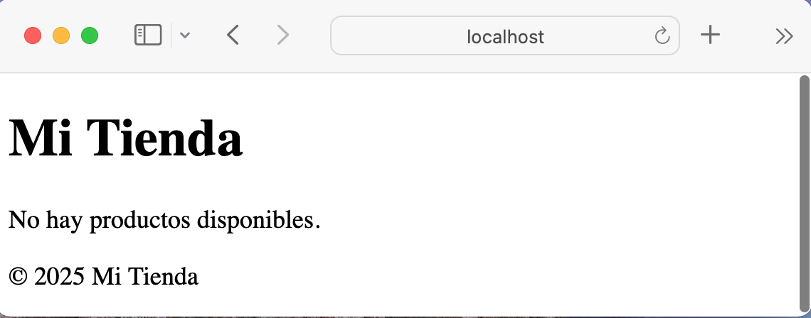
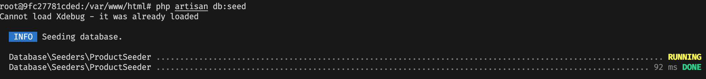
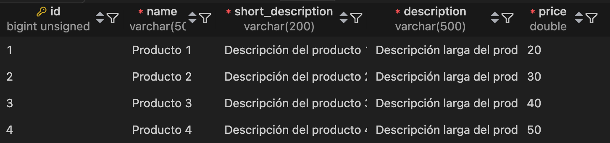
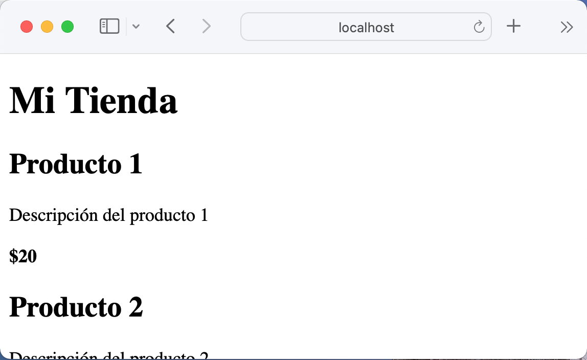
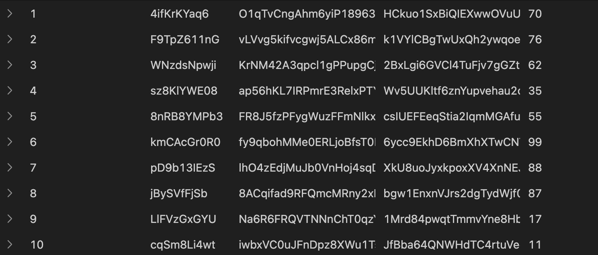
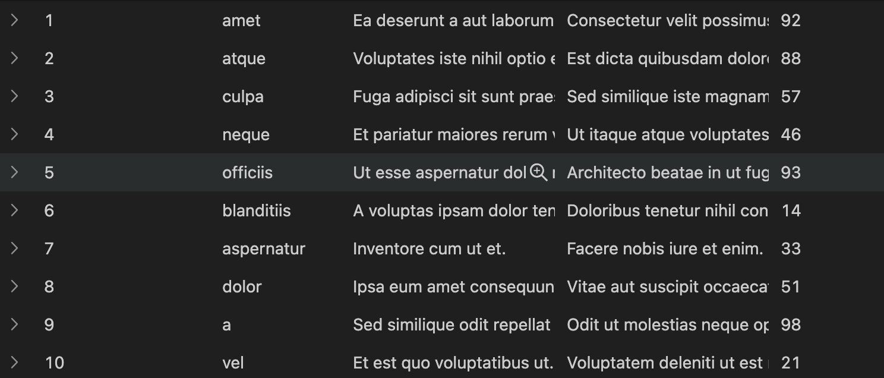
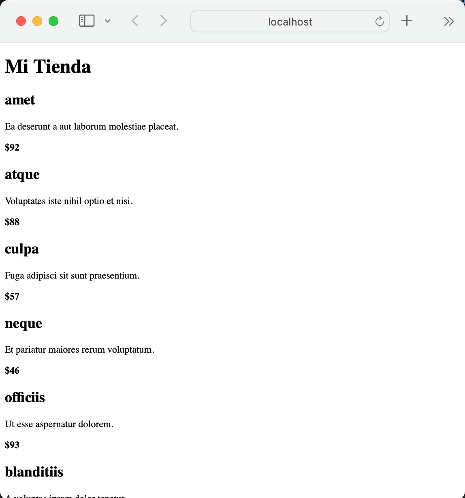

# Creación de datos iniciales y prueba: Seeders, Factories y Faker

!!! quote "Autoría"

    Contenido original de **Javier Beteta** en el curso [*Introducción a Laravel*](https://jbeteta-ies.github.io/2025_Laravel_32/) ([ver esta página en el original](https://jbeteta-ies.github.io/2025_Laravel_32/content/T09/unidad09_01/)). Adaptado para 2º DAW del IES Juan de Garay por Eva María Gómez Abad.

## Introducción

En los temas anteriores aprendimos a crear tablas con migraciones y a manipular datos manualmente. Sin embargo, en muchos proyectos reales necesitamos:

- Crear **datos iniciales**, como usuarios, roles o productos básicos.
- Generar **datos masivos de prueba** para desarrollo y pruebas funcionales.

Laravel nos ofrece tres herramientas clave para ello:

- **Seeders**: para insertar datos conocidos y permanentes.
- **Factories**: para generar datos aleatorios.
- **Faker**: para crear contenido realista de forma automática.

Utilizaremos la base de datos `laravel` y actualizaremos el archivo `.env` para garantizar la conexión correcta.

---

## Preparación del Entorno

vamos a comenzar desde un proyecto Laravel nuevo y la base de datos también nueva. La base de datos podemos eliminar la que teníamos `drop database laravel;` y crear una nueva `create database laravel;`.

Para el proyecto Laravel:

```bash
composer create-project laravel/laravel example-app
cd example-app
```

o podemosusar el proyecto que teníamos eliminando todos los archivos, controladores, migraciones recursos, vistas etc, que hemos creado en los temas anteriores. De esta manera evitamos conflictos con los archivos que vamos a crear en este tema.

Una vez creado o limpiado el proyecto, editamos el archivo `.env` para configurar la conexión a la base de datos:

```bash
DB_CONNECTION=mysql
DB_HOST=mysql
DB_PORT=3306
DB_DATABASE=laravel
DB_USERNAME=alumno
DB_PASSWORD=alumno
```

Luego hacemos la migración inicial:

```bash
php artisan migrate
```

### Crear la tabla y el modelo `Product`

En este tema vamos manejar una tabla de productos. Creamos la migración y el modelo:

```bash
php artisan make:model Product -m
```

Este comando crea el modelo `Product.php` en `app/Models` y la migración en `database/migrations`.

Editamos la migración:

!!! note "Migración de la tabla products"

    ```php
    <?php
    Schema::create('products', function (Blueprint $table) {
        $table->id();
        $table->string('name', 50);
        $table->string('short_description', 200);
        $table->string('description', 500);
        $table->float('price')->default(20);
        $table->timestamps();
    });
    ```

Editamos el modelo `Product.php` para permitir asignación masiva:

!!! note "Modelo Product con guarded vacío"

    ```php
    <?php
    class Product extends Model
    {
        protected $guarded = [];
    }
    ```

Ejecutamos la migración:

```bash
php artisan migrate
```

### Controlador, ruta y vista

Ahora que ya tenemos la tabla y el modelo, vamos a crear el circuito completo para mostrar los productos en una vista.

Creamos el controlador:

```bash
php artisan make:controller ProductController
```

Ruta en `web.php`:

!!! note "Ruta para listar productos"

    ```php
    <?php
    use App\Http\Controllers\ProductController;

    Route::get('/products', [ProductController::class, 'index'])->name('product.index');
    ```

Método `index()` en el controlador:

!!! note "Controlador ProductController"

    ```php
    <?php
    use App\Models\Product;
    use Illuminate\View\View;

    public function index(): View
    {
        $products = Product::all();
        return view('products.index', compact('products'));
    }
    ```

Antes de crear la vista vamos a crear el layout `layouts/app.blade.php` para que todas las vistas tengan un diseño común.

!!! note "Layout app.blade.php"

    ```html
    <!DOCTYPE html>
    <html lang="es">
    <head>
        <meta charset="UTF-8">
        <meta name="viewport" content="width=device-width, initial-scale=1.0">
        <title>@yield('title', 'Mi Aplicación')</title>
    </head>
    <body>
        <header>
            <h1>Mi Tienda</h1>
            <!-- Aquí podría ir una barra de navegación -->
        </header>
        <main>
             @yield('content')
        </main>

        <footer>
            <p>&copy; {{ date('Y') }} Mi Tienda</p>
        </footer>
    </body>
    </html>
    ```

Ahora que ya tenemos el layout, podemos crear la vista `index.blade.php` para listar los productos. Creamos la carpeta `products` dentro de `resources/views` y dentro de ella el archivo `index.blade.php`.

Creamos `resources/views/products/index.blade.php`:

En este caso la vista es sencilla, solo muestra una lista de productos, en forma de `cards`. Más adelante con CSS ya le cambiaremos el aspecto. Utilizamos `@forelse` para mostrar un mensaje si no hay productos.

!!! note "Vista index.blade.php"

    ```html
    @extends ('layouts.app')

    @section('title', 'Products')

    @section('content')
        <div class="product-container">
            @forelse ($products as $product)
                <div class="card">
                    <h2>{{ $product->name }}</h2>
                    <p>{{ $product->short_description }}</p>
                    <p><strong>${{ $product->price }}</strong></p>
                </div>
            @empty
                <p>No hay productos disponibles.</p>
            @endforelse
        </div>
    @endsection
    ```

Añadimos un par de reglas CSS en `public/assets/css/app.css` para mejorar la presentación de la vista:

!!! note "CSS para la vista de productos"

    ```css
    .product-container {
        display: flex;
        flex-wrap: wrap;
        gap: 20px;
    }

    .card {
        border: 1px solid #ccc;
        padding: 15px;
        width: 200px;
        box-shadow: 2px 2px 10px rgba(0,0,0,0.1);
    }
    ```

Nos falta añadir el CSS a la vista. Editamos el layout `app.blade.php` para incluir el CSS:

!!! note "Layout app.blade.php con CSS"

    ```html
    <head>
        ...
        <link rel="stylesheet" href="{{ asset('assets/css/app.css') }}">
        ...
    </head>
    ```

!!! info "Nuestra vista de productos"

    

    De momento esta es la vista, sin datos. Vamos a crear datos iniciales y de prueba para que se vea mejor.

---

## Seeders

### Introducción a Seeders

Los **seeders** permiten poblar la base de datos con datos iniciales que queremos tener siempre disponibles.

### Crear y registrar un seeder

```bash
php artisan make:seeder ProductSeeder
```

En el seeder:

!!! note "ProductSeeder con 4 productos"

    ```php
    <?php

    namespace Database\Seeders;

    use Illuminate\Database\Console\Seeds\WithoutModelEvents;
    use Illuminate\Database\Seeder;
    use App\Models\Product;

    class ProductSeeder extends Seeder
    {
        /**
        * Run the database seeds.
        */
        public function run(): void
        {
            // Vamos a crear 4 productos de ejemplo
            Product::create([
                'name' => 'Producto 1',
                'short_description' => 'Descripción del producto 1',
                'description' => 'Descripción larga del producto 1',
                'price' => 20.00,
            ]);
            Product::create([
                'name' => 'Producto 2',
                'short_description' => 'Descripción del producto 2',
                'description' => 'Descripción larga del producto 2',
                'price' => 30.00,
            ]);
            Product::create([
                'name' => 'Producto 3',
                'short_description' => 'Descripción del producto 3',
                'description' => 'Descripción larga del producto 3',
                'price' => 40.00,
            ]);
            Product::create([
                'name' => 'Producto 4',
                'short_description' => 'Descripción del producto 4',
                'description' => 'Descripción larga del producto 4',
                'price' => 50.00,
            ]);
        }
    }
    ```

Editamos `DatabaseSeeder.php` para incluirlo:

```php
<?php
 public function run(): void
    {
       $this->call(ProductSeeder::class);

    }
```

Ejecutamos:

```bash
php artisan db:seed
```

!!! info "Nuestra vista de productos con datos"

    

    Ahora ya tenemos productos en la base de datos y se muestran en la vista. Puedes comprobar que esxisten en la base de datos con `select * from products;`.

    

### Ejecutar un seeder específico

Si en alguna ocasión queremos ejecutar un seeder específico, podemos usar:

```bash
php artisan db:seed --class=ProductSeeder
```

### Vista de los productos

Vamos al navegador, accedemos a [http://localhost:8080/products](http://localhost:8080/products) y vemos la lista de productos que hemos creado con el seeder.

!!! info "Vista de productos"

    

    Ahora ya tenemos productos en la base de datos y se muestran en la vista.

---

## Factories

### Introducción a Factories

Al probar su aplicación o sembrar su base de datos, es posible que necesites insertar algunos registros en ella. En lugar de especificar manualmente el valor de cada columna, `Laravel` te permite definir un conjunto de atributos predeterminados para cada uno de sus modelos `Eloquent` mediante fábricas de modelos.

!!! info "definición"

    Una **factory** es una clase que define un modelo y cómo generar datos de prueba para ese modelo. Las **factories** permiten generar muchos datos automáticamente para pruebas y desarrollo.

### Crear una factory

```bash
php artisan make:factory ProductFactory --model=Product
```

Este comando debe crear el archivo

database/factories/ProductFactory.php

.

Definición simple:

Antes de modificar la función hay que importar `Str`:

!!! note "Importar Str"

    ```php
    <?php
    use Illuminate\Support\Str;
    ```

!!! note "Factory inicial (manual)"

    ```php
    <?php
    public function definition(): array
    {
        return [
            'name' => Str::random(10),
            'short_description' => Str::random(30),
            'description' => Str::random(50),
            'price' => random_int(5, 100),
        ];
    }
    ```

Es necesario modificar el modelo para que use la factory.

Primero importamos `HasFactory`, y luego modificamos la clase para usar el trait `HasFactory`:

!!! note "Importar HasFactory"

    ```php
    <?php
    use Illuminate\Database\Eloquent\Factories\HasFactory;
    ```

!!! note "Modelo Product con factory"

    ```php
    <?php
    class Product extends Model
    {
        use HasFactory;

        protected $guarded = [];
    }
    ```

### Usar factory en un seeder

Modificamos el contenido del seeder `ProductSeeder.php` para usar la factory. En la función `run()` quitamos los prodcutos que habíamos creado manualmente y añadimos la factory.

Primero agregamos la importación del modelo `Product`:

!!! note "Importar Product en el seeder"

    ```php
    <?php
    use App\Models\Product;
    ```

!!! note "ProductSeeder con factory"

    ```php
    <?php
    public function run(): void
    {
        // Crear 10 productos usando la factory
        Product::factory()->count(10)->create();
    }
    ```

Ahora como no tenemos nada importante en la base de datos vamos a ejecutar las migraciones de nuevo, para eliminar los datos que teníamos y crear la tabla de nuevo:

```bash
php artisan migrate:fresh
php artisan db:seed
```

Esto nos borrará todos los datos y creará la tabla de nuevo, luego ejecutará el seeder que a su vez usará la factory para crear 10 productos con datos aleatorios.

Si vamos a la base de datos veremos que tenemos 10 productos con datos aleatorios:

!!! info "Productos en la base de datos"

    

Hemos conseguido tener 10 productos en la base de datos con datos aleatorios en segundos. Pero los datos no son muy realistas, ya que son cadenas aleatorias. Para conseguir unos datos más realistas veremos Faker en el siguiente apartado.

## Faker

### Introducción a Faker

**Faker** genera datos aleatorios que parecen reales (nombres, direcciones, textos...). Laravel lo usa integrado en `Factory`.

### Tabla de métodos útiles de Faker

| Método | Descripción | Ejemplo |
|---|---|---|
| `name()` | Nombre completo | Juan Pérez |
| `email()` | Email realista | juan@mail.com |
| `sentence(n)` | Frase con `n` palabras | Lorem ipsum dolor sit amet. |
| `paragraph()` | Párrafo de texto | Lorem ipsum dolor sit amet... |
| `text(n)` | Texto de longitud `n` | Texto aleatorio |
| `word()` | Una palabra aleatoria | laptop |
| `numberBetween(a, b)` | Número entre `a` y `b` | 47 |
| `randomElement([...])` | Valor de un array | 'IT' |
| `boolean()` | true o false aleatorio | true |
| `date()` | Fecha aleatoria | 2023-01-15 |
| `company()` | Nombre de empresa | Grupo Pérez SL |

### Aplicar Faker a `ProductFactory`

!!! note "ProductFactory con faker"

    ```php
    <?php
    public function definition(): array
    {
        return [
            'name' => $this->faker->word(),
            'short_description' => $this->faker->sentence(5),
            'description' => $this->faker->paragraph(),
            'price' => $this->faker->numberBetween(10, 100)
        ];
    }
    ```

Ahora, al igual que en el punto anterior como no tenemos nada importante en la base de datos vamos a ejecutar las migraciones de nuevo, para eliminar los datos que teníamos y crear la tabla de nuevo, esta vez lo hacemos en un solo comando:

```bash
php artisan migrate:fresh --seed
```

!!! info "Productos en la base de datos"

    

    Siguen siendo datos aleatorios, pero ahora son más realistas. Y a la hora de ver cómo quedan en una vista, para un prototipo, es mucho mejor.

Comprobamos la vista: [http://localhost:8080/products](http://localhost:8080/products), vamos a ver los productos con datos más realistas:

!!! info "Vista de productos con datos realistas"

    

---

## Conclusiones

- Los **seeders** son útiles para poblar la base de datos con datos estáticos.
- Las **factories** permiten generar cientos de registros en segundos.
- **Faker** mejora la calidad de los datos de prueba.
- Todo esto acelera y mejora el desarrollo realista de tu aplicación.
